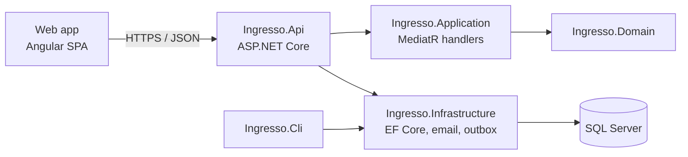

<p align="center">
  <picture>
    <source media="(prefers-color-scheme: dark)" srcset="docs/assets/ingresso-logo-dark.svg">
    
  </picture>
</p>

<p align="center">
  <strong>Every app, one door.</strong><br>
  A front-door dashboard for the apps you build and use. Add, edit, reorder and open them from one place.
</p>

<p align="center">
  <a href="https://github.com/QuinntyneBrown/ingresso/actions/workflows/ci.yml"></a>
  
  
  
  
</p>

<p align="center">
  <a href="#getting-started">Getting started</a> ·
  <a href="#documentation">Documentation</a> ·
  <a href="CONTRIBUTING.md">Contributing</a> ·
  <a href="https://github.com/QuinntyneBrown/ingresso/issues">Report a bug</a>
</p>

---

## About

ingresso is a dynamic dashboard of app tiles. Each tile is a door to one of your apps: it shows the app's name,
address and when you last opened it, and opens the app in a new tab. You create, edit, delete and reorder tiles
yourself, so the dashboard always matches the apps you actually use. ingresso never sees what you do inside them.

## Features

| Area           | What you can do                                                                                   |
| -------------- | ------------------------------------------------------------------------------------------------- |
| Tiles          | Create, read, update and delete app tiles with a name, address, description, colour and category. |
| Dashboard      | See every app as a tile, with large tiles for recent apps and compact tiles for the rest.         |
| Edit layout    | Drag tiles to reorder them, finish editing, or reset the layout to its default.                   |
| Jump to an app | Search tiles from anywhere with the `/` shortcut and open the match with Enter.                   |
| Add an app     | Add from a directory of common apps, or add any app by its web address.                           |
| Recently used  | Each tile shows when you last opened it.                                                          |
| Accounts       | Sign in with a secure session, keep a dashboard per user, and sign out.                           |

Every screen is responsive from phone to desktop, supports light and dark themes, meets WCAG 2.2 AA, and
uses no tracking.

## Architecture



| Component                             | Technology                | Responsibility                                                              |
| ------------------------------------- | ------------------------- | --------------------------------------------------------------------------- |
| `frontend/projects/ingresso`          | Angular                   | The web app: dashboard, directory and dialogs.                              |
| `frontend/projects/components`        | Angular, Storybook        | The `ig-*` component library on Fluent UI v9 design tokens.                 |
| `frontend/projects/api`               | TypeScript                | Typed API contracts, injection tokens and clients.                          |
| `backend/src/Ingresso.Api`            | ASP.NET Core              | Controllers, authentication, authorization, rate limiting, problem details. |
| `backend/src/Ingresso.Application`    | MediatR, FluentValidation | Commands, queries, validators and DTOs.                                     |
| `backend/src/Ingresso.Domain`         | .NET                      | Entities and enums, with no dependencies.                                   |
| `backend/src/Ingresso.Infrastructure` | EF Core, SQL Server       | Persistence, migrations, email, outbox, seeder.                             |
| `backend/src/Ingresso.Cli`            | .NET console              | Migrate, seed and reset the database; register apps for sign-in.            |

The API never applies migrations on startup. Run the CLI `migrate` command instead.

## Getting started

### Prerequisites

- [.NET 10 SDK](https://dotnet.microsoft.com/download)
- [Node.js 24 LTS](https://nodejs.org/) and npm
- SQL Server 2022, SQL Server Express LocalDB, or the SQL Server container image
- [Git LFS](https://git-lfs.com/), for the demo videos

### Clone and build

```bash
git clone https://github.com/QuinntyneBrown/ingresso.git
cd ingresso
git lfs pull
dotnet build Ingresso.sln
cd frontend && npm ci
```

### Set up the database

Set the connection string, then migrate and seed:

```bash
export ConnectionStrings__Default="Server=localhost;Database=Ingresso;Trusted_Connection=True;TrustServerCertificate=True"
dotnet run --project backend/src/Ingresso.Cli -- migrate
dotnet run --project backend/src/Ingresso.Cli -- seed
```

Seeding is idempotent and safe to re-run. `reset --confirm` drops and recreates the database; without the flag it refuses.

To try the app without SQL Server, use SQLite, as the end-to-end tests do
([ADR 0001](docs/adr/0001-sqlite-for-tests-and-demos.md)):

```bash
export Database__Provider=Sqlite
export ConnectionStrings__Default="Data Source=ingresso.db"
dotnet run --project backend/src/Ingresso.Cli -- reset --confirm
```

### Register an app for sign-in

ingresso is becoming the OpenID Connect identity provider for your apps (journeys 15–27 in
[docs/journey.md](docs/journey.md)). Administrators register apps in **Settings → Apps**, including confidential
server apps, whose secret is shown once. Make an account an administrator from the CLI:

```bash
dotnet run --project backend/src/Ingresso.Cli -- users grant-admin --email you@example.com
```

Or register each app from the CLI; it prints the client ID:

```bash
dotnet run --project backend/src/Ingresso.Cli -- clients add --name "Notes" \
  --redirect-uri https://notes.example.com/signin-oidc \
  --post-logout-redirect-uri https://notes.example.com/signout-callback-oidc
dotnet run --project backend/src/Ingresso.Cli -- clients list
dotnet run --project backend/src/Ingresso.Cli -- clients remove --client-id <client-id>
```

An app that calls its own API registers the API and its scopes first, then asks to be allowed them. The API
validates ingresso's access tokens with standard JWT bearer authentication against
`/.well-known/openid-configuration`; `backend/samples/Ingresso.SampleApp` shows how.

```bash
dotnet run --project backend/src/Ingresso.Cli -- resources add --name "Notes API" --audience notes-api --scope notes.read
dotnet run --project backend/src/Ingresso.Cli -- clients add --name "Notes" \
  --redirect-uri https://notes.example.com/signin-oidc --scope notes.read
dotnet run --project backend/src/Ingresso.Cli -- resources list
dotnet run --project backend/src/Ingresso.Cli -- resources remove --audience notes-api
```

Signing out of ingresso signs out of every app that signed in with it on that device, and an app's own sign-out
(the end-session endpoint) signs out of ingresso. For ingresso to sign an app out, register the app's front-channel
sign-out address; ingresso loads it in a hidden frame with `iss` and `sid`:

```bash
dotnet run --project backend/src/Ingresso.Cli -- clients add --name "Notes" \
  --redirect-uri https://notes.example.com/signin-oidc \
  --post-logout-redirect-uri https://notes.example.com/signout-callback-oidc \
  --front-channel-logout-uri https://notes.example.com/frontchannel-logout
```

An app that should stay signed in asks for the `offline_access` scope and renews its access tokens with a refresh
token. Allow it with `--offline-access`. Refresh tokens rotate on every use and last 14 days from each renewal and
90 days at most (`IdentityProvider:RefreshTokenSlidingLifetime` and `:RefreshTokenAbsoluteLifetime`). They stop when
the ingresso session ends, and apps revoke them at `/connect/revoke`:

```bash
dotnet run --project backend/src/Ingresso.Cli -- clients add --name "Notes" \
  --redirect-uri https://notes.example.com/signin-oidc --offline-access
```

### Rotate signing keys

ingresso signs tokens with keys it keeps in the database, encrypted with ASP.NET Core Data Protection. Outside
Development, a certificate at `DataProtection:Certificate:Path` (and `:Password`) protects the Data Protection key
ring. Rotate the signing key and list the keys with:

```bash
dotnet run --project backend/src/Ingresso.Cli -- keys rotate
dotnet run --project backend/src/Ingresso.Cli -- keys list
```

A running API signs with the new key within a minute. The previous key stays published at `/.well-known/jwks`
until every token it signed has expired (14 days by default). To rotate on a schedule, set
`IdentityProvider:SigningKeys:RotationInterval`, for example `90.00:00:00`. It is off by default.
`IdentityProvider:SigningCertificate` now holds only the certificate that encrypts codes and refresh tokens.

### Run the app

```bash
# Terminal 1: the API, with Swagger at /swagger
dotnet run --project backend/src/Ingresso.Api

# Terminal 2: the web app at http://localhost:4200
cd frontend && npm start
```

In development, emails such as sign-in links go to a local dev mailbox instead of being sent.

## Development

### Tests

| Suite           | Command                                                             | Notes                                                                                       |
| --------------- | ------------------------------------------------------------------- | ------------------------------------------------------------------------------------------- |
| Backend         | `dotnet test`                                                       | In-memory SQLite and EF Core InMemory. No database server needed.                           |
| SQL Server only | `INGRESSO_TEST_SQLSERVER=1 dotnet test --filter Category=SqlServer` | Runs `[SqlServerFact]` tests against a real SQL Server.                                     |
| Performance     | `INGRESSO_TEST_PERF=1 dotnet test --filter Category=Performance`    | Opt-in: p95 under 200 ms for tile requests with 200 tiles (L2-039).                         |
| End to end      | `cd frontend && npm run e2e`                                        | Playwright in Chromium against the API on a seeded SQLite database, with visual regression. |

If ports 4200 or 5100 are taken, run the end-to-end suite with `PW_WEB_PORT` and `PW_API_PORT` set to free ports.

### Frontend tasks

Run these from `frontend/`:

| Command                                         | Purpose                                                     |
| ----------------------------------------------- | ----------------------------------------------------------- |
| `npm run lint`                                  | angular-eslint                                              |
| `npm run format` / `npm run format:check`       | Prettier                                                    |
| `npm run tokens` / `npm run tokens:check`       | Generate or verify design tokens from the TypeScript theme  |
| `npm run storybook` / `npm run build-storybook` | Component library docs                                      |
| `npm run perf-test`                             | Component performance scenarios                             |
| `npm run e2e:serve`                             | Run the API on seeded SQLite and the app, for manual checks |
| `npm run demo -- <nn>-<slug>`                   | Record, narrate and build a journey's demo video            |

A husky pre-commit hook formats and lints staged frontend files. CI runs every check above on each pull request.

## Repository structure

```text
Ingresso.sln
backend/src/         .NET projects: Domain, Application, Infrastructure, Api, Cli
backend/tests/       one test project per backend/src project
frontend/            Angular workspace: ingresso, api, components, perf-test, e2e
docs/                requirements, designs, mocks, design system, journeys, prompts, demos
.github/             CI workflows
```

[AGENTS.md](AGENTS.md) holds the full, binding layout and conventions.

## Documentation

| Document                                      | Contents                                               |
| --------------------------------------------- | ------------------------------------------------------ |
| [Architecture decisions](docs/adr/README.md)  | Records of choices the designs leave open              |
| [Design system](docs/design-system/README.md) | Tokens, foundations, components and patterns           |
| [Brand assets](docs/assets/)                  | The ingresso mark and logo, in light and dark variants |
| [Agent instructions](AGENTS.md)               | Architecture rules and the delivery workflow           |

## Contributing

Contributions are welcome. Every change to behaviour starts with a requirement, a detailed design and a mock,
and is built in small slices with acceptance tests written first. Read [CONTRIBUTING.md](CONTRIBUTING.md)
before you open a pull request.

This project follows the [Code of Conduct](CODE_OF_CONDUCT.md).

## Security

Please don't report security issues in public issues. See [SECURITY.md](SECURITY.md).

## Support

See [SUPPORT.md](SUPPORT.md) for how to get help and where to report a problem.

## License

[MIT](LICENSE) © 2026 Quinntyne Brown
