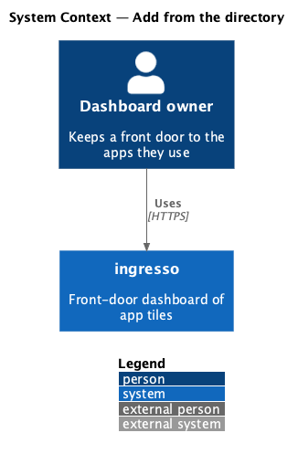
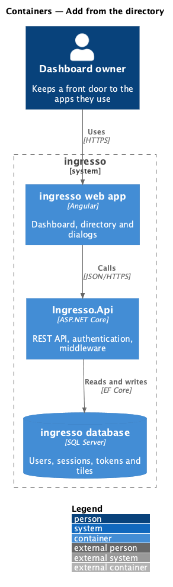
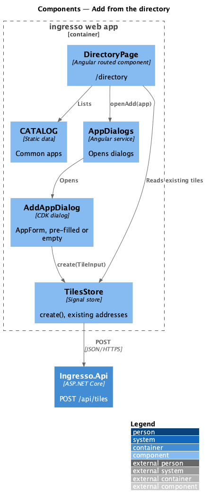
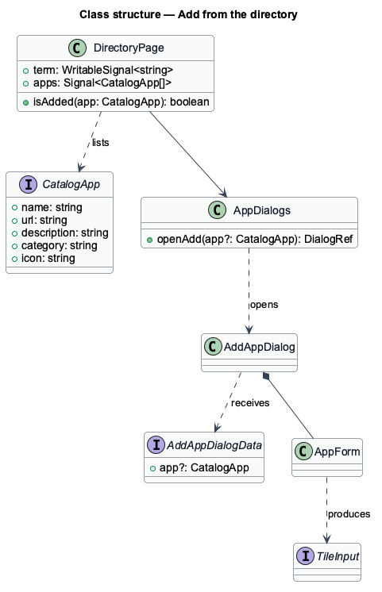
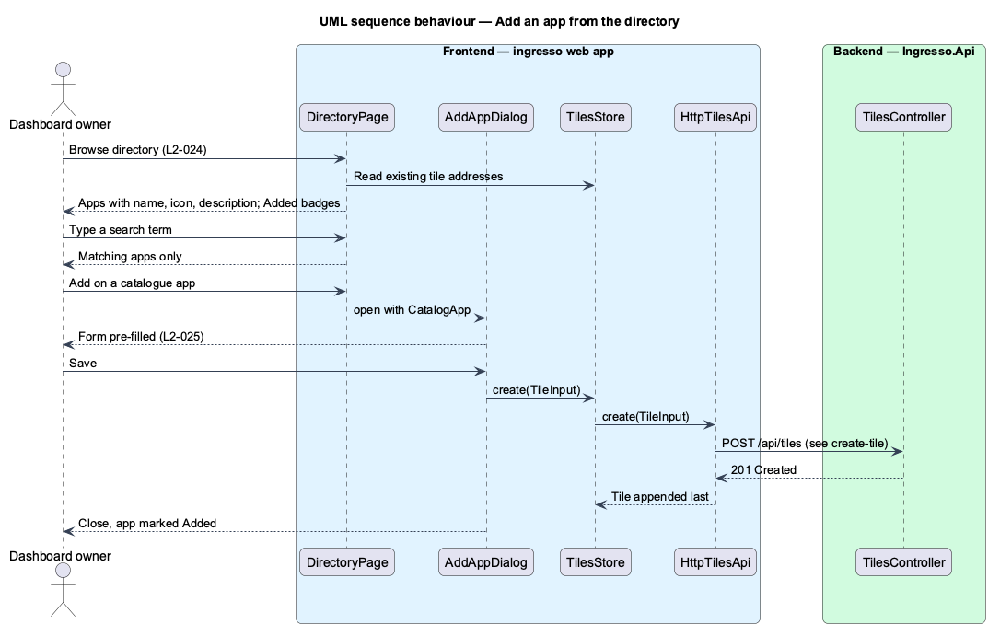
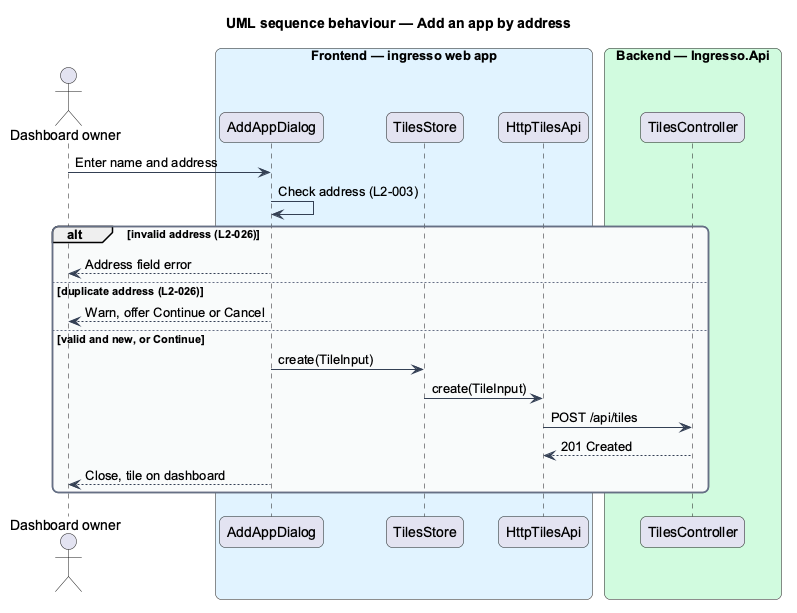

# Add from the directory

## Overview

Most owners start with apps everyone uses. The directory is a curated catalogue of common apps, so adding one takes a click instead of typing a name and address.

**directory** — built-in catalogue of common apps with name, icon, description, address and category

**catalogue app** — one directory entry, before it becomes a tile

Adding from the directory pre-fills the tile form and then follows the `create-tile` path. Owners can also add any app by address from the Add app dialog. The directory is static data in the web app and makes no request to load.

## Description

The slice runs from the ingresso web app to the ingresso database.

- **`DirectoryPage`** — routed page at `/directory`. It lists `CATALOG` entries with `ig-app-icon`, filters them by a search term, and marks entries whose address already exists on the dashboard as Added.
- **`CATALOG` / `CatalogApp`** — the catalogue in `shared/catalog.ts`.
- **`AddAppDialog`** — opened with `AddAppDialogData`. With a catalogue app, it pre-fills `AppForm`. Without one, it starts empty for an address entry.
- **`AppDialogs`** — opens `AddAppDialog` from the dashboard empty state, the header and the directory.
- **Duplicate check** — compares the normalized address with existing tiles before submit and offers continue or cancel (`L2-026`).

Decisions made in journey 09:

- **Added, not hidden.** Apps already on the dashboard stay in the list with an `Added` badge in place of the Add button (`L2-024` 3). An app counts as added when a tile has its name or its address; addresses are compared ignoring the scheme, a leading `www.` and a trailing slash.
- **Grouped by category.** Categories appear in the order they first occur in `CATALOG`; the search matches name, description and category and drops empty groups. No match shows `EmptyState` (the `empty` mock). `loading` and `error` mocks stay as designed states: the catalogue is static, so the page never shows them.
- **Browse directory** sits at the top of the Add app dialog when it is opened without a pre-filled app. It closes the dialog and navigates to `/directory`.
- **Create at the first free space.** A directory app is saved through the same `create-tile` path, so it takes the first free 3 × 2 space (`L2-009`).
- The duplicate-address warning (`L2-026`) exists in `AddAppDialog`.

## Requirements

The feature realizes the following level-2 (L2) requirements. Each L2 requirement refines a level-1 (L1) requirement, cited by identifier.

| L2 ID | Refines (L1) | Requirement |
|-------|--------------|-------------|
| `L2-024` | `L1-006` | A directory page shall list common apps. |
| `L2-025` | `L1-006` | Choosing a directory app shall prefill the tile form. |
| `L2-026` | `L1-006` | The user shall be able to add any app by typing its address. |

## Diagrams

### System context

The owner adds apps to ingresso from its directory or by address.

### Containers

The directory renders from static data in the web app. Saving a tile calls `Ingresso.Api` through `create-tile`.

### Components

`DirectoryPage` reads `CATALOG` and the store, and opens `AddAppDialog` through `AppDialogs`.

### Class structure

`DirectoryPage` reads `CatalogApp` entries. `AddAppDialog` receives an optional `CatalogApp` in `AddAppDialogData` and produces a `TileInput`.

### Behaviour — add an app from the directory

The directory marks apps already on the dashboard. Choosing Add opens the form pre-filled, and saving creates the tile at the first free 3 × 2 space.

### Behaviour — add an app by address

The owner enters a name and address. An invalid address shows a field error, and a known address raises a duplicate warning before submit.

