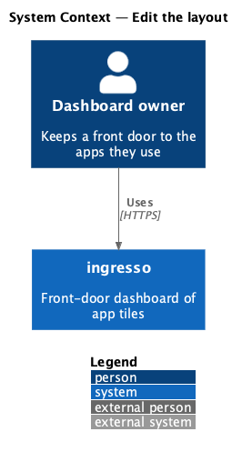
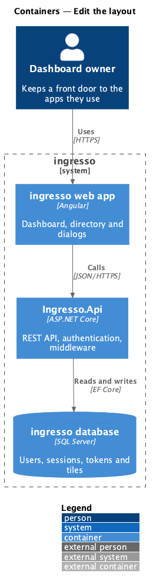
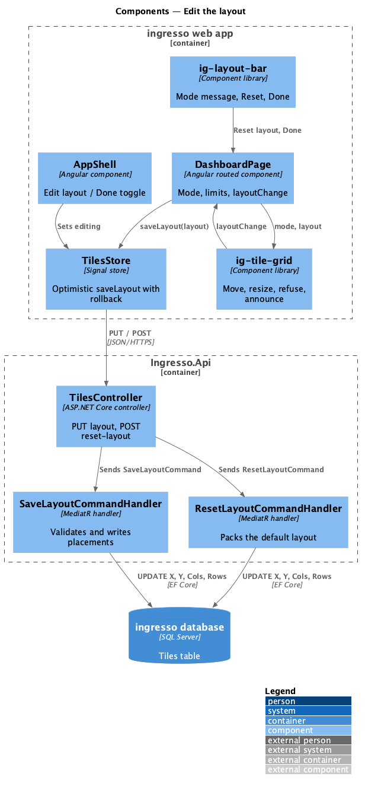
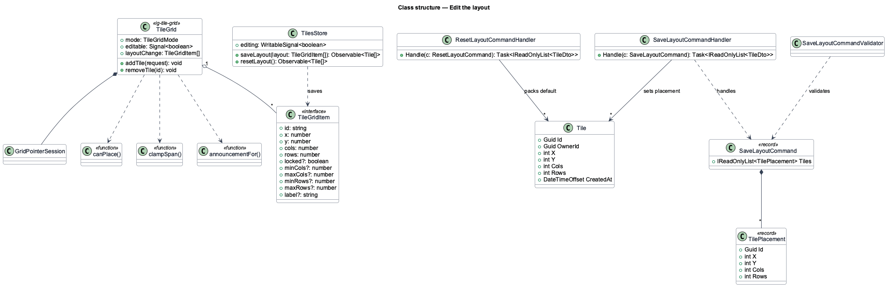
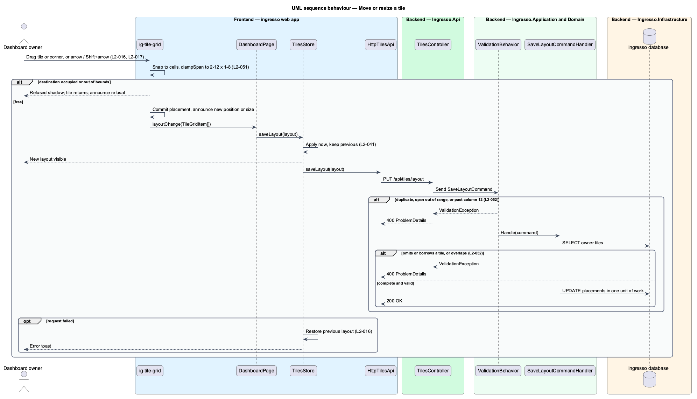
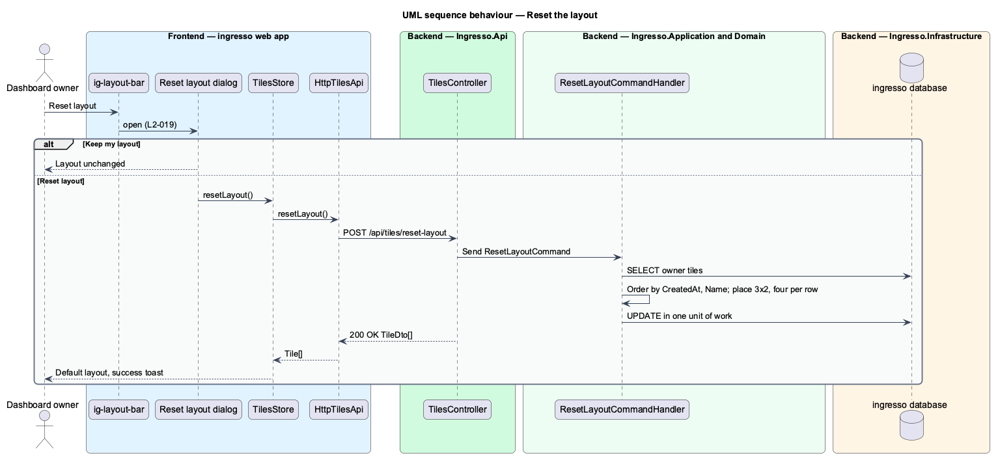
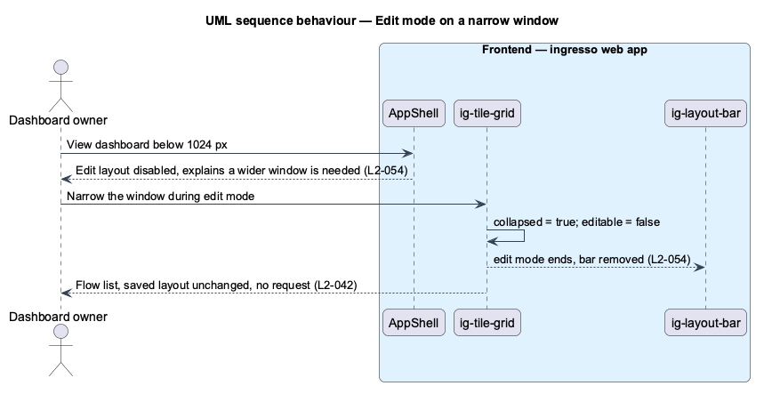

# Edit the layout

## Overview

Owners arrange tiles to match how they work. This feature covers edit mode, moving and resizing tiles by pointer or keyboard, saving the layout, and resetting it to the default.

**edit mode** — dashboard state in which tiles show grid lines and resize handles, and do not open apps

**refused destination** — target cells that overlap another tile, which the grid rejects without moving any other tile

**default layout** — tiles in creation order, oldest first, each 3 columns by 2 rows, four per row

Every committed move or resize saves at once. The dashboard shows the change before the request completes and rolls back if the save fails, so edit mode never holds unsaved work. The client sends the whole layout in one request, so the server can reject a layout that omits, repeats or borrows a tile, overlaps, or leaves the grid. Edit mode needs a window of at least 1024 px (ADR 0010).

## Description

The slice runs from the ingresso web app to the ingresso database.

- **`AppShell`** — header toggle between Edit layout and Done. It binds `aria-pressed` to `TilesStore.editing`, and disables the toggle with an explanation below 1024 px (`L2-054`).
- **`ig-layout-bar`** — library banner shown in edit mode with the mode message, Reset layout and Done.
- **`TileGrid` (`ig-tile-grid`)** — runs pointer and keyboard gestures through `GridPointerSession` and `gridKeyboardCandidate`, refuses occupied cells with `canPlace`, clamps spans with `clampSpan`, announces each result through two polite live regions, and emits `layoutChange` once per committed change.
- **`DashboardPage`** — passes `mode` from `TilesStore.editing`, applies `minCols: 2` and `maxRows: 8` to each item (`L2-051`), and forwards `layoutChange` to `TilesStore.saveLayout`.
- **`TilesStore.saveLayout`** — applies the new layout to the signal at once, calls the API, and restores the previous layout with an error toast on failure.
- **`TilesController.SaveLayout`** — `PUT /api/tiles/layout` with a `SaveLayoutRequest` listing `id`, `x`, `y`, `cols` and `rows` for every tile.
- **`SaveLayoutCommandValidator`** — rejects duplicates, spans outside 2–12 columns and 1–8 rows, and tiles that extend past column 12.
- **`SaveLayoutCommandHandler`** — loads the owner's tiles, rejects a layout that does not name each exactly once or that overlaps, and writes the placements in one unit of work.
- **Reset layout dialog** — CDK dialog composed from `DialogShell` (mock `dialogs/reset-layout`). On confirm it calls `TilesController.ResetLayout`.
- **`ResetLayoutCommandHandler`** — orders the owner's tiles by `CreatedAt` then `Name` and packs them at 3 by 2, four per row. It changes no other field.

The current source differs from the requirements in these points. Each is open work for the slice.

- `TilesStore.editing` is a root-level signal and keeps its value across routes, against `L2-020`.

## Requirements

The feature realizes the following level-2 (L2) requirements. Each L2 requirement refines a level-1 (L1) requirement, cited by identifier.

| L2 ID | Refines (L1) | Requirement |
|-------|--------------|-------------|
| `L2-015` | `L1-004` | The user shall be able to switch the dashboard into edit mode, which exposes drag handles and tile actions. |
| `L2-016` | `L1-004` | In edit mode, the user shall be able to drag a tile to free cells and drag its corner handle to resize it. A destination that overlaps another tile shall be refused; other tiles never move. |
| `L2-017` | `L1-004` | Moving and resizing shall be possible without a pointer, with every change announced. |
| `L2-019` | `L1-004` | The user shall be able to reset the layout to the default after confirming. The default layout packs tiles in creation order, oldest first, each at the default 3 by 2 span, in reading order. |
| `L2-020` | `L1-004` | Edit mode shall not hold unsaved work. |
| `L2-051` | `L1-004` | A tile's span shall stay within 2 to 12 columns and 1 to 8 rows, and inside the grid's 12 columns. |
| `L2-052` | `L1-004` | The layout shall be saved as one request listing every tile's column, row and span. |
| `L2-054` | `L1-004` | Edit mode shall be available only at widths of 1024px and above. |

## Diagrams

### System context

The owner arranges their tiles in ingresso. No external system takes part.

### Containers

The web app sends each new layout to `Ingresso.Api`, which writes the placements to the Tiles table.

### Components

`ig-tile-grid` turns gestures into a new layout. The store saves it optimistically, and the API validates the complete layout before it writes.

### Class structure

`TileGrid` emits `TileGridItem` arrays. `SaveLayoutCommandHandler` and `ResetLayoutCommandHandler` both rewrite the placement of every `Tile` for one owner.

### Behaviour — move or resize a tile

The grid refuses an occupied destination without moving any other tile. A committed change shows within one frame, saves as a whole layout, and rolls back with a toast if the save fails.

### Behaviour — reset the layout

A confirmation explains that positions and sizes change and nothing is deleted. A confirmed reset packs tiles in creation order at 3 by 2. If the request fails the dialog stays open with an alert (mock `dialogs/reset-layout/failed`) and no placement changes; undo after reset is deferred.

### Behaviour — edit mode on a narrow window

Below 1024 px the grid collapses and refuses edit mode. Edit mode in progress ends when the window narrows.

## Verified in journey 08

- Edit mode is announced by the layout bar's polite status; each tile gets a drag handle, a resize handle and an Edit action. Delete is chosen inside the Edit dialog, so `L2-015` now says so.
- The dashboard leaves edit mode when it is destroyed, so leaving and coming back opens it in normal mode (`L2-020`); narrowing below 1024 px also ends it (`L2-054`).
- A refused pointer drop shows a refusal shadow, returns the tile and saves nothing; Escape cancels a drag; a failed save restores the layout and toasts an error (`L2-016`).
- A move is drawn within 100 ms, before the save returns (`L2-041` 1). The 60 fps drag with 200 tiles is checked with the perf-test `TileGrid` scenario, not in CI.
- Acceptance tests: `edit-layout.spec.ts`, `arrange-tiles.spec.ts`, `dashboard.visual.spec.ts` and the layout cases in `TilesApiTests`.
