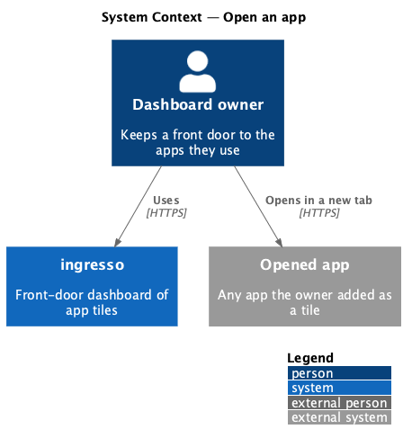
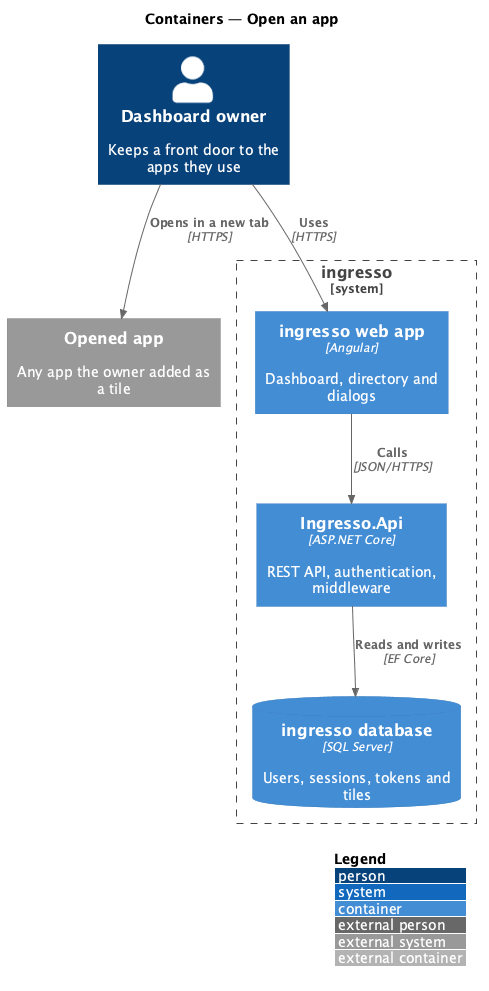
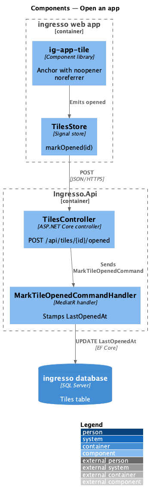
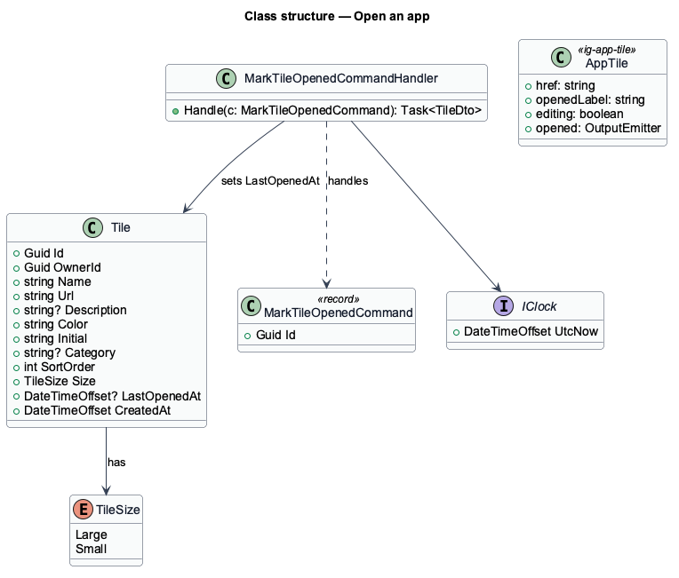
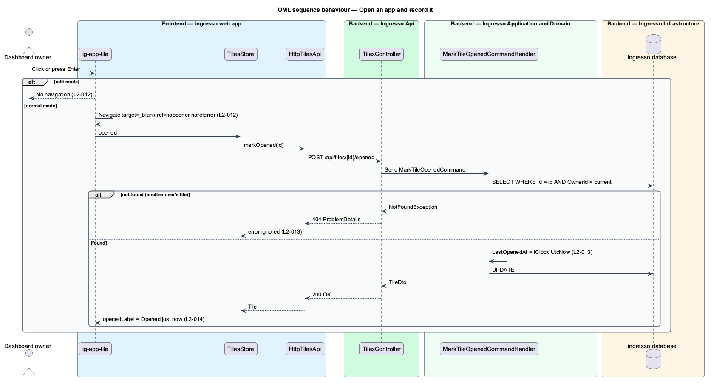

# Open an app

## Overview

Opening an app is the reason ingresso exists. Activating a tile opens its address in a new browser tab and records the time on the server.

**last opened** — UTC time the owner most recently opened a tile from ingresso

The new tab opens without a reference back to ingresso, so the opened page cannot script the dashboard. Recording the time is best-effort: a failed record never blocks navigation. Each tile then shows its last-opened time in relative words, with the exact time as its accessible title.

## Description

The slice runs from the ingresso web app to the ingresso database.

- **`ig-app-tile`** — renders the tile as an anchor with `target="_blank"` and `rel="noopener noreferrer"`. It emits `opened` on activation and suppresses navigation in edit mode.
- **`DashboardPage`** — forwards `opened` to `TilesStore.markOpened` and passes `openedLabel(tile.lastOpenedAt)` to the tile.
- **`openedLabel`** — formats a relative label such as `Opened 5 minutes ago`, or `Never opened` when the value is empty.
- **`TilesStore.markOpened`** — calls the API and updates the tile's `lastOpenedAt`. It ignores failures.
- **`TilesController.MarkOpened`** — `POST /api/tiles/{id}/opened`.
- **`MarkTileOpenedCommandHandler`** — loads the owner's tile, sets `LastOpenedAt` from `IClock.UtcNow`, and saves. It throws `NotFoundException` for any other tile.

## Requirements

The feature realizes the following level-2 (L2) requirements. Each L2 requirement refines a level-1 (L1) requirement, cited by identifier.

| L2 ID | Refines (L1) | Requirement |
|-------|--------------|-------------|
| `L2-012` | `L1-003` | Activating a tile shall open its address in a new browser tab without exposing ingresso to the opened page. |
| `L2-013` | `L1-003` | Opening a tile shall record the time on the server. |
| `L2-014` | `L1-003` | Each tile shall show when it was last opened, in relative terms. |

## Diagrams

### System context

The owner opens an app from ingresso. The app opens in its own tab; ingresso records only the time.

### Containers

The browser opens the app directly. In parallel, the web app tells `Ingresso.Api` to record the time in the Tiles table.

### Components

`ig-app-tile` emits `opened`. The store posts the event, and the handler stamps the time.

### Class structure

`MarkTileOpenedCommandHandler` handles `MarkTileOpenedCommand`, reads `IClock`, and mutates `Tile.LastOpenedAt`.

### Behaviour — open an app and record it

The browser opens the app first. The record request runs alongside navigation, and its failure is silent.

