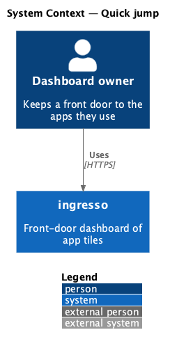
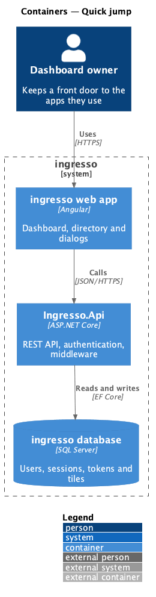
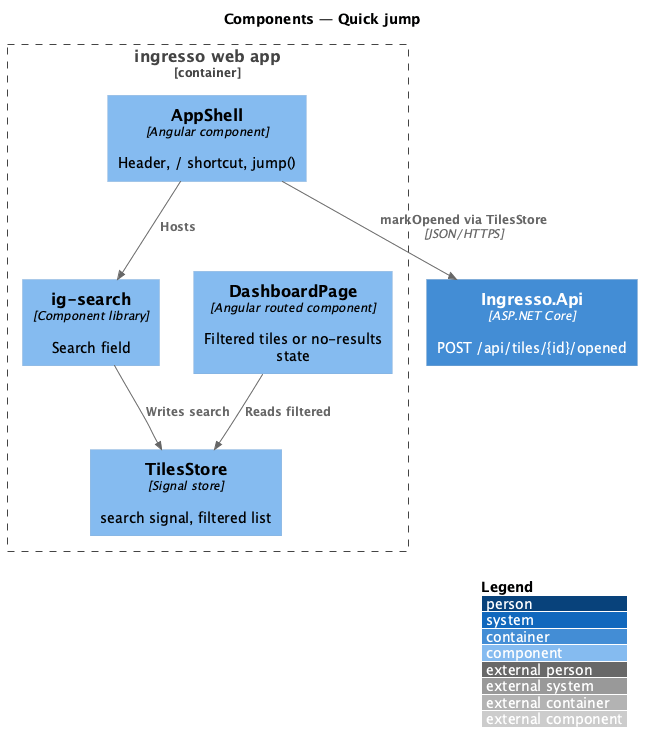
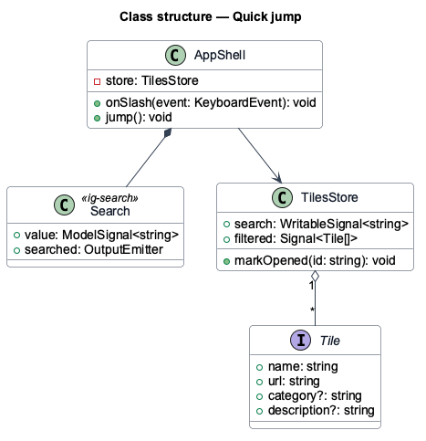
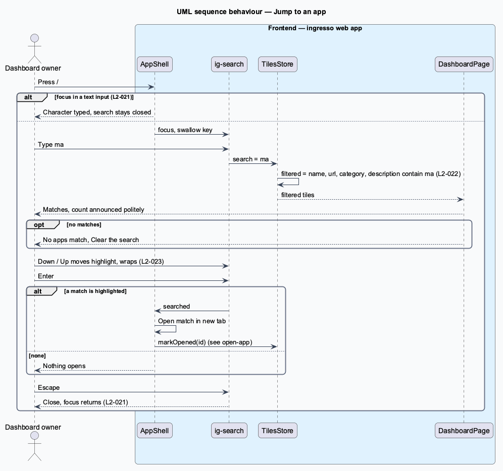

# Quick jump

## Overview

Owners with many tiles reach an app faster by typing than by scanning. Quick jump is a search field in the header that opens from any screen with the `/` key.

**quick jump** — header search that filters tiles as the owner types and opens the highlighted match with Enter

The search runs entirely in the browser over the tiles the store already holds. No request leaves the browser until the owner opens a match, which then follows the `open-app` path.

## Description

The slice runs from the ingresso web app to the ingresso database.

- **`AppShell`** — places `ig-search` in the header's `search` slot, binds it to `TilesStore.search`, and calls `jump()` on `searched`.
- **`ig-search`** — library search field. `/` outside a text field or dialog focuses it and remembers where focus was; Escape clears it and returns focus there (when that element is still on the page, otherwise focus is released); Up and Down emit `navigated`.
- **`TilesStore`** — computes the filtered list (name, address, category and description, case-insensitive), the highlighted match (first by default, reset whenever the query changes, moved and wrapped by `moveHighlight`) and the `matchSummary` ("2 apps match", "1 app matches", "No apps match").
- **`AppShell.jump()`** — opens the highlighted match in a new tab and calls `TilesStore.markOpened`; with no match it does nothing.
- **`DashboardPage`** — renders the filtered tiles with the highlighted one marked (`ig-app-tile [highlighted]`, `aria-current` on its link), a visually hidden `role="status"` that carries the count, or `ig-empty-state` with Clear the search when nothing matches.

Decisions made in journey 07: the highlight is an accent edge on the tile (`tile--highlighted`, added to the design system and the `search-results` mock); while a query is active the matches close up into the first free spaces in reading order (`packMatches`, never saved; clearing the search restores the saved places); if the tile that had focus is filtered out, Escape cannot return to it and focus is released.

## Requirements

The feature realizes the following level-2 (L2) requirements. Each L2 requirement refines a level-1 (L1) requirement, cited by identifier.

| L2 ID | Refines (L1) | Requirement |
|-------|--------------|-------------|
| `L2-021` | `L1-005` | Pressing `/` outside a text field shall open the search from any screen. |
| `L2-022` | `L1-005` | Search shall filter tiles by name, address, category and description, case-insensitively. |
| `L2-023` | `L1-005` | Enter shall open the highlighted match. |

## Diagrams

### System context

The owner searches their tiles in ingresso and opens the match in a new tab.

### Containers

Filtering runs in the web app. Only opening a match calls `Ingresso.Api`, through `open-app`.

### Components

`AppShell` and `ig-search` own the input. `TilesStore` owns the filter, and `DashboardPage` renders the result.

### Class structure

`AppShell` writes `TilesStore.search`. The store derives `filtered` from `tiles` and `search`.

### Behaviour — jump to an app

The `/` key opens the field only when focus is outside a text input. Typing filters in place, and Enter opens the highlighted match.

