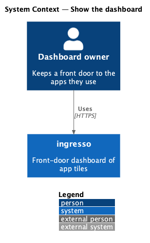
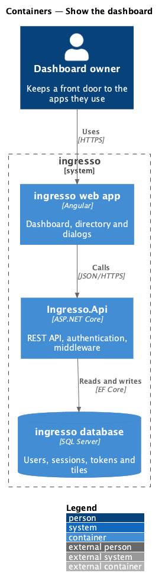
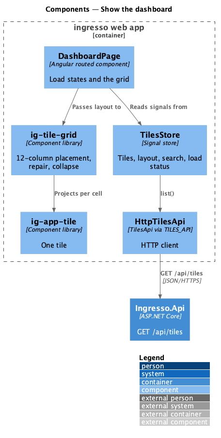
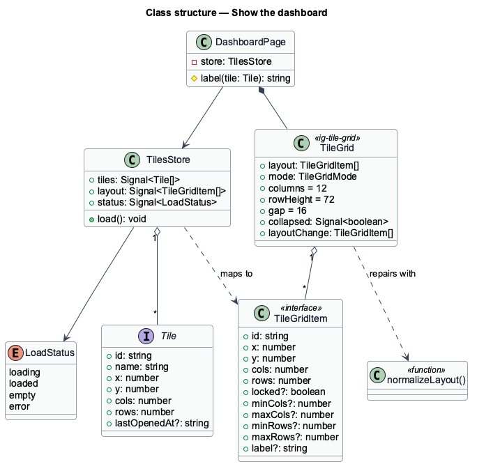
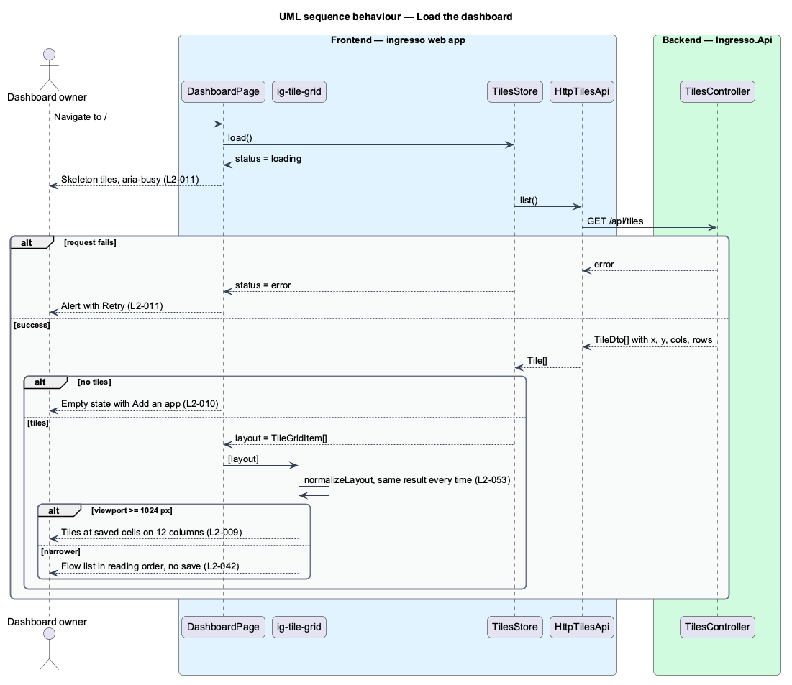

# Show the dashboard

## Overview

The dashboard is ingresso's home page. It shows every tile the signed-in user owns, where the user placed it, and lets them open an app with one click.

**cell** — one column-by-row unit of the 12-column dashboard grid

**placement** — a tile's column, row, column span and row span

**load state** — one of loading, loaded, empty or error, which selects what the dashboard renders

**collapse** — rendering of the tiles as a flow list in reading order below a width of 1024 px

The dashboard renders four load states. While the list loads, skeleton tiles hold the layout. An empty list shows an empty state with an Add an app action. A failed load shows an alert with Retry. A loaded list renders `ig-tile-grid`, which places each tile at its saved cells, repairs an invalid stored layout by deterministic rules, and collapses below 1024 px without changing the saved layout (ADR 0010).

## Description

The slice runs from the ingresso web app to the ingresso database.

- **`DashboardPage`** — routed page at `/`. It renders `ig-skeleton`, `ig-empty-state`, `ig-alert` or `ig-tile-grid` from `TilesStore` state. The grid's `igTileGridTile` template renders `ig-app-tile` for each tile.
- **`TilesStore`** — exposes `tiles`, the derived `layout` (`TileGridItem[]`), a filtered view driven by `search`, and a `LoadStatus` (`shared/load-state.ts`).
- **`TileGrid` (`ig-tile-grid`)** — library component ported from qbc-grid. It takes `layout`, `mode`, `columns` (12), `rowHeight` (72 px) and `gap` (16 px). It runs `normalizeLayout` on every input, so overlapping or out-of-bounds tiles are repaired the same way each time (`L2-053`).
- **`normalizeLayout`** — pure function in `tile-grid/normalize-layout.ts`. It clamps spans, moves a colliding tile to the first free cell in reading order, and reports the repair.
- **`ig-app-tile`** — library component that renders one tile. Spans of 4 by 3 or more render the large variant with description and footer.
- **`Tile.X`, `Y`, `Cols`, `Rows`** — the stored placement, returned in `TileDto` and mapped to `TileGridItem`.

The current source differs from the requirements in these points. Each is open work for the slice.

- `Tile` keeps the obsolete `SortOrder` and `Size` columns beside `X`, `Y`, `Cols` and `Rows`. The schema is created by `EnsureCreated`, so no migration carries existing placements (see `manage-database`).

## Greeting (journey 28)

The intro's `h1` greets the person by the display name they saved in Settings → Profile (`L2-117`, `L2-146`,
[ADR 0024](../../../adr/0024-greet-by-profile-name.md)).

- **Heading rule** — `DashboardPage.greeting` is a `computed` over `SessionStore.user()`: `Hi, {displayName}` with
  the whole saved name when `displayName` is set, otherwise `Hi there`. The page never reads the email for the
  heading, so the address cannot appear there. There is no time-of-day greeting any more; `greetingFor` and
  `firstName()` are removed.
- **Text, not markup** — the name is rendered by Angular interpolation, so `<b>Maya</b>` shows as text (`L2-037`).
- **Wrapping** — the heading keeps the intro's type ramp and adds `overflow-wrap: anywhere` in
  `dashboard-page.scss`, so a 100-character name, even one without spaces, wraps at 320 px and the page never
  scrolls sideways.
- **Unset state** — with no display name, the intro shows "Add your name" under the summary: `ig-button`
  (`appearance="link"`, `size="sm"`, `aria-haspopup="dialog"`). It calls `AppDialogs.openEditProfile` with a
  `Profile` built from the session (`displayName: null`, `email`, `emailVerified`) and the button as the focus
  return target, so the existing `EditProfileDialog` opens in a CDK `Dialog` with `DialogShell`. No extra request
  is made to open it.
- **Staying current** — when the dialog closes with a saved profile, the page shows the "Profile saved" toast
  through `ToastService` and calls `SessionStore.refresh()`, which reloads `GET /api/auth/me` and sets `user`.
  The heading and the link follow the signal, so they change without a reload. Settings already calls
  `refresh()` after its own save, so a name changed or cleared there shows when the person returns to `/`. The
  name lives on the account (`User.Name`), so it is the same after signing out and in again.
- **Privacy** — `GET /api/auth/me` answers only for the session's own account, so each person sees only their own
  greeting, as with their tiles (`L2-032`).

Behaviour, as a sequence:

1. The shell loads `GET /api/auth/me` into `SessionStore.user`.
2. With `displayName` set, the heading reads "Hi, {displayName}"; otherwise "Hi there" with "Add your name".
3. Add your name → `AppDialogs.openEditProfile` → `EditProfileDialog` → `PUT /api/profile`.
4. The dialog closes with the saved profile → toast "Profile saved" → `SessionStore.refresh()` →
   `GET /api/auth/me` → the heading reads "Hi, {displayName}" and the link is gone.

## Requirements

The feature realizes the following level-2 (L2) requirements. Each L2 requirement refines a level-1 (L1) requirement, cited by identifier.

| L2 ID | Refines (L1) | Requirement |
|-------|--------------|-------------|
| `L2-008` | `L1-002` | The dashboard shall render every tile in the user's saved order, showing name, address host, description (on large tiles) and colour. |
| `L2-009` | `L1-002` | Each tile shall occupy a rectangle of cells on a 12-column grid, given by its column, row, column span and row span. A tile's size is its span; the default span for a new tile is 3 columns by 2 rows. |
| `L2-010` | `L1-002` | A user with no tiles shall see an empty state with a call to action. |
| `L2-011` | `L1-002` | The dashboard shall show a skeleton while loading and a retryable error if loading fails. |
| `L2-053` | `L1-002` | A stored layout that is invalid shall be repaired on display by the same rules every time, without losing a tile. |
| `L2-146` | `L1-002`, `L1-007` | The dashboard shall greet a signed-in person by the display name they saved, never by their email address. |
| `L2-042` | `L1-010` | The dashboard shall show the 12-column grid at widths of 1024px and above, and collapse to a flow list in reading order (top row first, then left to right) below that width. A width change never changes the saved layout. |

## Diagrams

### System context

The dashboard owner views their tiles in ingresso. No external system takes part.

### Containers

The web app loads tiles from `Ingresso.Api` and renders them on the grid. The API reads the Tiles table (`view-tiles`).

### Components

Within the web app, `DashboardPage` reads `TilesStore` and hands the layout to `ig-tile-grid`, which projects one `ig-app-tile` per cell.

### Class structure

`DashboardPage` depends on `TilesStore`. The store maps `Tile` values to `TileGridItem` values, and `TileGrid` repairs them with `normalizeLayout`.

### Behaviour — load the dashboard

The page shows skeletons until the list arrives. It then renders the empty state, the grid, or an alert with Retry. The grid repairs an invalid stored layout before it renders.

## Decisions made in journey 03

- A tile shows name, host, description (large tiles) and colour; category is not shown ([ADR 0012](../../../adr/0012-tiles-do-not-show-a-category.md)).
- While loading, the skeleton grid is marked `aria-busy` and a polite status says "Loading apps…" (`L2-011`).
- The Amber icon colour is `#A15F00` (5.06:1 with white) so every palette colour keeps AA contrast for its initial (`L2-008`).
- Acceptance tests: `dashboard-grid.spec.ts` (placement, repair, responsive collapse, 200 tiles) and `dashboard-states.spec.ts`.

## Decisions made in journey 28

- The greeting is "Hi, {display name}" or "Hi there"; the time-of-day greeting is dropped
  ([ADR 0024](../../../adr/0024-greet-by-profile-name.md)).
- "Add your name" reuses `EditProfileDialog` through `AppDialogs`; the dashboard never edits inline.
- Acceptance tests: `greet-by-profile-name.spec.ts` and `greet-by-profile-name.visual.spec.ts`; the heading
  assertion in `dashboard.spec.ts` now expects "Hi, Maya Okafor".
