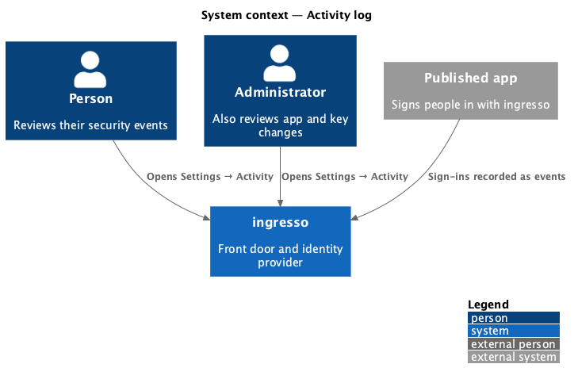
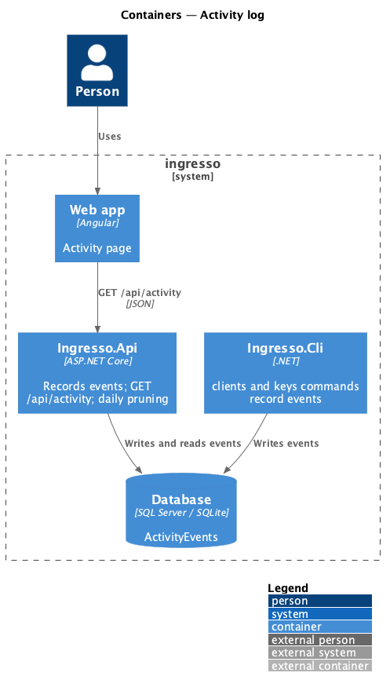
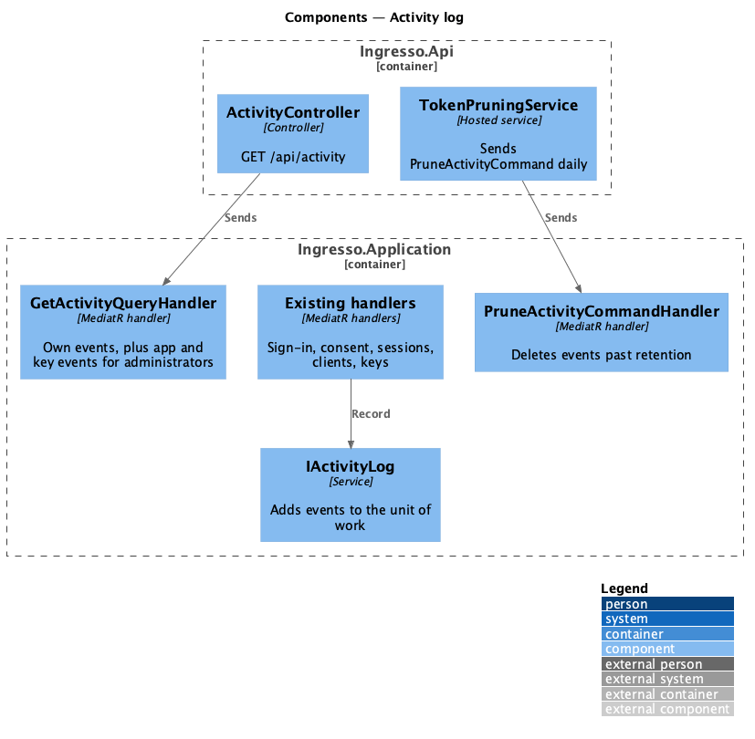
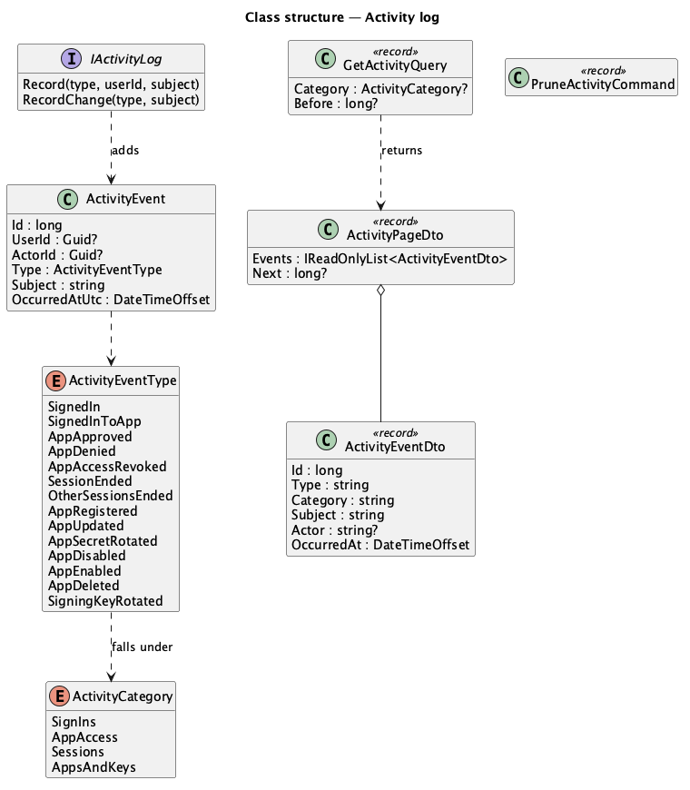
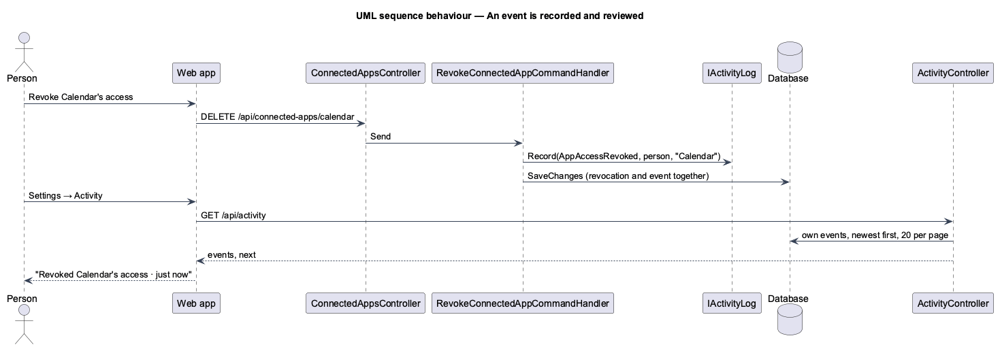

# Activity log

## Overview

Settings → Activity shows a person the security events on their account, newest first: sign-ins to ingresso
and to apps, approvals and denials, revocations and ended sessions. Administrators also see changes to
registered apps and signing keys. The list filters by type, loads older events on request, and keeps events for
90 days by default.

**event** — one recorded security change: its type, whose activity it is, who made it (for app and key
changes), a short subject (an app's name or a device description) and when

**category** — the filter an event falls under: Sign-ins, App access, Sessions, or Apps and keys

## Description

- **Domain** — `ActivityEvent(Id, UserId?, ActorId?, Type, Subject, OccurredAtUtc)`. `Id` is a database
  sequence, so events order newest first even when two share a time. `ActivityEventType`:
  - Sign-ins: `SignedIn` (subject: the device), `SignedInToApp` (the app).
  - App access: `AppApproved`, `AppDenied`, `AppAccessRevoked` (the app).
  - Sessions: `SessionEnded` (the device), `OtherSessionsEnded`.
  - Apps and keys (no `UserId`): `AppRegistered`, `AppUpdated`, `AppSecretRotated`, `AppDisabled`,
    `AppEnabled`, `AppDeleted` (the app), and `SigningKeyRotated` (subject `scheduled` when the schedule rotated).
  - `ActivityCategories.Of(type)` maps a type to its category.
- **Recording** — `IActivityLog.Record(type, userId, subject)` and `RecordChange(type, subject)` (the actor is the
  current user, or none from the CLI) add the event to `IAppDbContext`. The handler's own `SaveChangesAsync`
  saves it with the change (ADR 0022):
  - `RedeemSignInLinkCommand` and `StartSessionCommand` record `SignedIn`.
  - `RecordAppSignInCommand` records `SignedInToApp` once per ingresso session and app.
  - `ApproveConsentCommand` records `AppApproved`; `RecordConsentDeniedCommand`, sent by the authorize endpoint on
    Deny, records `AppDenied`; `RevokeConnectedAppCommand` records `AppAccessRevoked`.
  - `EndSessionCommand` and `EndOtherSessionsCommand` record the session events.
  - The client commands and `RotateSigningKeyCommand` record the app and key events.
  - Events never hold tokens, secrets, codes, tile addresses or IP addresses (L2-038).
- **Query** — `GetActivityQuery(Category?, Before?)` returns `ActivityPageDto(Events, Next)`, 20 events per page,
  newest first. A person gets their own events; an administrator also gets every app and key event. `Before` is
  the last event id of the previous page and `Next` the cursor for the following one, or null.
  `ActivityEventDto(Id, Type, Category, Subject, Actor, OccurredAt)`; `Actor` is the administrator's display name
  or email, or null.
- **Retention** — `PruneActivityCommand` deletes events older than `Activity:RetentionPeriod` (90 days by
  default). The daily `TokenPruningService` sends it.
- **API** — `GET /api/activity?category=sign-ins|app-access|sessions|apps-and-keys&before=<id>` for the signed-in
  person (`ActivityController`).
- **Frontend**:
  - `ACTIVITY_API` (`list(category, before)`), `ActivityPage` at `/settings/activity`, and an Activity card in
    Settings that links to it.
  - The page shows a chip row (All, Sign-ins, App access, Sessions, and Apps and keys for administrators), the
    list, and Show more; `EmptyState`, `Skeleton` and a danger `Alert` with Try again cover the other states.
  - `activityTitle` and `activityMeta` turn an event into its words, such as “Signed in to Sample app” and
    “Chrome on macOS · 15 minutes ago”.

## Requirements

The feature realizes the following level-2 (L2) requirements. Each L2 requirement refines a level-1 (L1) requirement, cited by identifier.

| L2 ID | Refines (L1) | Requirement |
|-------|--------------|-------------|
| `L2-141` | `L1-008`, `L1-012` | ingresso shall record a person's security events as they happen. |
| `L2-142` | `L1-008`, `L1-007` | A person shall see their own security events, newest first. |
| `L2-143` | `L1-012`, `L1-011` | Administrators shall also see changes to registered apps and signing keys. |
| `L2-144` | `L1-008` | Activity shall filter by type and load older events on request. |
| `L2-145` | `L1-008` | ingresso shall keep security events for a configured period and then delete them. |

It builds on `L2-032` (private data), `L2-038` (privacy) and `L2-132` (device descriptions).

## Diagrams

### System context

### Containers

### Components

### Class structure

### Behaviour — record and review

## Open questions

- **Sign-outs, password changes and failed sign-ins** aren't recorded yet.
- **Exporting activity** is deferred.
