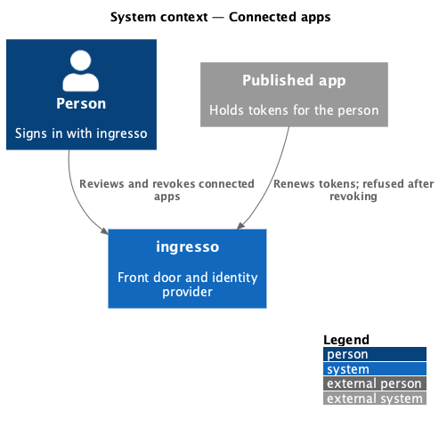
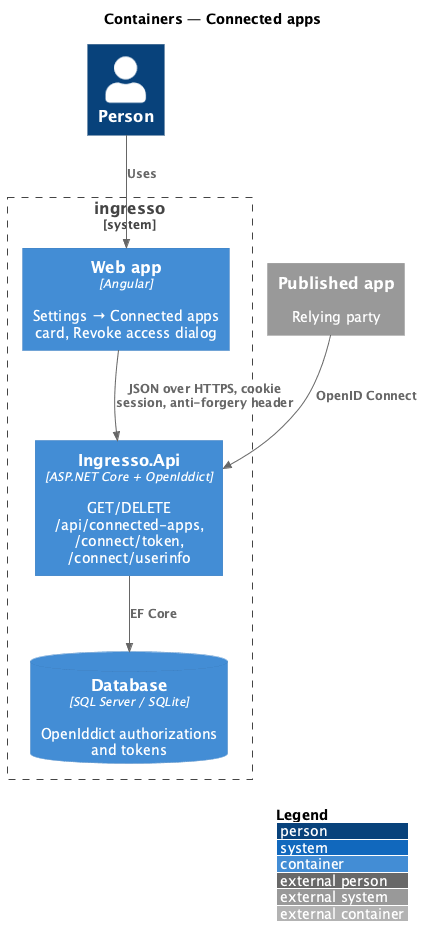
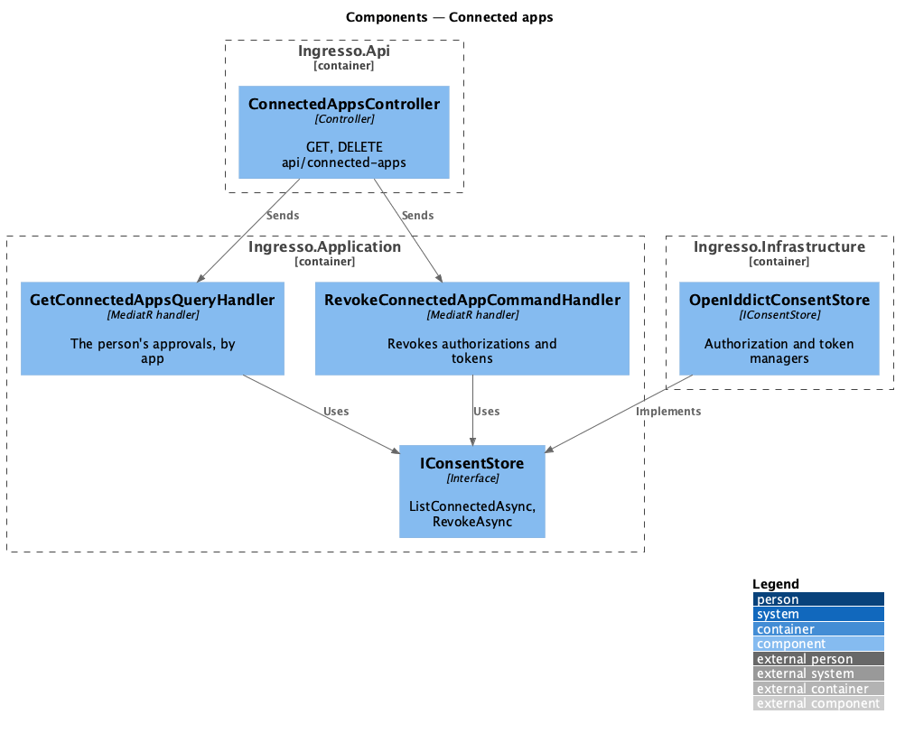
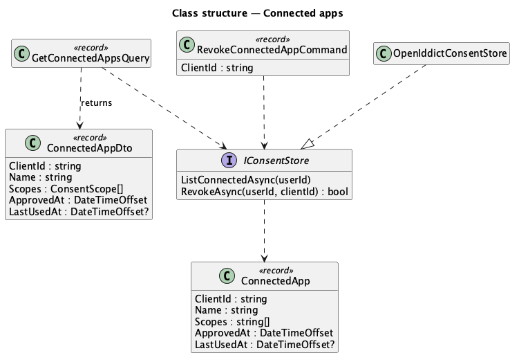
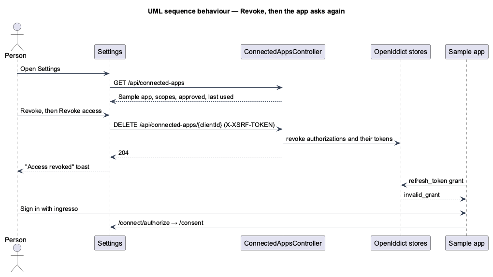

# Connected apps

## Overview

In **Settings → Connected apps**, a person sees each app they have approved (journey 23), what it can do, when
they approved it and when it last used their sign-in. **Revoke** asks first, then revokes the app's
authorizations and tokens for that person, so the app has to ask again next time.

**connected app** — an app the signed-in person has at least one valid permanent authorization (approval) for

"Last used" is the newest token ingresso issued the app for the person
([ADR 0019](../../../adr/0019-last-used-is-the-latest-token-issued.md)).

## Description

- **Application** (`Ingresso.Application/Consent/ConnectedApps.cs`):
  - `GetConnectedAppsQuery` returns the signed-in person's `ConnectedAppDto(ClientId, Name, Scopes, ApprovedAt,
    LastUsedAt)` list, sorted by name. `Scopes` are `ConsentScope`s with the plain-language titles of journey 23,
    without `openid`. Only the person's own approvals are read (L2-128, L2-032).
  - `RevokeConnectedAppCommand(clientId)` revokes every authorization the person has for the app, of any type, and
    every token tied to them. With none, it throws `NotFoundException` (404) (L2-129, L2-130).
  - `IConsentStore` gains `ListConnectedAsync(userId)` and `RevokeAsync(userId, clientId)`.
- **Infrastructure** — `OpenIddictConsentStore`:
  - Lists the person's valid permanent authorizations by subject, groups them by app, unions their scopes, takes
    the earliest creation date as `ApprovedAt`, and the newest creation date of their tokens as `LastUsedAt`.
  - Revokes with `IOpenIddictAuthorizationManager.TryRevokeAsync` and
    `IOpenIddictTokenManager.RevokeByAuthorizationIdAsync`, for the person's authorizations of that app only.
- **API** — `ConnectedAppsController` (`[Authorize]`, `api/connected-apps`):
  - `GET` returns the list.
  - `DELETE {clientId}` answers 204, or 404 when the app isn't connected to the person. The anti-forgery
    middleware refuses it without the token (L2-034).
- **Refused tokens** — OpenIddict checks the token store when a refresh token is redeemed and when an access token
  is used at the userinfo endpoint, so revoked ones are refused (`invalid_grant`, 401) (L2-130).
- **Asking again** — the consent step (journey 23) finds no valid approval, so the next sign-in shows the consent
  page (L2-131).
- **Web app**:
  - `CONNECTED_APPS_API` (`projects/api/src/lib/connected-apps`): `list()` and `revoke(clientId)`.
  - `ConnectedAppsCard` (`pages/settings/connected-apps-card.ts`): `Card`, `List`, `ListItem`, `Button` (Revoke),
    `EmptyState`, `Skeleton` and `Alert`. The scope sentence reuses the consent page's joining of titles
    (`shared/scope-phrase.ts`); dates use `relative-time`.
  - `RevokeAccessDialog` (`dialogs/revoke-access`): `DialogShell`, `Alert` and a danger `Button`. It closes with
    `true` after revoking.
  - `SettingsPage` shows the card for everyone, after Appearance, and the "Access revoked" toast.

## Requirements

The feature realizes the following level-2 (L2) requirements. Each L2 requirement refines a level-1 (L1) requirement, cited by identifier.

| L2 ID | Refines (L1) | Requirement |
|-------|--------------|-------------|
| `L2-128` | `L1-012`, `L1-008` | Settings shall list the person's own connected apps, with what they can do and when. |
| `L2-129` | `L1-012`, `L1-008` | A person shall revoke an app's access after confirming. |
| `L2-130` | `L1-012`, `L1-008` | Revoking shall end the app's tokens for that person only. |
| `L2-131` | `L1-012`, `L1-008` | After revoking, the next sign-in shall ask again. |

It builds on `L2-032` (private data), `L2-034` (CSRF), `L2-038` (privacy) and `L2-121` to `L2-125` (consent).

## Diagrams

### System context

### Containers

### Components

### Class structure

### Behaviour — revoke, then the app asks again

## Open questions

- **First-party apps** never create an approval, so they are not listed and can't be revoked here; an
  administrator disables them instead (journey 21).
- **Revoking an app for everyone** is disabling it (journey 21).
