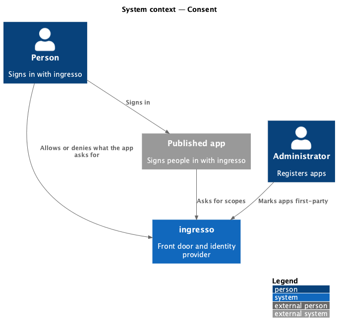
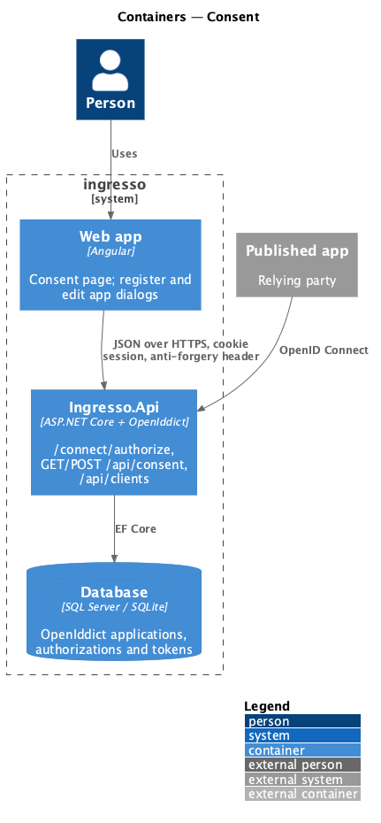
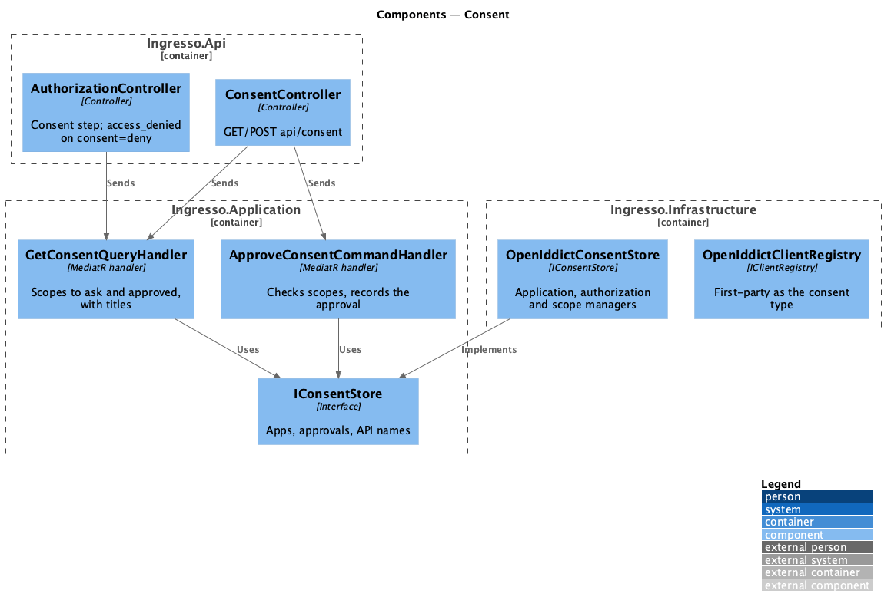
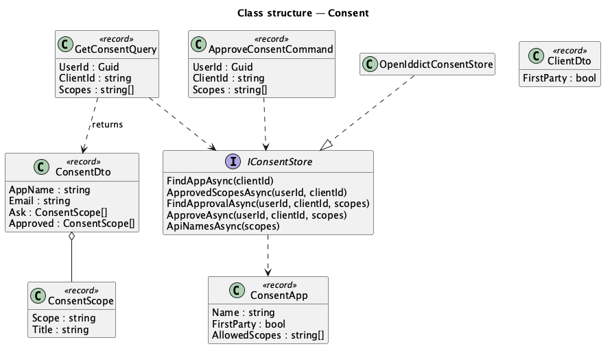
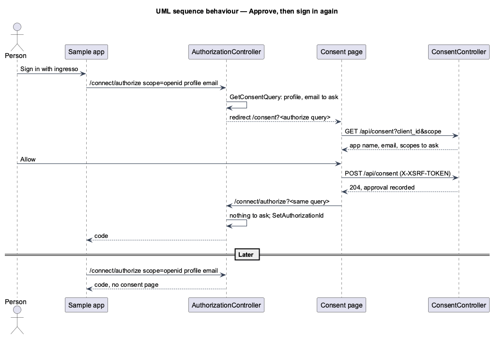

# Consent

## Overview

The first time a person signs in to an app that asks for more than `openid`, ingresso asks them first. The
consent page names the app and lists, in plain words, what it will be able to see and do. **Allow** records an
approval and returns to the app; **Deny** returns `access_denied`. Asking for new scopes later asks for those
only. An administrator can mark an app they run as first-party, which skips the page.

**approval** — a permanent OpenIddict authorization for one person, one app and a set of scopes

**first-party app** — an app with OpenIddict's `implicit` consent type; other apps are `explicit` and ask

The page is a web app page that resumes the authorize request
([ADR 0018](../../../adr/0018-consent-page-resumes-the-authorize-request.md)).

## Description

- **Consent step** — `AuthorizationController.Authorize`, after the session, verified-email and disabled-app
  checks:
  - With `consent=deny` in the request, it answers `access_denied` through OpenIddict (L2-124).
  - Otherwise it sends `GetConsentQuery(userId, clientId, scopes)`. When the result has scopes to ask, it
    redirects to `/consent` with the authorize query (L2-121).
  - Otherwise it sends `FindApprovalQuery` and attaches the approval that covers the requested scopes, when there
    is one, with `SetAuthorizationId`, so the tokens belong to it (L2-123). First-party and `openid`-only sign-ins
    have no approval and get OpenIddict's ad-hoc authorization as before.
- **Application** (`Ingresso.Application/Consent/Consent.cs`):
  - `GetConsentQuery` returns `ConsentDto(AppName, Email, Ask, Approved)`. `Ask` is the requested scopes minus
    `openid` minus the scopes already approved; it is empty for a first-party app. `Ask` and `Approved` are
    `ConsentScope(Scope, Title)` lists (L2-122, L2-125).
  - `ApproveConsentCommand(userId, clientId, scopes)` refuses a scope the app may not ask for (`profile`,
    `email`, `openid`, its API scopes, and `offline_access` with refresh tokens), then records one approval for
    everything approved so far plus the new scopes (L2-123, L2-127).
  - `ScopeTitles`: `profile` "See your display name", `email` "See your email address", `offline_access`
    "Stay signed in when you’re not using it", an API scope "Use <API name> for you".
  - `IConsentStore` (Application interface) finds the app, the approved scopes and the approval covering a
    set of scopes, records an approval, and names each API scope.
- **Infrastructure** — `OpenIddictConsentStore` uses the application, authorization and scope managers.
  Approvals are `AuthorizationTypes.Permanent` with status `valid`, and the subject is the person's id.
- **API** — `ConsentController` (`[Authorize]`, the signed-in person only):
  - `GET /api/consent?client_id=…&scope=…` returns the `ConsentDto`, or 404 for an unknown app.
  - `POST /api/consent` takes `{ clientId, scope }` and answers 204. The anti-forgery filter refuses it with 400
    without the `X-XSRF-TOKEN` header (L2-034, L2-127), and a scope the app may not ask for gets 400.
- **First-party option** — `ClientDto`, `NewClient`, `RegisterClientCommand`, `UpdateClientCommand` and
  `ClientChanges` gain `FirstParty`. `OpenIddictClientRegistry` maps it to `ConsentTypes.Implicit`, and false
  to `ConsentTypes.Explicit`. The CLI gains `clients add --first-party`, and `clients list` prints
  "first-party" (L2-126).
- **Web app**:
  - `CONSENT_API` (`projects/api/src/lib/consent`): `get(clientId, scope)` and `allow(clientId, scope)`.
  - `ConsentPage` (`pages/consent`, route `/consent`, outside the shell): auth layout, `Card`, `Logo`, `List`,
    `Skeleton`, `Alert` and `Button`. Allow shows busy, posts, then calls `location.assign` with
    `/connect/authorize` and the same query. Deny calls `location.assign` with `consent=deny` added. A failed
    Allow shows the error alert; a failed load goes to the error page.
  - `RegisterAppDialog` gains a Consent `Check`, "Trusted first-party app — skip the consent screen", in a
    `FieldSet` with a `hint`. `FieldSet` gained the `hint` input (`{id}-help`, the group's description) for it.
  - The new-scopes wording joins the approved titles and says a repeated "see your" once: "You already let it
    see your display name and email address."
- **Sample app** — the seeded sample app is registered `explicit`, so it shows the consent page. On
  `access_denied` it returns home and says "You chose not to let Sample app use your ingresso account."

## Behaviour as built

- Apps registered before this journey keep the `implicit` consent type, so they skip the page until an
  administrator unticks the option.
- App and API names are rendered by Angular interpolation, so markup shows as text (L2-037).
- Playwright specs whose subject is not consent approve on the way with `SampleAppPage.waitUntilSignedIn`; the
  API tests' relying party registers first-party apps unless a test is about consent.

## Requirements

The feature realizes the following level-2 (L2) requirements. Each L2 requirement refines a level-1 (L1) requirement, cited by identifier.

| L2 ID | Refines (L1) | Requirement |
|-------|--------------|-------------|
| `L2-121` | `L1-012`, `L1-008` | ingresso shall ask before an app gets more than sign-in. |
| `L2-122` | `L1-012`, `L1-008` | The consent page shall say in plain words what each scope allows. |
| `L2-123` | `L1-012`, `L1-008` | Allow shall record the approval and return to the app; it is not asked again. |
| `L2-124` | `L1-012`, `L1-008` | Deny shall return `access_denied` and record nothing. |
| `L2-125` | `L1-012`, `L1-008` | New scopes shall be asked for alone. |
| `L2-126` | `L1-012`, `L1-008` | First-party apps shall skip consent; administrators set it. |
| `L2-127` | `L1-008` | Recording an approval shall need the session and the anti-forgery token. |

It builds on `L2-034` (CSRF), `L2-037` (safe rendering), `L2-092` to `L2-094` (sign in to an app), `L2-095`
(APIs), `L2-105` and `L2-112` (register and edit an app).

## Diagrams

### System context

### Containers

### Components

### Class structure

### Behaviour — approve, then sign in again

## Open questions

- **Reviewing and revoking approvals** comes with journey 24.
- **`prompt=consent` and `prompt=none`** are not handled specially; the page appears whenever scopes are new.
- **Approving some scopes and not others** is not offered: Allow approves everything listed.
