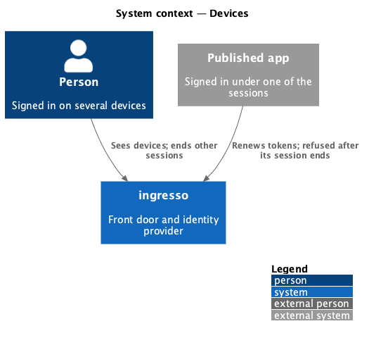
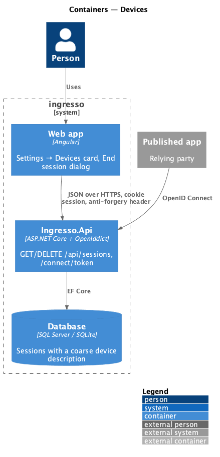
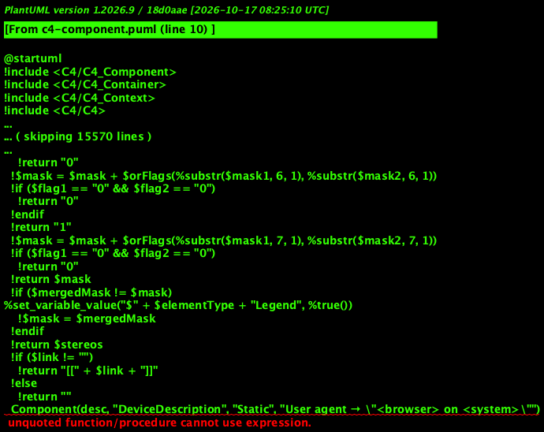
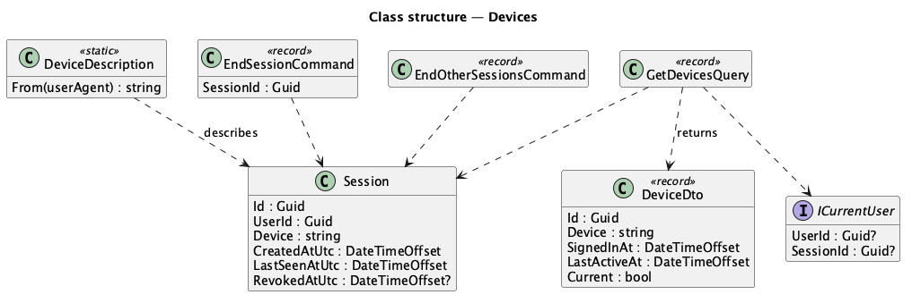
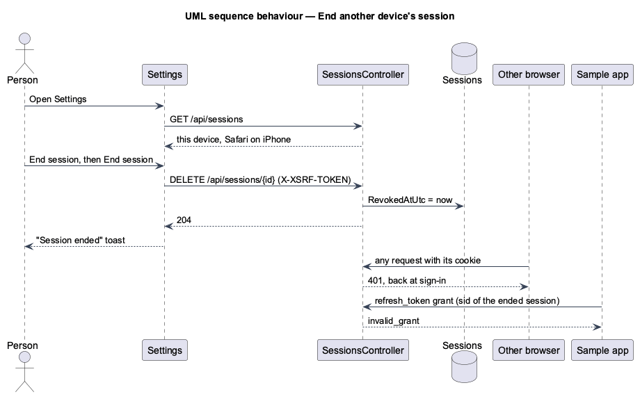

# Devices

## Overview

In **Settings → Devices**, a person sees each device signed in to ingresso as "<browser> on <system>", when it was
last active and when it signed in, with this device marked. **End session** on another device, or **Sign out of
all other devices**, asks first, then ends those sessions. The apps signed in under them can no longer renew
their tokens.

**device** — one active session of the signed-in person, described coarsely
([ADR 0020](../../../adr/0020-coarse-device-description.md))

## Description

- **Domain** — `Session.Device`: "<browser> on <system>", at most 100 characters, empty for sessions started
  before journey 25.
- **Application**:
  - `DeviceDescription.From(userAgent)` (`Identity/DeviceDescription.cs`) maps a user agent to the coarse
    description; nothing else from the header is kept (L2-132, L2-038).
  - `RedeemSignInLinkCommand` and the test seam's `StartSessionCommand` take the user agent and store the
    description on the new session.
  - `GetDevicesQuery` returns the signed-in person's active sessions as `DeviceDto(Id, Device, SignedInAt,
    LastActiveAt, Current)`, most recently active first (L2-132).
  - `EndSessionCommand(sessionId)` revokes one of the person's other active sessions; anything else (someone
    else's, ended, or this device's) is `NotFoundException` (404) (L2-133).
  - `EndOtherSessionsCommand` revokes every other active session of the person and returns how many (L2-134).
  - `ICurrentUser` gains `SessionId`, read from the cookie's `sid` claim.
- **Last activity** — `TouchSessionCommand` already moves `LastSeenAtUtc` at most every 5 minutes, so there's no
  write on every request (L2-132).
- **API** — `SessionsController` (`[Authorize]`, `api/sessions`): `GET` lists; `DELETE {id:guid}` and
  `DELETE others` answer 204. The anti-forgery middleware refuses them without the token (L2-034).
- **Signed out elsewhere** — the ended device's next request fails session validation, so it gets 401 and the web
  app returns to sign-in (L2-030, L2-031).
- **App tokens** — a refresh token carries its session's `sid`, and the token endpoint refuses a refresh whose
  session has ended (journey 20), so the apps signed in there can't renew (L2-135).
- **Web app**:
  - `SESSIONS_API` (`projects/api/src/lib/sessions`): `list()`, `end(id)` and `endOthers()`.
  - `DevicesCard` (`pages/settings/devices-card.ts`): `Card`, `List`, `ListItem`, `Badge` (This device), `Button`
    (End session; Sign out of all other devices in `[slot=actions]`), `Skeleton` and `Alert`. Dates use
    `relative-time`.
  - `EndSessionDialog` (`dialogs/end-session`): `DialogShell`, `Alert` and a danger `Button`, for one device or all
    the others. It closes with `true` after ending.
  - `SettingsPage` shows the card for everyone, after Connected apps, and the toasts "Session ended" and "Signed
    out of other devices".

## Requirements

The feature realizes the following level-2 (L2) requirements. Each L2 requirement refines a level-1 (L1) requirement, cited by identifier.

| L2 ID | Refines (L1) | Requirement |
|-------|--------------|-------------|
| `L2-132` | `L1-007`, `L1-008` | Settings shall list the person's own active sessions with a coarse device description and last activity. |
| `L2-133` | `L1-007`, `L1-008` | A person shall end the session on another of their devices, after confirming. |
| `L2-134` | `L1-007`, `L1-008` | A person shall end every session except this one, after confirming. |
| `L2-135` | `L1-012`, `L1-008` | Ending a session shall stop its apps from renewing their tokens. |

It builds on `L2-030` and `L2-031` (sessions and sign-out), `L2-032` (private data), `L2-034` (CSRF) and `L2-038`
(privacy).

## Diagrams

### System context

### Containers

### Components

### Class structure

### Behaviour — end another device's session

## Open questions

- **Front-channel sign-out of the ended device's apps** needs that device's browser, so it isn't sent; the apps
  find out when they next try to renew.
- **Notifying a person when a new device signs in** is deferred.
