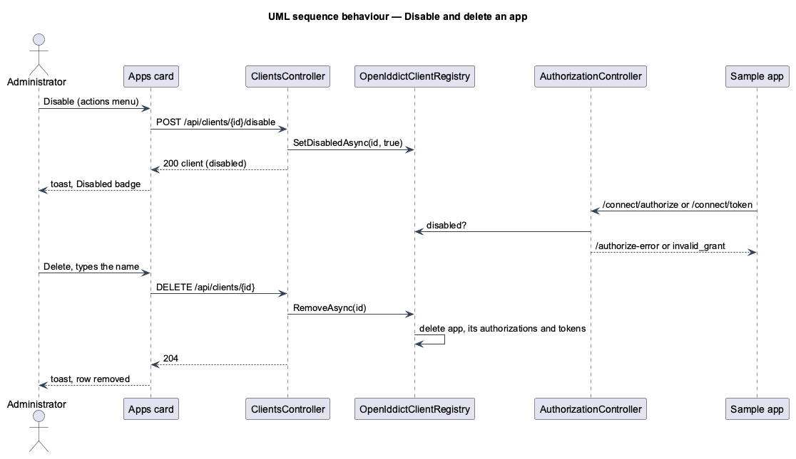

# Manage clients in Settings

## Overview

An administrator registers the apps that sign in with ingresso from **Settings → Apps** instead of the CLI. The
Apps card lists the registered apps. **Register an app** opens a dialog for the name, addresses, the APIs the app
may call and its type. A **public** app (a browser or device app) must use PKCE. A **confidential** app (a server
app) also gets a client secret, which ingresso stores hashed and shows once, in a client secret dialog with copy
buttons. People who are not administrators see no Apps card, and the API refuses them.

Each app's actions menu edits the app, rotates a confidential app's secret, disables or enables it, or deletes it
after its name is typed (journey 21). A disabled app signs no one in and renews no tokens. Deleting an app removes
every token it holds. A toast confirms each change.

**administrator** — an account whose role is `Admin`, granted only by `users grant-admin` (ADR 0016)

**confidential client** — an OpenID Connect client that authenticates to the token endpoint with a secret

The CLI `clients` commands keep working and use the same Application handlers.

## Description

- **Role** — `User.Role` (`Member`, `Admin`) already exists, and `/api/auth/me` returns it.
  - `GrantAdministratorCommand(Email)` (`Ingresso.Application/Identity`) makes the account an administrator.
    It returns whether it already was one, and throws `NotFoundException` for an unknown email.
  - CLI: `users grant-admin --email <address>` (`UserCommands`).
- **Policy** — `AuthPolicies.Administrator` with `AdministratorRequirement` and `AdministratorHandler`
  (`Ingresso.Api/Auth`). The handler reads the signed-in account's role from the database by its id on each
  request, so a grant applies without signing in again (ADR 0016).
- **Clients API** (`ClientsController`, `[Authorize(Policy = Administrator)]`):
  - `GET /api/clients` returns the registered apps, sorted by name (`GetClientsQuery`, as `clients list` uses).
  - `POST /api/clients` takes `{ name, redirectUris, postLogoutRedirectUris, frontChannelLogoutUri, scopes,
    confidential }`. It returns `201 { client, clientSecret }`, where `clientSecret` is null for a public app.
    Validation problems are `400` with field errors, a duplicate name is `409`, and an unknown scope is `404`.
  - `GET /api/resources` (`ResourcesController`, same policy) returns the registered APIs and their scopes, for
    the dialog's checkboxes.
- **Registration** — `RegisterClientCommand` gains `Confidential`. For a confidential app the handler generates
  32 random bytes (`RandomNumberGenerator`), base64url-encoded, and passes them as `NewClient.ClientSecret`. It
  returns `RegisteredClientDto(ClientDto Client, string? ClientSecret)`.
  - `OpenIddictClientRegistry` creates the application with `ClientType = confidential` and the secret.
    OpenIddict stores only a hash of it.
  - `ClientDto` gains `Confidential`, read from the client type.
  - The validator's messages no longer name CLI options, so the CLI and the dialog show the same words.
- **Web app** (`projects/api`):
  - The `ClientsApi` contract, the `CLIENTS_API` token and `HttpClientsApi` cover `list()`, `register(input)`
    and `resources()`.
- **Web app** (`projects/ingresso`):
  - `SettingsPage` shows `AppsCard` when the current user's role is `admin`.
  - `AppsCard` (`pages/settings/apps-card.ts`) loads the list, with loading, empty, error and Try again states.
    Its Register an app button opens the dialog through `AppDialogs.openRegisterApp`.
  - `RegisterAppDialog` (`dialogs/register-app`) splits each textarea into addresses, one per line. It maps
    `400` field errors to its fields (`Name`, `RedirectUris…`, `PostLogoutRedirectUris…`,
    `FrontChannelLogoutUri`) and `409` to the name field, and shows an error alert for anything else.
    - For a public app, it closes with the result. The card reloads and a toast names the app.
    - For a confidential app, it closes and `ClientSecretDialog` opens.
  - `ClientSecretDialog` (`dialogs/client-secret`) shows the client ID and secret in read-only inputs, each with
    a Copy button (CDK `Clipboard`). A polite status announces the copy. The secret lives only in the dialog's
    data and is gone when the dialog closes.
- **Changing an app** (journey 21) — Application commands, each throwing `NotFoundException` for an unknown
  client ID:
  - `UpdateClientCommand(ClientId, Name, RedirectUris, PostLogoutRedirectUris, Scopes, FrontChannelLogoutUri,
    OfflineAccess)` uses the same validator rules and conflict check as registering. The conflict check skips the
    app itself. The client type and secret never change here.
  - `RotateClientSecretCommand(ClientId)` throws `ValidationException` for a public app. It returns
    `RegisteredClientDto` with a new 32-byte secret, which replaces the stored hash.
  - `SetClientDisabledCommand(ClientId, Disabled)` returns the `ClientDto`.
  - `RemoveClientCommand` (journey 15) deletes. OpenIddict's application manager also deletes the app's
    authorizations and tokens.
  - `IClientRegistry` gains `UpdateAsync`, `ReplaceSecretAsync` and `SetDisabledAsync`. `ClientDto` and
    `NewClient` gain `Disabled` and `OfflineAccess`.
  - Disabled is the application property `ingresso_disabled`, because OpenIddict has no such field.
- **Disabled apps at the endpoints** — `AuthorizationController.Authorize` sends a disabled app's request to
  `/authorize-error`, the same page as for an unknown app. `Exchange` refuses a code or refresh token for a
  disabled app with `invalid_grant`. Nothing is revoked, so enabling the app restores refresh tokens that haven't
  expired.
- **Clients API** additions (same policy):
  - `PUT /api/clients/{clientId}` takes the registration body without `confidential` and returns `200` with the
    client. Its errors match `POST`: `400`, `409` and `404`.
  - `POST /api/clients/{clientId}/secret` returns `200 { client, clientSecret }`, or `400` for a public app.
  - `POST /api/clients/{clientId}/disable` and `…/enable` return `200` with the client.
  - `DELETE /api/clients/{clientId}` returns `204`.
- **Web app** additions:
  - `ClientsApi` gains `update`, `rotateSecret`, `disable`, `enable` and `remove`.
  - `AppsCard` gives each row a `more` actions `Menu` and a Disabled `Badge`. It emits `edit`, `rotateSecret` and
    `remove` for the page to open dialogs, and handles Disable and Enable itself with a toast.
  - `RegisterAppDialog` takes an optional app to edit. It then fills the form, shows the type as text, saves with
    `update` and closes with the saved app. Both modes offer "Let it stay signed in with refresh tokens".
  - `RotateSecretDialog` (`dialogs/rotate-secret`) confirms, rotates, and closes with the new secret. The page then
    opens `ClientSecretDialog` in its `rotated` wording.
  - `DeleteClientDialog` (`dialogs/delete-client`) enables Delete app only when the typed name matches, then
    deletes.
- **Test seam** — `POST /api/test/sign-in` accepts `administrator: true`, so Playwright can act as an
  administrator.

## Behaviour as built

- Secrets never reach logs: request logging records method, path and status only (L2-038), and responses are
  not logged.
- A confidential app still uses PKCE; the secret is an extra check at the token endpoint. A missing or wrong secret
  gets `401 invalid_client` (RFC 6749 section 5.2) and no tokens.
- Validation is the server's: the dialog sends what was typed and shows the API's messages, so the CLI and the
  dialog always agree. A name in use (`409`) is shown on the name field.
- Settings → Apps reloads the list after each registration; a confidential app's list reload waits until the
  client secret dialog closes.
- The list shows the type and client ID. The edit dialog shows the addresses and scopes.
- The effect of each change on tokens that are already issued:

  | Change | Access and ID tokens | Refresh tokens |
  |---|---|---|
  | Edit | keep working until they expire | keep working |
  | Rotate secret | keep working | renewals need the new secret |
  | Disable | keep working until they expire (L2-097) | refused while disabled; work again when enabled |
  | Delete | keep working until they expire (L2-097) | removed, so refused |

## Requirements

The feature realizes the following level-2 (L2) requirements. Each L2 requirement refines a level-1 (L1) requirement, cited by identifier.

| L2 ID | Refines (L1) | Requirement |
|-------|--------------|-------------|
| `L2-103` | `L1-012`, `L1-008` | ingresso shall have administrators, and only the CLI shall make someone one. |
| `L2-104` | `L1-012`, `L1-008` | An administrator shall see the registered apps in Settings → Apps, and no one else shall. |
| `L2-105` | `L1-012` | An administrator shall register an app from a dialog, with the same rules as the CLI. |
| `L2-106` | `L1-012`, `L1-008` | An administrator shall register a confidential app, whose secret is stored hashed and shown once. |
| `L2-112` | `L1-012` | An administrator shall edit a registered app with the same rules as registering it. |
| `L2-113` | `L1-012`, `L1-008` | An administrator shall rotate a confidential app's secret. |
| `L2-114` | `L1-012`, `L1-008` | An administrator shall disable an app so it signs no one in, and enable it again. |
| `L2-115` | `L1-012`, `L1-008` | An administrator shall delete an app after confirming its name; its tokens stop working. |
| `L2-116` | `L1-012`, `L1-008` | The changes shall be API endpoints only administrators can call. |

It builds on `L2-087` and `L2-088` (registered apps and address rules), `L2-096` (scopes), `L2-099`
(front-channel address), `L2-033` (authentication) and `L2-038` (no secrets in logs).

## Diagrams

### System context

The administrator registers apps in ingresso. The apps later sign people in with it.

### Containers

The web app calls the clients API. The CLI grants the administrator role directly against the database.

### Components

### Class structure

### Behaviour — register a confidential app

### Behaviour — disable and delete an app

## Open questions

- **Removing an administrator** is a database change until a `users revoke-admin` command is needed.
- **An audit trail** of who changed which app is journey 27.
- **Access tokens outlive a disable or a delete** by up to their 10-minute lifetime, because APIs validate them
  locally (L2-097).
