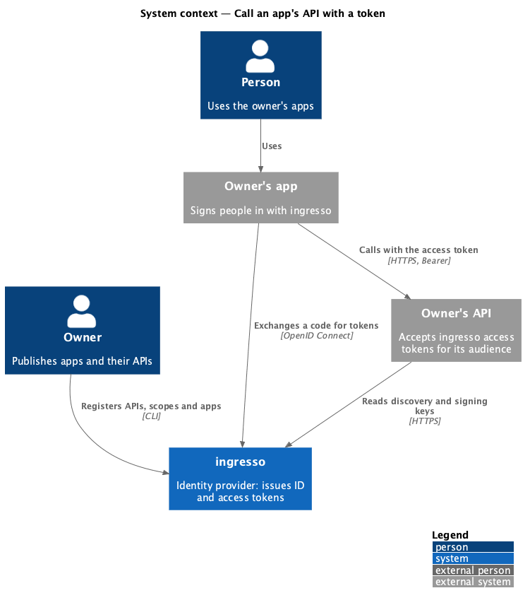
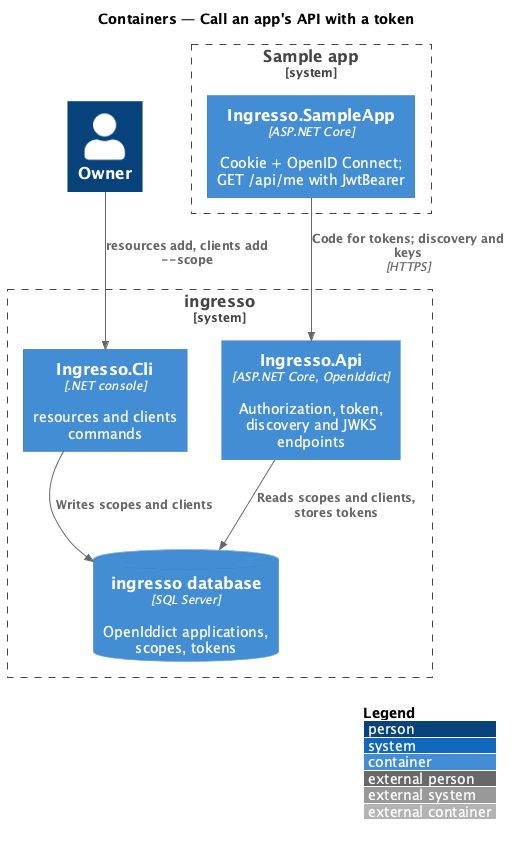
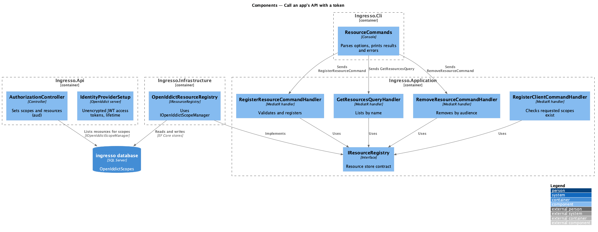
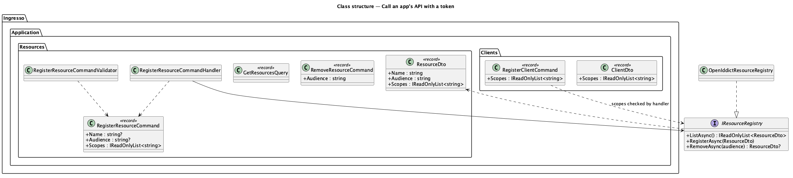
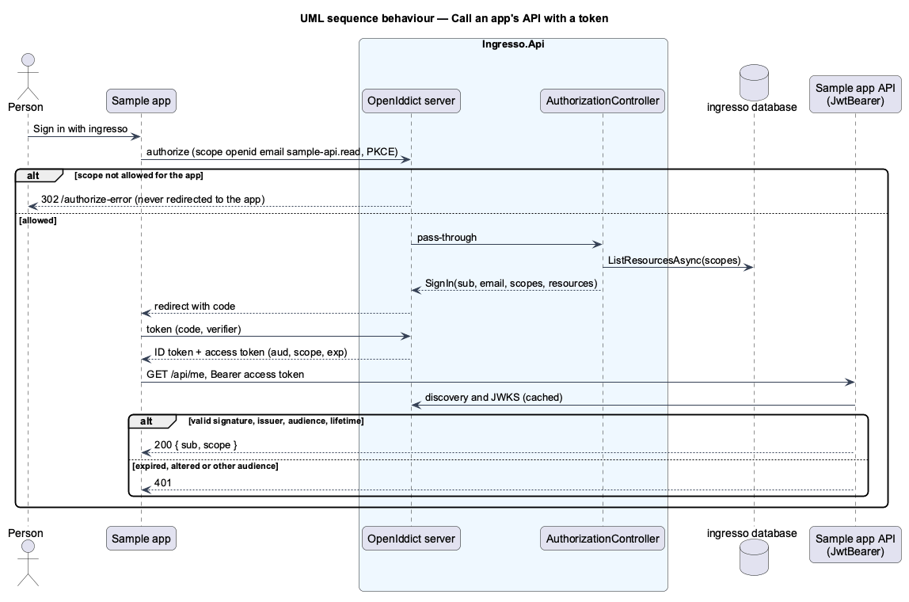

# Call an app's API with a token

## Overview

An app signed in through ingresso (journey 16) calls its own API with an access token. The owner registers
each API and its scopes from the CLI, and allows an app those scopes when registering it. The token endpoint
then issues an access token for the API, and the API checks it locally against ingresso's discovery document.

**resource** — an API the owner publishes, identified by its **audience** (the `aud` its tokens carry), with
one or more **scopes** apps may ask for to call it

**access token** — a signed JSON Web Token that names the person (`sub`), the API (`aud`), the granted scopes
(`scope`) and when it expires (`exp`)

OpenIddict is the OpenID Connect server ([ADR 0014](../../../adr/0014-openiddict-is-the-openid-connect-server.md)).
ingresso's own API is unchanged: it keeps the cookie session and does not accept bearer tokens.

## Description

- **`ResourceCommands`** (`Ingresso.Cli`) — parses `resources add | list | remove`, sends the MediatR request,
  and prints the result or one line per problem. `CliApp` delegates `resources` to it.
- **`RegisterResourceCommand`** (`Ingresso.Application/Resources`) — name, audience, scopes.
  `RegisterResourceCommandValidator`: name 1–100 characters; audience and scopes 1–100 characters with no
  spaces; at least one scope; no reserved scope (`openid`, `email`, `profile`, `offline_access`). The handler
  refuses an audience or a scope already registered (`ConflictException`).
- **`GetResourcesQuery`** and **`RemoveResourceCommand`** — list ordered by name; remove by audience
  (`NotFoundException` when unknown).
- **`IResourceRegistry`** (`Ingresso.Application/Common/Interfaces`) and **`OpenIddictResourceRegistry`**
  (`Ingresso.Infrastructure/Identity`) — each scope is an OpenIddict scope entry whose display name is the
  API's name and whose only resource is its audience. Listing groups scope entries by audience.
- **`clients add --scope`** — `RegisterClientCommand` takes scopes; the handler refuses a scope no API has
  (`No API has scope '<scope>'.`). `OpenIddictClientRegistry` adds a `scp:<scope>` permission for each, and
  `ClientDto` lists them, so `clients list` prints `Scope: <scope>`.
- **`IdentityProviderSetup`** — access tokens are not encrypted (`DisableAccessTokenEncryption`), so any API
  can validate them with the published keys. Their lifetime is `IdentityProvider:AccessTokenLifetime`
  (a `TimeSpan`), 10 minutes by default. OpenIddict checks requested scopes against the scope store and the
  client's `scp:` permissions. It checks permissions before it accepts the redirect address, so a scope the app
  may not use is refused without a redirect, and the person sees `/authorize-error`, as for an unknown app.
- **`AuthorizationController`** — after setting the granted scopes, sets the identity's resources from
  `IOpenIddictScopeManager.ListResourcesAsync`, so the access token's `aud` is the audience of each API whose
  scopes were granted.
- **Sample app** (`backend/samples/Ingresso.SampleApp`) — the reference for an app's API:
  - `GET /api/me` requires a bearer token. `AddJwtBearer` has `Authority` = ingresso and `Audience` =
    `SampleApp:Audience` (`ingresso-sample-api`), so it reads the issuer and keys from discovery.
  - The OpenID Connect handler asks for `sample-api.read` and saves the tokens in the cookie. The home page
    calls `/api/me` with the saved access token and shows the answer.
  - `seed` registers the resource Sample API (`ingresso-sample-api`, scope `sample-api.read`) and allows the
    sample client that scope, when `SampleApp:BaseUrl` is configured.

### Validating tokens in an app's API

```csharp
builder.Services.AddAuthentication()
    .AddJwtBearer(options =>
    {
        options.Authority = "https://ingresso.dev";   // reads /.well-known/openid-configuration and the keys
        options.Audience = "ingresso-sample-api";      // tokens for any other API are refused
        options.MapInboundClaims = false;              // keep sub, scope and email as issued
    });
```

`AddJwtBearer` checks the signature against the JWKS, the issuer, the audience and the lifetime (with its
default 5-minute clock skew). No call to ingresso is made per request.

### CLI usage and output

This is the design reference for the journey in place of an HTML mock.

```text
$ ingresso resources add --name "Sample API" --audience ingresso-sample-api --scope sample-api.read
Registered Sample API.
Audience: ingresso-sample-api
Scope: sample-api.read

$ ingresso resources list
Sample API
  Audience: ingresso-sample-api
  Scope: sample-api.read

$ ingresso clients add --name "Sample app" --redirect-uri http://localhost:5201/signin-oidc --scope sample-api.read
Registered Sample app.
Client ID: 0f6d3c1a8e2b4f7a9c5d1e3b7a2f4c60

$ ingresso clients add --name "Notes" --redirect-uri http://localhost:5300/signin-oidc --scope notes.write
No API has scope 'notes.write'.

$ ingresso resources remove --audience ingresso-sample-api
Removed Sample API.
```

| Situation | Output | Exit |
|---|---|---|
| Registered | `Registered <name>.`, `Audience: <audience>` and one `Scope: <scope>` per scope | 0 |
| Invalid name, audience or scope | One line per problem | 1 |
| Audience taken | `An API with audience '<audience>' is already registered.` | 1 |
| Scope taken | `The scope '<scope>' is already registered.` | 1 |
| No APIs | `No APIs are registered.` | 0 |
| Removed | `Removed <name>.` | 0 |
| Unknown audience | `No API has audience '<audience>'.` | 1 |
| Missing or unknown option | The `resources` usage line | 1 |

## Behaviour as built

- An access token's `aud` holds every API whose scopes were granted; an app asking for no API scope gets an
  access token with no audience, which no API accepts.
- Removing an API leaves `scp:` permissions on apps that had its scopes. A request for such a scope gets
  `invalid_scope`, as the scope no longer exists.
- Tokens are never logged (L2-038). OpenIddict stores token entries by reference ID only.

## Requirements

The feature realizes the following level-2 (L2) requirements. Each L2 requirement refines a level-1 (L1) requirement, cited by identifier.

| L2 ID | Refines (L1) | Requirement |
|-------|--------------|-------------|
| `L2-095` | `L1-012` | The CLI shall register an API with the scopes apps may ask for to call it. |
| `L2-096` | `L1-012`, `L1-008` | An app shall get access tokens only for the API scopes it is allowed. |
| `L2-097` | `L1-012` | The token endpoint shall issue an access token for the APIs whose scopes were granted. |
| `L2-098` | `L1-012`, `L1-008` | An API validating against discovery shall accept only valid tokens issued for it. |

It builds on `L2-087` to `L2-090` (registered apps) and `L2-091` to `L2-094` (sign in to an app).

## Diagrams

### System context

The app's API trusts ingresso's keys; the person never sees a token.



### Containers

The CLI registers APIs; the API issues tokens; the app's API reads ingresso's discovery document and keys.



### Components

`ResourceCommands` sends MediatR requests; the handlers use `IResourceRegistry`, which OpenIddict implements.



### Class structure



### Behaviour — call an app's API

The app exchanges its code for an access token, then calls its API, which validates the token locally.



## Open questions

- **No introspection.** APIs validate JWTs locally; a token stays valid until it expires, which is why the
  lifetime is short. Revoking access is journey 24, refresh tokens journey 20.
- **The authorize error page names the app or its address.** Its copy ("doesn’t recognise it or the address
  it gave") also covers a scope the app isn't allowed. That is a misconfiguration the owner fixes with
  `clients add --scope`; separate copy for it is deferred.
- **Scopes are global.** A scope belongs to one API, so two APIs cannot both define `read`. Owners prefix
  scopes with the API's name.
