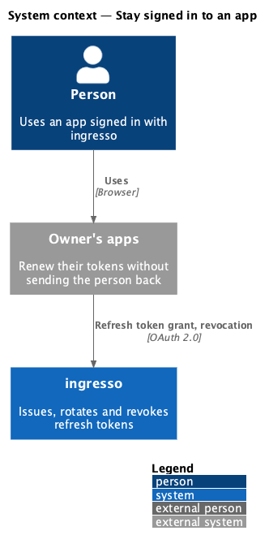
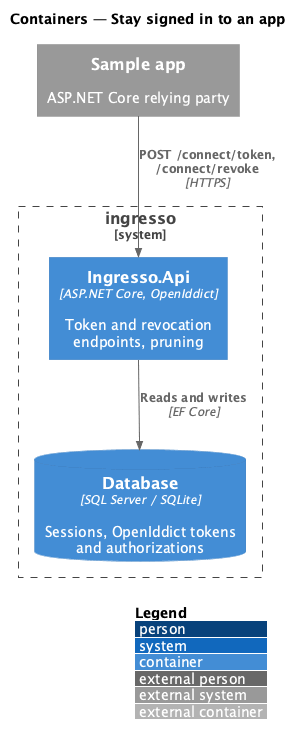
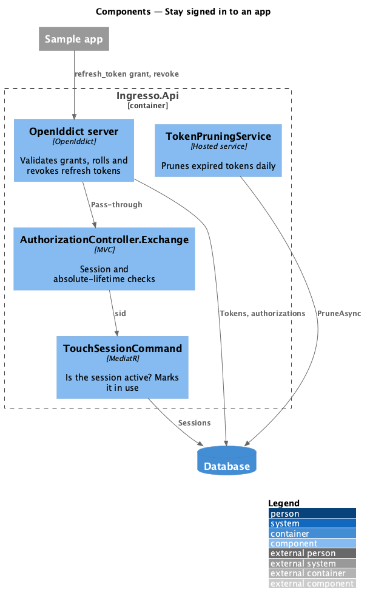
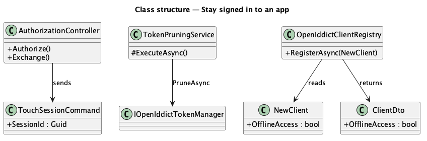
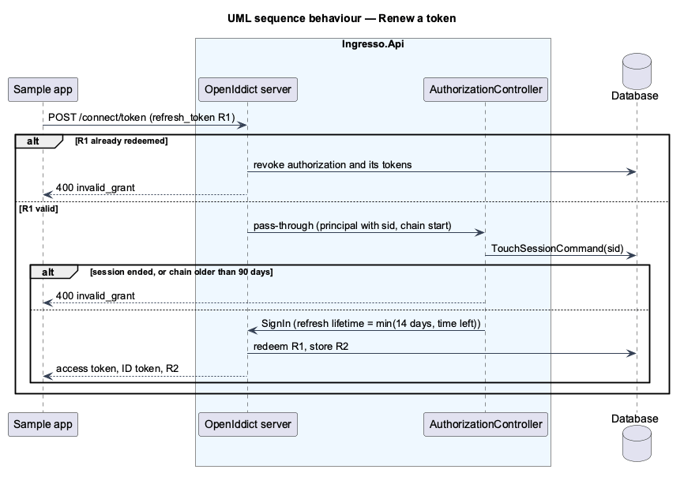

# Stay signed in to an app (refresh tokens)

## Overview

Access tokens last 10 minutes (journey 17). An app allowed offline access asks for the `offline_access` scope
and gets a refresh token with its first tokens. It renews its tokens with that refresh token, without sending
the person back to ingresso. Each refresh token works once. Reusing one revokes every token from the same
sign-in. Refresh tokens expire after 14 days without renewal and 90 days after the sign-in. They also stop
when the ingresso session they came from ends, and an app can revoke them at `/connect/revoke`.

**chain** — the refresh tokens descended from one sign-in to an app, linked in OpenIddict by one authorization

**sliding lifetime** — how long a refresh token lasts after it is issued; renewing starts it again

**absolute lifetime** — how long a chain lasts after its sign-in, however often it renews

## Description

- **Token storage** — OpenIddict's EF Core stores already hold every token and authorization (ADR 0014).
  - An authorization code exchange creates an ad-hoc authorization, which links all the chain's tokens.
  - Refresh tokens roll: each renewal redeems the token it was given and issues a new one (OpenIddict's default).
  - The reuse leeway is zero (`SetRefreshTokenReuseLeeway(TimeSpan.Zero)`). A redeemed token presented again
    makes OpenIddict revoke the authorization and all its tokens, and answer `invalid_grant` (L2-108).
- **`IdentityProviderSetup`** —
  - Allows the refresh token flow, registers `offline_access`, and sets the revocation endpoint
    `connect/revoke`.
  - Sets the sliding lifetime from `IdentityProvider:RefreshTokenSlidingLifetime` (14 days by default).
  - Enables pass-through for the token endpoint, so `AuthorizationController.Exchange` runs after OpenIddict has
    validated the grant.
- **Client permissions** — `NewClient.OfflineAccess` adds `Permissions.GrantTypes.RefreshToken`.
  - OpenIddict refuses `offline_access` from an app without that permission, so no code is issued (L2-107).
  - Every app may use the revocation endpoint.
  - `ClientDto.OfflineAccess` reports the setting.
  - The CLI has `clients add --offline-access`, and `/api/clients` takes `offlineAccess`.
  - The seeded sample app is allowed offline access.
  - The Settings dialog doesn't offer it yet; that comes with editing apps (journey 21).
- **The link to the session** — `Authorize` puts two claims on the principal:
  - `sid`, the ingresso session;
  - `ingresso_chain_started`, the sign-in instant from `IClock`.

  Neither has a destination, so they stay inside the code and refresh tokens and never appear in an access
  token. The ID token keeps its `sid` (journey 18).
- **`AuthorizationController.Exchange`** (`POST /connect/token`, pass-through):
  - **Authorization code** — signs in the validated principal unchanged.
  - **Refresh token:**
    1. `TouchSessionCommand(sid)` returns false when the session has been signed out or has expired. The grant
       is then forbidden with `invalid_grant` (L2-110). Otherwise the session counts as in use.
    2. If `ingresso_chain_started` plus `IdentityProvider:RefreshTokenAbsoluteLifetime` (90 days) has passed,
       the grant is forbidden with `invalid_grant` (L2-109).
    3. Otherwise the new refresh token's lifetime is the sliding lifetime or the time left in the chain,
       whichever is shorter. The principal is then signed in again with its claims and destinations.
- **Revocation** — handled by OpenIddict. A known refresh token for the calling app is revoked. Unknown tokens
  still get 200 (RFC 7009, L2-111).
- **Pruning** — `TokenPruningService` (`Ingresso.Api`, a hosted service) calls `IOpenIddictTokenManager.PruneAsync`
  and `IOpenIddictAuthorizationManager.PruneAsync` once a day. They remove tokens and authorizations that are
  expired or revoked and more than a day old. It is off in tests (`IdentityProvider:Pruning:Enabled`).
- **Sample app** — asks for `offline_access` and stores the tokens in its cookie (`SaveTokens`).
  - Before calling its API it reads `expires_at`. When the token has expired, it posts the refresh token to the
    token endpoint and stores the new tokens in its cookie.
  - The page shows how many times it renewed (`data-token-renewals`).
  - A refused renewal signs the person out of the app, and the page says to sign in again.
  - Its API validates tokens with no clock skew, so an expired token is really refused.

## Behaviour as built

- Access tokens that are already issued stay valid until they expire. They are self-contained JWTs (L2-097), so
  ending the session stops renewals, not tokens already in an app's hands.
- Revoking an access token at `/connect/revoke` changes nothing an API sees, for the same reason.
- Playwright runs the API with a 5-second access token lifetime (`IdentityProvider__AccessTokenLifetime`), so the
  sample app's renewal can be seen in a test.

## Requirements

The feature realizes the following level-2 (L2) requirements. Each L2 requirement refines a level-1 (L1) requirement, cited by identifier.

| L2 ID | Refines (L1) | Requirement |
|-------|--------------|-------------|
| `L2-107` | `L1-012` | An app allowed offline access shall renew its tokens with a refresh token. |
| `L2-108` | `L1-012`, `L1-008` | Each refresh token shall work once; reuse stops the chain. |
| `L2-109` | `L1-012`, `L1-008` | Refresh tokens shall have a sliding and an absolute lifetime, both configurable. |
| `L2-110` | `L1-012`, `L1-007`, `L1-008` | A refresh token shall stop working when its session ends. |
| `L2-111` | `L1-012`, `L1-008` | An app shall revoke its refresh token. |

It builds on `L2-030` and `L2-031` (sessions and signing out), `L2-087` (registered apps), `L2-092` (codes),
`L2-097` (access tokens) and `L2-101` (signing out of apps).

## Diagrams

### System context

### Containers

### Components

### Class structure

### Behaviour — renew, reuse and an ended session

## Open questions

- **Signing out does not revoke tokens in the database.** The session check at renewal refuses them. Pruning
  removes them when they expire. Revoking them eagerly would add a query per sign-out for no change in
  behaviour.
- **Settings can't allow offline access yet.** Journey 21 adds editing apps, which is where the switch belongs.
