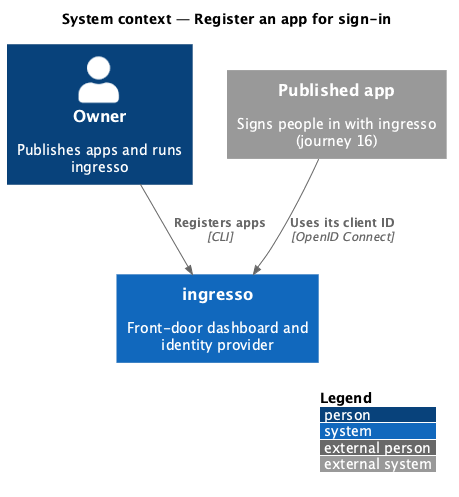
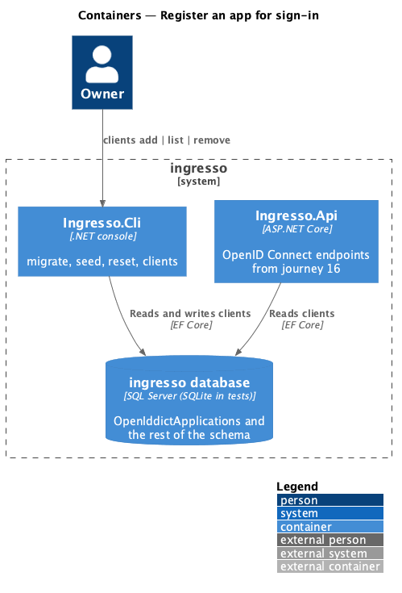
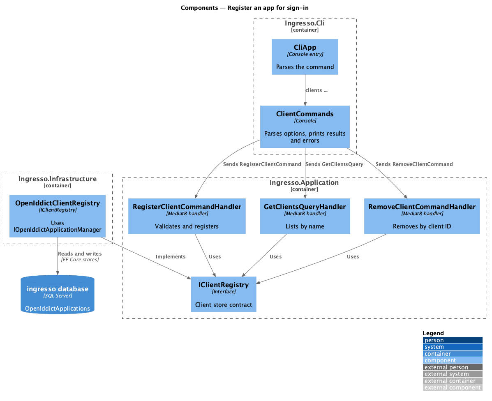
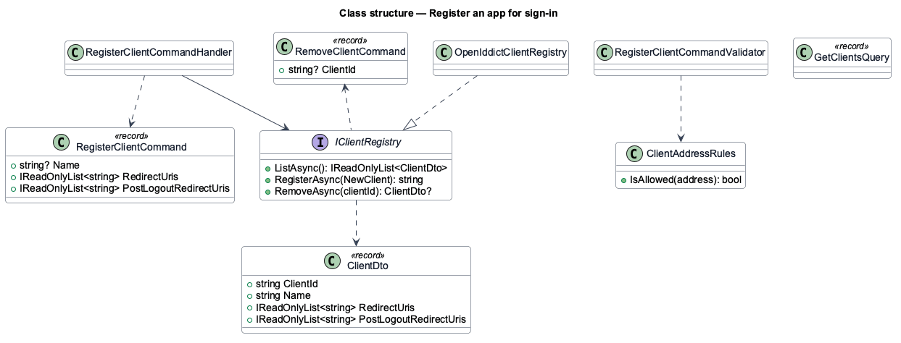
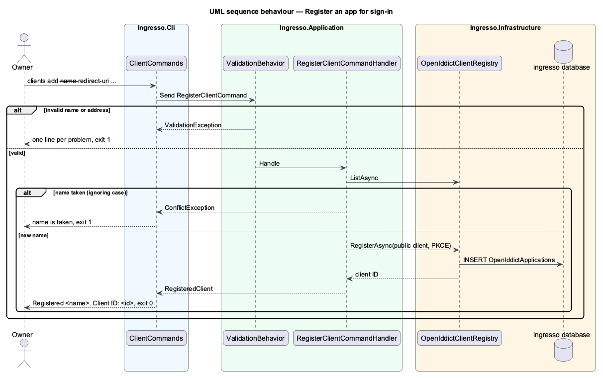

# Register an app for sign-in

## Overview

The owner registers each app they publish as an OpenID Connect client, so it can sign people in with ingresso
(journey 16). Registration is a CLI command; the dashboard gets its own screen in journey 19.

**client** — an app registered with ingresso, identified by a generated client ID, with the exact addresses
ingresso may send people back to after sign-in (redirect addresses) and after sign-out (sign-out return
addresses)

OpenIddict is the OpenID Connect server and stores clients in `AppDbContext` ([ADR 0014](../../../adr/0014-openiddict-is-the-openid-connect-server.md)).
Every client registered here is a **public** client that must use **PKCE**; it holds no secret.

## Description

The slice runs from the CLI to the ingresso database. It adds no HTTP endpoint.

- **`ClientCommands`** (`Ingresso.Cli`) — parses `clients add | list | remove`, sends the matching MediatR
  request, and prints the result or one line per problem.
- **`RegisterClientCommand`** (`Ingresso.Application/Clients`) — name, redirect addresses, sign-out return
  addresses. `RegisterClientCommandValidator` applies the address rules; the handler refuses a name already
  registered, ignoring case (`ConflictException`).
- **`GetClientsQuery`** and **`RemoveClientCommand`** — list ordered by name; remove by client ID
  (`NotFoundException` when unknown).
- **`IClientRegistry`** (`Ingresso.Application/Common/Interfaces`) — the client store contract, so the
  Application layer never references OpenIddict.
- **`OpenIddictClientRegistry`** (`Ingresso.Infrastructure/Identity`) — implements it with
  `IOpenIddictApplicationManager`: client type `public`, consent type `implicit` (journey 23 adds consent),
  permissions for the authorization, token and (with sign-out addresses) end-session endpoints, the
  authorization-code grant and the `code` response type, and the PKCE requirement.
- **`AppDbContext`** — `modelBuilder.UseOpenIddict()` maps the OpenIddict entities; migration
  `AddOpenIddict` creates their tables.

### Address rules

An address must be absolute; use `https`, or `http` only for `localhost`, `127.0.0.1` or `[::1]`; and have no
fragment and no `*`. At least one redirect address is required. Names are 1–100 characters and unique,
ignoring case. Matching at sign-in is exact (journey 16), so no normalisation is applied beyond trimming.

### CLI usage and output

This is the design reference for the journey in place of an HTML mock.

```text
$ ingresso clients add --name "Sample app" \
    --redirect-uri https://localhost:5201/signin-oidc \
    --post-logout-redirect-uri https://localhost:5201/signout-callback-oidc
Registered Sample app.
Client ID: 6f1c2a9e4b7d4e0c9a3f5b8d2e1c7a40

$ ingresso clients list
Sample app
  Client ID: 6f1c2a9e4b7d4e0c9a3f5b8d2e1c7a40
  Redirect: https://localhost:5201/signin-oidc
  Sign-out return: https://localhost:5201/signout-callback-oidc

$ ingresso clients add --name "Notes" --redirect-uri http://notes.example.com/callback
The address 'http://notes.example.com/callback' must use https (http is allowed only for localhost).

$ ingresso clients remove --client-id 6f1c2a9e4b7d4e0c9a3f5b8d2e1c7a40
Removed Sample app.
```

| Situation | Output | Exit |
|---|---|---|
| Registered | `Registered <name>.` and `Client ID: <id>` | 0 |
| Invalid name or address | One line per problem, naming the address | 1 |
| Name taken | `An app named '<name>' is already registered.` | 1 |
| No apps | `No apps are registered.` | 0 |
| Removed | `Removed <name>.` | 0 |
| Unknown client ID | `No app has client ID '<id>'.` | 1 |
| Missing or unknown option | The `clients` usage line | 1 |

## Behaviour as built

- `clients add` generates a 32-character hexadecimal client ID and prints it with the name.
- `--redirect-uri` and `--post-logout-redirect-uri` repeat; duplicates are stored once.
- `seed` and `reset` leave registered clients alone, apart from `reset` deleting the database.
- `migrate` creates the `OpenIddictApplications`, `OpenIddictAuthorizations`, `OpenIddictScopes` and
  `OpenIddictTokens` tables on SQL Server and SQLite.

## Requirements

The feature realizes the following level-2 (L2) requirements. Each L2 requirement refines a level-1 (L1) requirement, cited by identifier.

| L2 ID | Refines (L1) | Requirement |
|-------|--------------|-------------|
| `L2-087` | `L1-012` | The CLI shall register an app as a public client that signs in with PKCE. |
| `L2-088` | `L1-012`, `L1-008` | A client's redirect and sign-out return addresses shall be exact, absolute and safe. |
| `L2-089` | `L1-012` | The CLI shall list registered apps and remove one by client ID. |
| `L2-090` | `L1-012`, `L1-011` | App registrations shall be stored through the OpenID Connect server's stores and kept by the maintenance commands. |

It builds on `L2-049` (CLI migrate, seed and reset).

## Diagrams

### System context

The owner registers apps with ingresso; each app later signs people in with its client ID.



### Containers

`Ingresso.Cli` writes clients to the database; `Ingresso.Api` reads them from journey 16 on.



### Components

`ClientCommands` sends MediatR requests; the handlers use `IClientRegistry`, which OpenIddict implements.



### Class structure

The commands, the address rules and the client store contract.



### Behaviour — register an app

Validation runs first, then the uniqueness check, then OpenIddict stores the public PKCE client.



## Open questions

- Client IDs are random, not derived from the name, so renaming an app (journey 21) never changes them.
