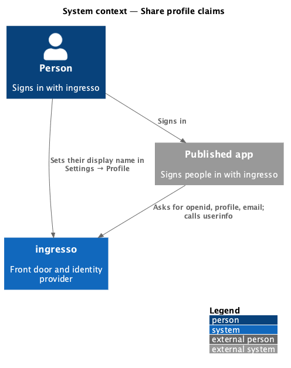
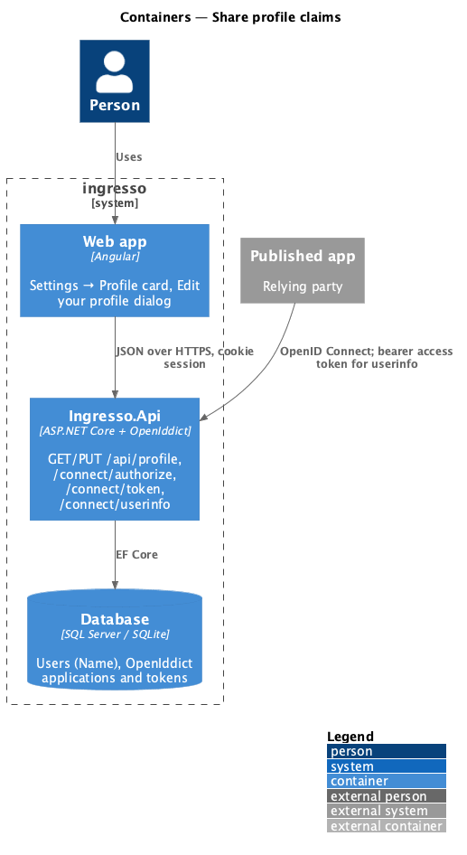
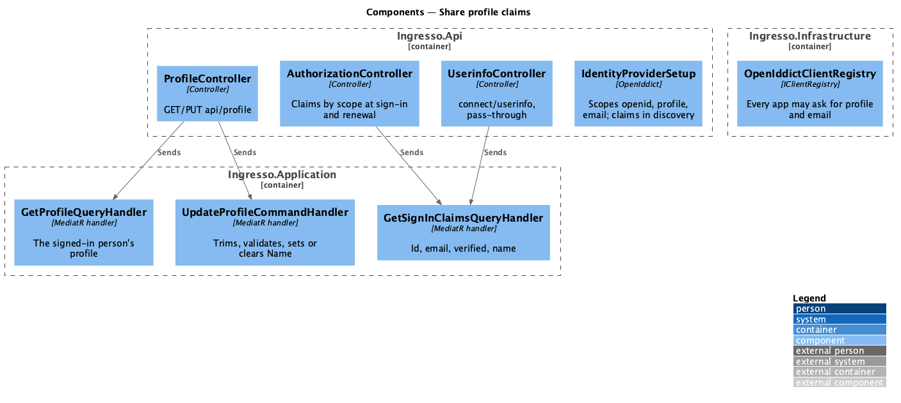
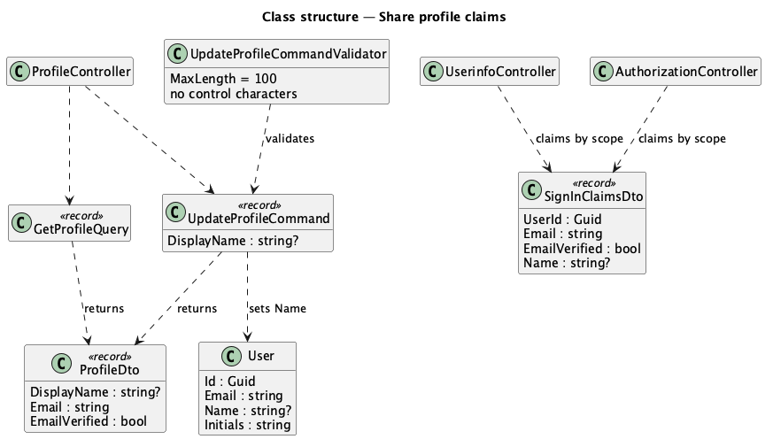
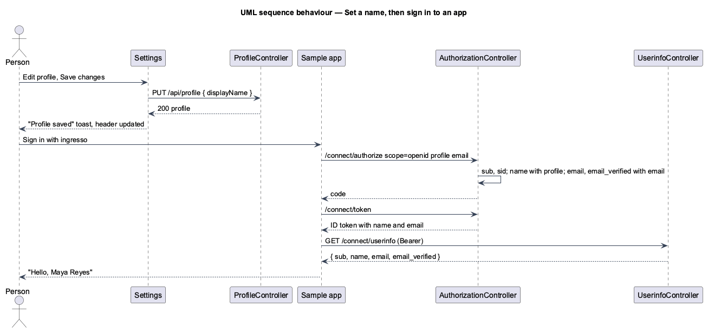

# Share profile claims

## Overview

People set their display name in **Settings → Profile**. Apps then receive what their scopes allow. With
`profile` they get the display name as `name`. With `email` they get `email` and `email_verified`. With neither
they get only the subject id, `sub`. These claims come in the ID token and from the OpenID Connect userinfo
endpoint.

**display name** — the optional name a person chooses, shown in the dashboard greeting and header initials and sent to
apps as `name`

**identity scope** — `openid`, `profile` or `email`. Any registered app may ask for one, unlike API scopes
(journey 17), which an app must be allowed.

The profile is shown in a card and edited in a dialog ([ADR 0017](../../../adr/0017-profile-is-edited-in-a-dialog.md)).

## Description

- **Account** — `User.Name` already exists: nullable, `nvarchar(120)`, used for the dashboard greeting and initials. This
  design adds no column and no migration. The 100-character rule is enforced by validation, under the column's
  limit.
- **Profile API** (`ProfileController`, `[Authorize]`, the signed-in person only):
  - `GET /api/profile` returns `{ displayName, email, emailVerified }`. `displayName` is null when it isn't set.
  - `PUT /api/profile` takes `{ displayName }` and returns the profile. It answers 400 with field errors and 401
    without a session.
  - `GetProfileQuery` and `UpdateProfileCommand` live in `Ingresso.Application/Identity/Profile.cs`, handled by
    `ProfileHandlers`. The validator trims the
    name, then checks it is at most 100 characters with no control characters (Unicode category `Cc`, which
    includes line breaks). Empty or whitespace clears the name (`null`).
- **Claims at sign-in** — `AuthorizationController.Authorize` adds claims by the granted scopes:
  - Always `sub`, plus `sid` in the ID token.
  - With `profile`, `name` when the person has a display name.
  - With `email`, `email` and `email_verified`. Authorization only reaches this point with a verified email, so
    `email_verified` is `true`.
  - Destinations: `name`, `email` and `email_verified` go to the ID token and the access token (APIs use them,
    journey 17). The chain start stays out of both (journey 20).
- **Claims on renewal** — the refresh grant reloads the account (`GetSignInClaimsQuery`) and replaces `name`,
  `email` and `email_verified` by the scopes the chain was granted, so a renamed person's next token has the new
  name (L2-119).
- **Scopes** — `IdentityProviderSetup` registers `openid`, `profile`, `email` and `offline_access`, and lists the
  claims `sub`, `name`, `email` and `email_verified` in discovery. `OpenIddictClientRegistry` gives every app
  `Permissions.Scopes.Profile` and `Permissions.Scopes.Email`, and hides both in the app's scope list as it
  already hides `email`. The CLI `seed` command grants both to apps registered before through
  `IClientRegistry.AllowIdentityScopesAsync`, idempotently; the API changes no data on startup.
- **Userinfo** — `connect/userinfo` with pass-through to `UserinfoController`, which is `[AllowAnonymous]` because
  the bearer access token, not the cookie, authenticates it. OpenIddict validates the access
  token and answers 401 with `WWW-Authenticate` when it is missing, invalid or expired. The controller loads the
  account and returns `sub`, plus `name` with `profile`, and `email` and `email_verified` with `email`.
- **Web app**:
  - `PROFILE_API` (`projects/api/src/lib/profile`): `get()` and `update(displayName)`.
  - `ProfileCard` (`pages/settings/profile-card.ts`): `Card`, `Button` (Edit profile), `List`, `ListItem`,
    `Skeleton` and `Alert`. It emits `edit` with the loaded profile.
  - `EditProfileDialog` (`dialogs/edit-profile`): `DialogShell`, `ErrorSummary`, `FormField`, `Input` and
    `Alert`. It closes with the saved profile.
  - On save, `SettingsPage` shows the "Profile saved" toast, shows the saved profile in the card and calls
    `SessionStore.refresh()`, so the header initials and the dashboard greeting update (L2-146).
- **Current user contract (journey 28)** — `GET /api/auth/me` returns `CurrentUserDto(DisplayName, Email,
  Initials, Role, UnreadNotificationCount, EmailVerified)`. `displayName` is `User.Name`, null when not set; the
  `name` field, which fell back to the email, is removed ([ADR 0024](../../../adr/0024-greet-by-profile-name.md)),
  so no client has to guess whether a name is an address. The frontend `CurrentUser` mirrors it with
  `displayName: string | null`. Its callers:
  - `DashboardPage` — the greeting, "Hi, {displayName}" or "Hi there" with Add your name.
  - `SignOutDialog` — "Signed in as {displayName} · {email}", or "Signed in as {email}" with no name.
  - `AppShell` — the avatar uses `initials` only; the initials rules are unchanged (the first letters of up to two
    words of the name, otherwise the email's first letter).
  - Every other caller reads `email`, `emailVerified` or `role`, which are unchanged.
- **Sample app** — asks for `openid profile email sample-api.read offline_access` and greets the person with
  "Hello, <name>" when the ID token carries `name`, and with their email otherwise.

## Behaviour as built

- A display name is text everywhere: Angular interpolation in ingresso, and HTML encoding in the sample app
  (L2-037). Neither the name nor the email is logged (L2-038).
- An app that asked only for `openid` gets `sub` and `sid`, nothing about the person.

## Requirements

The feature realizes the following level-2 (L2) requirements. Each L2 requirement refines a level-1 (L1) requirement, cited by identifier.

| L2 ID | Refines (L1) | Requirement |
|-------|--------------|-------------|
| `L2-117` | `L1-007`, `L1-008` | A signed-in person shall set, change or clear their display name in Settings → Profile. |
| `L2-118` | `L1-012`, `L1-008` | An app shall receive the display name only with `profile`, and the email and its verification only with `email`. |
| `L2-119` | `L1-012`, `L1-008` | An app that asks for neither shall receive only the subject id. |
| `L2-120` | `L1-012`, `L1-008` | ingresso shall answer the userinfo endpoint with the claims the access token's scopes allow. |

It builds on `L2-037` (safe rendering), `L2-038` (privacy), `L2-050` (header), `L2-092` (sign in to an app) and
`L2-108` (renewal).

## Diagrams

### System context

### Containers

### Components

### Class structure

### Behaviour — set a name, then sign in to an app

## Open questions

- **Changing the email address** is deferred. The email is read-only in the dialog.
- **Asking the person before sharing** comes with consent (journey 23). Until then, any registered app that asks
  for `profile` or `email` gets them.
- **Per-app scope limits** — identity scopes are open to every app. Limiting them per app is deferred.
