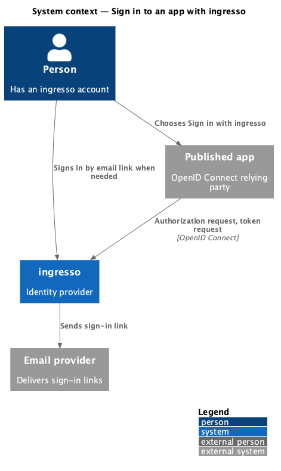
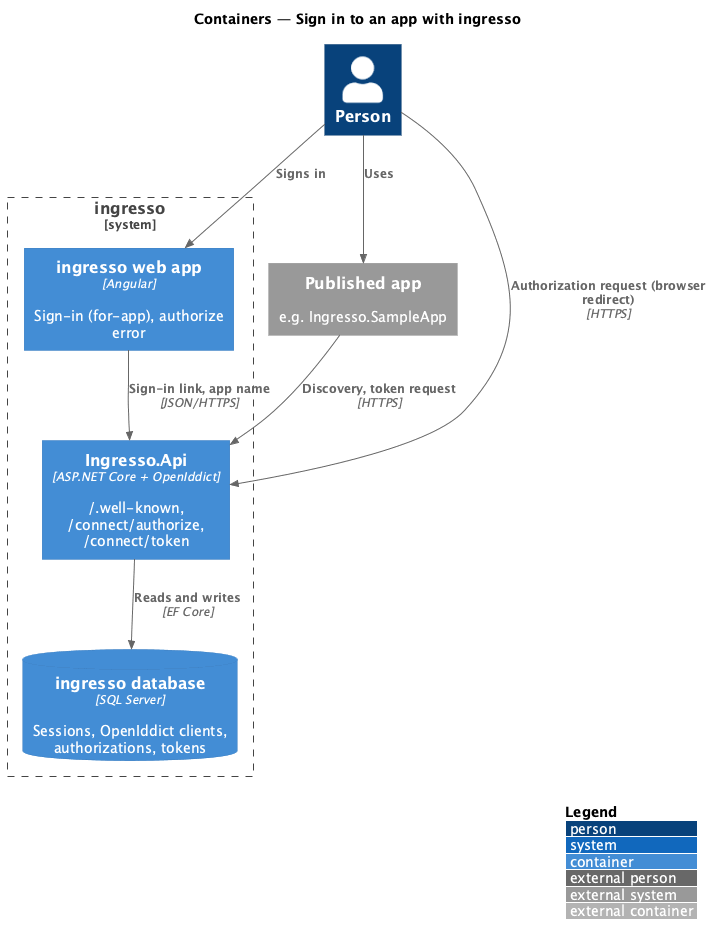
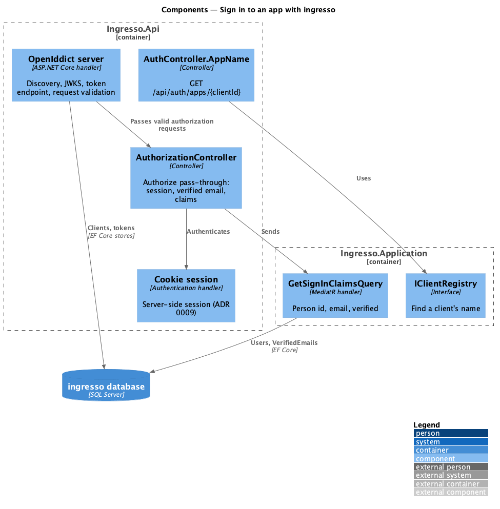
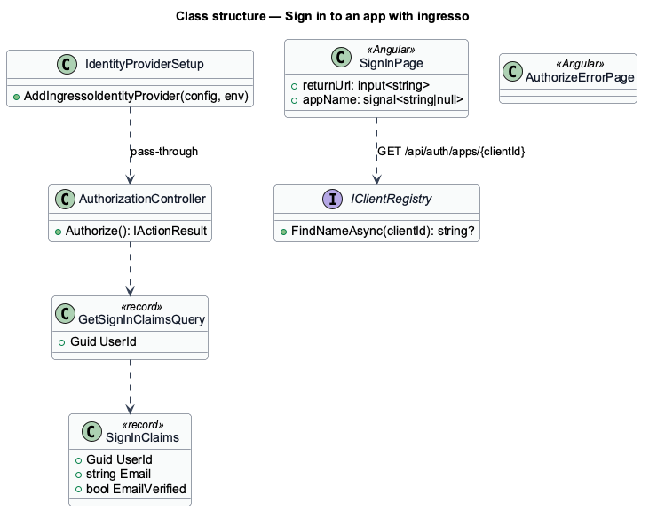
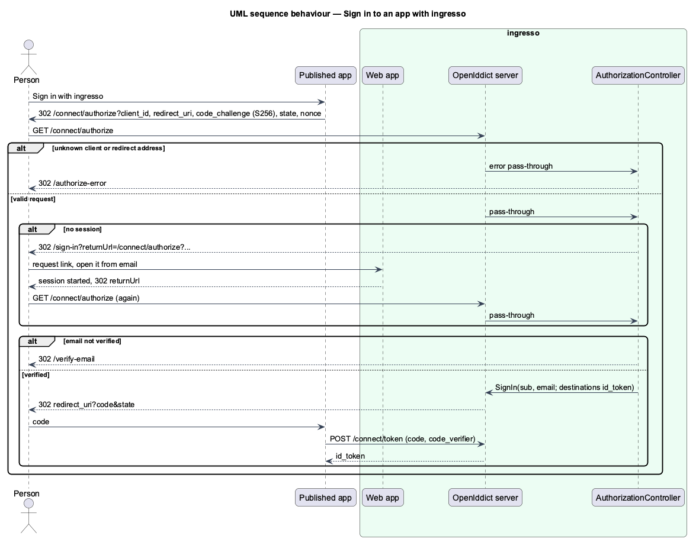

# Sign in to an app with ingresso

## Overview

A registered app (journey 15) sends people to ingresso to sign in, over OpenID Connect with the authorization
code flow and PKCE. A person who already has an ingresso session goes straight back to the app. A person
without one signs in by email link first, on a sign-in page that names the app, and then continues to the app.
The app receives an ID token with the person's id, plus the profile details its scopes allow (journey 22).

**authorization request** — the browser redirect from an app to `/connect/authorize` with its client ID,
redirect address, `S256` code challenge, `state` and `nonce`

**relying party** — an app that trusts ingresso to sign people in

OpenIddict is the OpenID Connect server ([ADR 0014](../../../adr/0014-openiddict-is-the-openid-connect-server.md)).

## Description

- **`IdentityProviderSetup.AddIngressoIdentityProvider`** (`Ingresso.Api/Auth`) — configures the OpenIddict
  server:
  - The issuer is `Site:PublicBaseUrl`. Endpoint addresses in discovery use the origin the request arrived on, which
    is the same origin in production.
  - Endpoints: `connect/authorize` and `connect/token`. Discovery is at `/.well-known/openid-configuration` and
    the keys at `/.well-known/jwks`.
  - The authorization-code flow only, with PKCE required and `S256` only.
  - Pass-through for the authorization endpoint. An event handler on the authorization response sends errors
    that cannot be returned to an app to `/authorize-error`.
  - Keys: `IdentityProvider:SigningCertificate:Path` (and `:Password`) loads a PFX for signing and encryption.
    Without one, Development and Testing use ephemeral keys, and any other environment fails at startup.
  - Transport security is relaxed only in Development and Testing, which run on `http://localhost`.
- **`AuthorizationController`** (`GET`/`POST /connect/authorize`, anonymous) — runs after OpenIddict has
  validated the request:
  - No cookie session → `302 /sign-in?returnUrl=<the authorization request>`.
  - A session whose email is not verified → `302 /verify-email`.
  - Otherwise it signs in to OpenIddict with `sub` (user id) and the requested scopes. Since journey 22, `name`
    comes only with `profile`, and `email` and `email_verified` only with `email`
    ([Share profile claims](../share-profile-claims/README.md)). OpenIddict then redirects to the app with the code.
- **Token endpoint** — handled by OpenIddict without pass-through. It checks the code, the PKCE verifier and
  the client, and issues the ID token.
- **`GetSignInClaimsQuery`** (`Ingresso.Application/Identity`) — loads the person's id and email, and whether
  the email is verified.
- **`GET /api/auth/apps/{clientId}`** (anonymous) — returns `{ name }` for a registered client, or `404`. The
  sign-in page uses it to name the app, so a crafted link cannot put arbitrary text on the page.
- **Return path** — `RequestSignInLinkCommand.ReturnUrl` and `SecurityToken.ReturnUrl` accept local paths of
  up to 4000 characters, because an authorization request with `state` and `nonce` is longer than the old
  500-character limit. Migration `LongerSignInReturnPath`.
- **Web app** (`projects/ingresso`):
  - `SignInPage` takes a `returnUrl` query input and sends it with the link request. When it is an
    authorization request, the page reads its `client_id`, fetches the app's name, and shows the `for-app`
    heading and lead.
  - `AuthorizeErrorPage` (`/authorize-error`, outside the shell) uses `SiteHeader`, `Logo`, `StatusPage` and
    `Button`.
- **Dev proxy** — `/connect` and `/.well-known` go to the API too, so the issuer and its endpoints share the
  web origin, as they do in production. The `/auth` key became `/auth/`, so the web app's own `/authorize-error`
  is not sent to the API.
- **Sample relying party** (`backend/samples/Ingresso.SampleApp`) — a minimal ASP.NET Core app using cookies
  and `AddOpenIdConnect` (PKCE, `response_mode=query`). It has Sign in with ingresso and shows the signed-in
  email. `seed` registers it as client `ingresso-sample-app` when `SampleApp:BaseUrl` is configured, as it is
  for Playwright and demos.

## Behaviour as built

- Codes are single use and expire after 5 minutes (OpenIddict's default).
- A request without a code challenge, or with `plain`, is rejected before the redirect address is checked, so no
  code is issued and the person sees `/authorize-error`.
- An unknown `client_id` or a redirect address that does not exactly match a registered one never redirects.
  The person sees `/authorize-error`.
- The person's session and its 14-day rules (ADR 0009) are what keep them signed in. This journey issues no
  refresh tokens (journey 20).

## Requirements

The feature realizes the following level-2 (L2) requirements. Each L2 requirement refines a level-1 (L1) requirement, cited by identifier.

| L2 ID | Refines (L1) | Requirement |
|-------|--------------|-------------|
| `L2-091` | `L1-012` | ingresso shall publish its discovery document and public signing keys. |
| `L2-092` | `L1-012` | A person with a session shall sign in to a registered app without seeing ingresso. |
| `L2-093` | `L1-012`, `L1-007` | A person without a session shall sign in by email link and return to the app. |
| `L2-094` | `L1-012`, `L1-008` | An authorization request ingresso cannot trust shall never redirect. |

It builds on `L2-027` and `L2-028` (sign-in link), `L2-029` (verified email), `L2-030` (session) and `L2-087`
(registered apps).

## Diagrams

### System context

The person uses a published app, which sends them to ingresso to sign in.

### Containers

The browser carries the authorization request to `Ingresso.Api`. The app calls the token endpoint directly.

### Components

OpenIddict validates every request and passes good authorization requests to `AuthorizationController`.

### Class structure

### Behaviour — sign in to an app

The signed-in path goes straight to the code. The anonymous path goes through the email link and repeats the
authorization request.

## Open questions

- **`form_post` is not supported yet.** The Content-Security-Policy's `form-action 'self'` blocks posting a
  response to another origin, so apps use `response_mode=query` (in ASP.NET Core,
  `OpenIdConnectOptions.ResponseMode = "query"`). Allowing each client's own origin in `form-action` on
  authorization responses is deferred.
- **Ephemeral keys outside production.** They change when the API restarts, so ID tokens issued before a
  restart no longer validate. Journey 26 moves keys to the database with rotation.
- **An unverified email.** It goes to `/verify-email`, and after verifying the person lands on the dashboard,
  not back at the app. They can choose Sign in with ingresso again.
