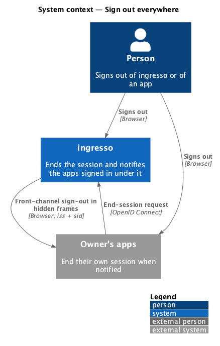
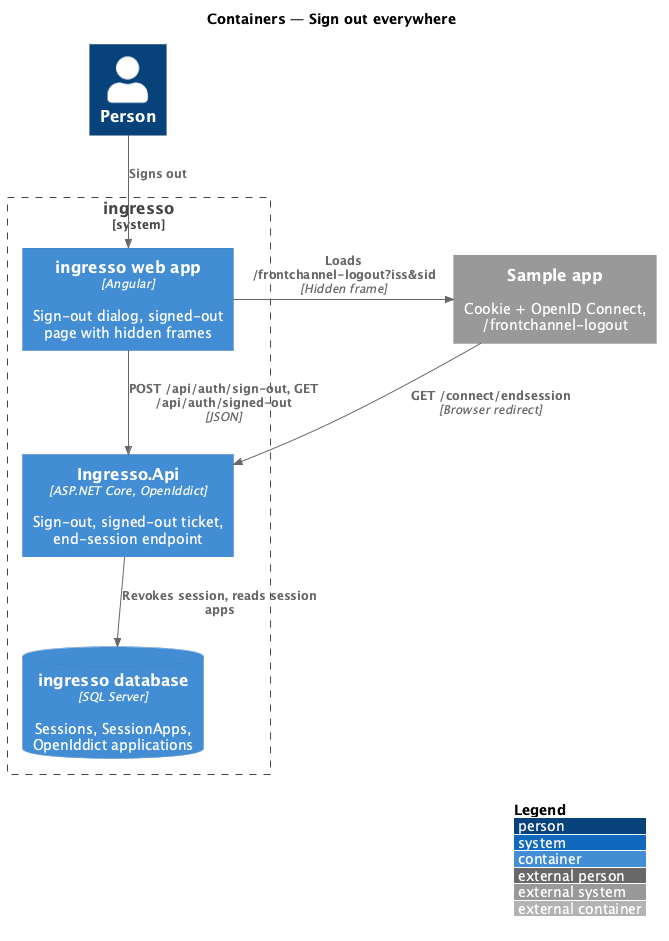
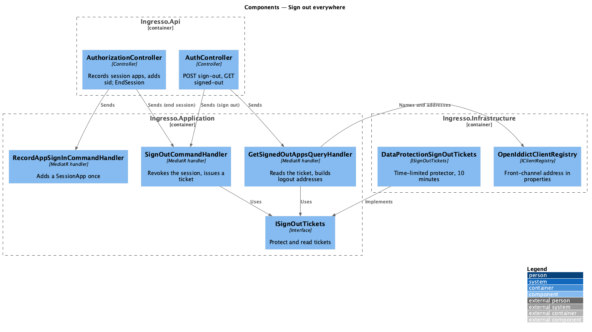
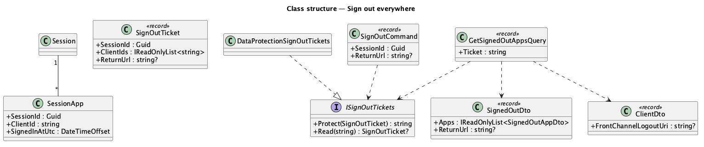
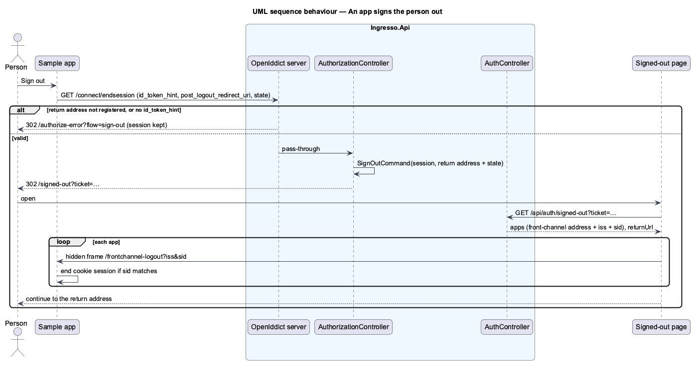

# Sign out everywhere

## Overview

Signing out of ingresso, or of an app that signed in with ingresso, ends the ingresso session and every app
session that came from it. An app starts it through the end-session endpoint (RP-initiated logout); ingresso
tells each app through front-channel logout ([ADR 0015](../../../adr/0015-front-channel-logout.md)).

**session app** — a client recorded against an ingresso session because it signed in under it

**front-channel sign-out address** — the address an app registers for ingresso to load in a hidden frame, with
`iss` and `sid`, so the app ends its own session

**signed-out ticket** — a time-limited (10 minutes) Data Protection payload with the session's id, the apps to
notify and, for app-started sign-out, the return address

## Description

- **`SessionApp`** (`Ingresso.Domain`) — `SessionId`, `ClientId`, `SignedInAtUtc`; key (`SessionId`,
  `ClientId`). Migration `AddSessionApps`.
- **`RecordAppSignInCommand`** (`Ingresso.Application/Identity`) — adds the row if missing.
  `AuthorizationController` sends it before signing in to OpenIddict, and adds `sid` (the session's id) to the
  ID token. The session id is only ever carried inside the encrypted cookie, so knowing it grants nothing.
- **`clients add --front-channel-logout-uri`** — one address, checked by the client address rules (L2-088), kept
  in the OpenIddict application's properties as `frontchannel_logout_uri`. `ClientDto.FrontChannelLogoutUri`;
  `clients list` prints `Front-channel sign-out: <address>`.
- **`SignOutCommand`** (changed) — revokes the session as before, and returns a signed-out ticket for the session's
  apps that have a front-channel address and the return address it was given; null when there is neither.
- **`ISignOutTickets`** (`Ingresso.Application/Common/Interfaces`) and **`DataProtectionSignOutTickets`**
  (`Ingresso.Infrastructure/Identity`) — protect and read tickets with a time-limited protector.
- **`GetSignedOutAppsQuery`** — reads a ticket and returns each app's name and front-channel address with `iss`
  (the issuer) and `sid` appended, and the return address; null for an unreadable or expired ticket.
- **API**
  - `POST /api/auth/sign-out` returns 200 `{ signedOut: <ticket or null> }` instead of 204.
  - `GET /api/auth/signed-out?ticket=…` (anonymous) returns `{ apps: [{ name, logoutUri }], returnUrl }`, or 404.
  - `GET`/`POST /connect/endsession` — OpenIddict validates the request (the `id_token_hint`, and that the
    `post_logout_redirect_uri` is registered for the app) and passes it to `AuthorizationController.EndSession`.
    Without an `id_token_hint` the controller sends the browser to `/authorize-error?flow=sign-out`. With no
    session it redirects straight to the return address (with `state`). Otherwise it signs the session out and
    redirects to `/signed-out?ticket=…`. An event handler on the end-session response sends requests OpenIddict
    rejects to `/authorize-error?flow=sign-out`.
- **Web app**
  - `SignOutDialog` copy says connected apps are signed out too; after signing out it goes to
    `/signed-out?ticket=…` when there is a ticket, otherwise to `/sign-in` as before.
  - `SignedOutPage` (`/signed-out`, outside the shell) fetches the ticket's apps, shows signing-out with one
    hidden frame per app, waits for every frame to load (5 seconds at most), then shows done with the apps, or
    goes to the return address.
  - `AuthorizeErrorPage` reads `flow=sign-out` for its sign-out copy.
- **Sample app** — a Sign out link signs out of its cookie and through ingresso's end-session endpoint (the
  OpenID Connect handler sends `id_token_hint` and `post_logout_redirect_uri`); `/frontchannel-logout` ends its
  cookie session when `sid` matches the session's `sid`. `seed` registers its front-channel address.

## Behaviour as built

- Only apps with a front-channel address are notified and listed; an app without one keeps its own session.
- Signing out of ingresso from the dialog still asks for confirmation (journey 11). An app's end-session request
  does not, because the app already asked.
- Front-channel frames are best effort: a frame that never loads is given up after 5 seconds and the app is still
  listed.

## Requirements

The feature realizes the following level-2 (L2) requirements. Each L2 requirement refines a level-1 (L1) requirement, cited by identifier.

| L2 ID | Refines (L1) | Requirement |
|-------|--------------|-------------|
| `L2-099` | `L1-012` | ingresso shall know which apps signed in under each session, and tell each app its session. |
| `L2-100` | `L1-012`, `L1-007` | An app shall sign the person out of ingresso and every app signed in with the session. |
| `L2-101` | `L1-012`, `L1-007` | Signing out of ingresso shall notify every app signed in under the session. |
| `L2-102` | `L1-012`, `L1-008` | An end-session request ingresso cannot trust shall never redirect or sign anyone out. |

It builds on `L2-031` (sign out), `L2-088` (client addresses) and `L2-092` (sign in to an app).

## Diagrams

### System context

### Containers

### Components

### Class structure

### Behaviour — an app signs the person out

## Open questions

- **Back-channel logout is deferred** (ADR 0015): apps on another site need `SameSite=None` session cookies for
  front-channel frames, and browsers that block third-party cookies stop it.
- **The `id_token_hint` is trusted for its client.** ingresso does not check that its `sub` is the session's
  person; signing out a session someone else started on this device is harmless.
- **Sessions on other devices** stay signed in (journey 25).
