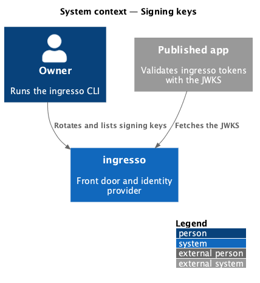
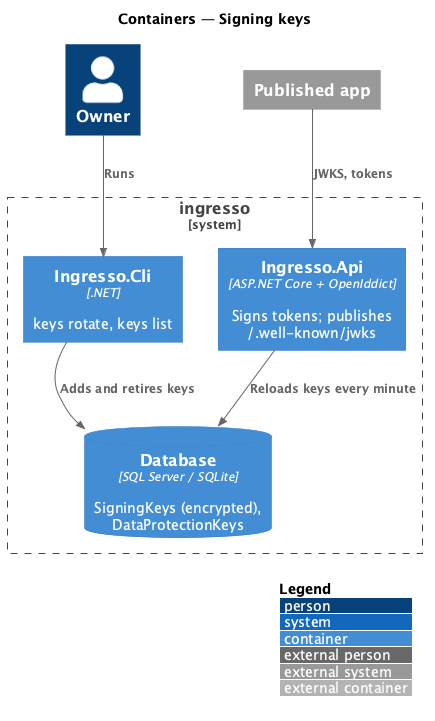
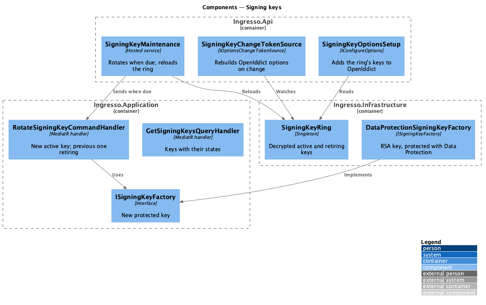
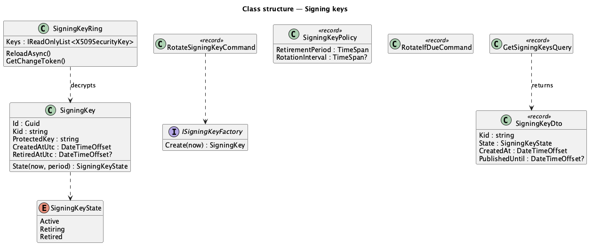
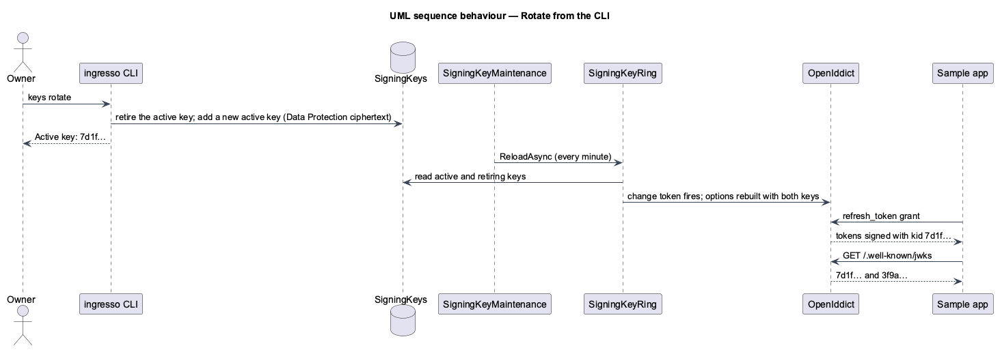

# Signing keys

## Overview

The owner rotates the keys ingresso signs tokens with, from the CLI or on a configured schedule. New tokens are
signed with the new key at once; the previous key stays published until every token it signed has expired, so
apps never reject a valid token.

**active key** — the key new tokens are signed with; there is one

**retiring key** — a key replaced by a newer one, still published and accepted until the retirement period ends

**retired key** — a key past its retirement period; no longer published or accepted

**retirement period** — the longest lifetime of any token ingresso signs: the refresh token lifetime
(`IdentityProvider:RefreshTokenSlidingLifetime`, 14 days by default), or the access token lifetime if longer

## Description

- **Domain** — `SigningKey(Id, Kid, ProtectedKey, CreatedAtUtc, RetiredAtUtc)`. `State(now, period)` is active
  (never retired), retiring (retired less than `period` ago) or retired.
- **Application** (`SigningKeys/`):
  - `ISigningKeyFactory` makes a new key: a 2048-bit RSA private key, exported as PKCS#8 and protected with Data
    Protection (purpose `Ingresso.SigningKeys`), and a random 16-hex-digit `kid`.
  - `RotateSigningKeyCommand` marks the active key retiring and adds a new active key; it returns the new key.
  - `GetSigningKeysQuery` returns `SigningKeyDto(Kid, State, CreatedAt, PublishedUntil)`, the active key first,
    then newest first; it creates the first key when there is none (L2-136).
  - `RotateIfDueCommand` rotates when `RotationInterval` is set and the active key is older (L2-140).
  - `SigningKeyPolicy(RetirementPeriod, RotationInterval)` holds the retirement period, computed from the token
    lifetimes, and the optional `IdentityProvider:SigningKeys:RotationInterval`.
- **Infrastructure**:
  - `DataProtectionSigningKeyFactory` implements `ISigningKeyFactory`.
  - `SigningKeyRing` (singleton) holds the active and retiring keys, decrypted, as `X509SecurityKey`s over
    self-signed certificates made in memory from each private key. The active key's certificate expires after
    every retiring key's, so OpenIddict, which signs with the credential whose certificate expires last, always
    signs with the active key. Each key's `KeyId` is its `kid`.
  - `SigningKeyRing.ReloadAsync` reads the keys, creating the first one when there is none, and fires a change
    token when the published set changed. If the database can't be read on first use, the ring holds a
    placeholder key until the next reload succeeds, so requests that need no token still work.
  - Data Protection persists its key ring to `AppDbContext` and, in production, protects it with a certificate
    (ADR 0021).
- **API**:
  - `SigningKeyOptionsSetup` (`IConfigureOptions<OpenIddictServerOptions>`) adds the ring's keys as signing
    credentials, and `SigningKeyChangeTokenSource` makes `IOptionsMonitor<OpenIddictServerOptions>` rebuild the
    options when the ring changes, so OpenIddict signs, validates and publishes the new keys without a restart.
  - `SigningKeyMaintenance` (hosted service) every `IdentityProvider:SigningKeys:RefreshInterval` (default 1
    minute) sends `RotateIfDueCommand` and reloads the ring, so a `keys rotate` from the CLI reaches a running API
    within a minute.
- **Encryption** — codes and refresh tokens are still encrypted with the configured certificate
  (`IdentityProvider:SigningCertificate`, now used for encryption only) or, in Development, a process key.

### CLI

```text
$ ingresso keys list
Signing keys:
3f9a1c2e7b4d5e60  active    created 2026-11-02 14:00 UTC
9b2d4e6f8a0c1e3d  retiring  created 2026-10-01 09:00 UTC, published until 2026-11-16 14:00 UTC
5c7e9a1b3d5f7092  retired   created 2026-09-01 09:00 UTC

$ ingresso keys rotate
Rotated the signing key.
Active key: 7d1f3b5a9c2e4f60
Retiring key: 3f9a1c2e7b4d5e60, published until 2026-11-16 14:05 UTC
A running API starts signing with the new key within a minute.
```

## Requirements

The feature realizes the following level-2 (L2) requirements. Each L2 requirement refines a level-1 (L1) requirement, cited by identifier.

| L2 ID | Refines (L1) | Requirement |
|-------|--------------|-------------|
| `L2-136` | `L1-012`, `L1-011` | The owner shall rotate and list signing keys from the CLI. |
| `L2-137` | `L1-012`, `L1-008` | Tokens shall be signed with the active key, and retiring keys' tokens stay valid. |
| `L2-138` | `L1-012`, `L1-008` | A retiring key shall stay published until its tokens have expired. |
| `L2-139` | `L1-008` | Signing keys shall be encrypted at rest. |
| `L2-140` | `L1-012`, `L1-011` | ingresso shall rotate its signing key on a configured interval, off by default. |

It builds on `L2-091` (discovery and JWKS), `L2-097` (access tokens) and `L2-038` (privacy).

## Diagrams

### System context



### Containers



### Components



### Class structure



### Behaviour — rotate from the CLI



## Open questions

- **Encryption keys** for codes and refresh tokens stay on the configured certificate; moving them to the
  database is deferred.
- **Hardware security modules and cloud key vaults** are deferred.
