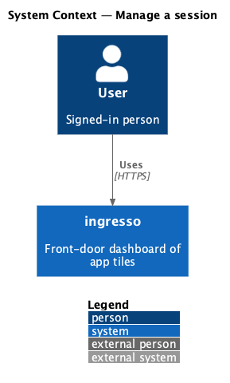
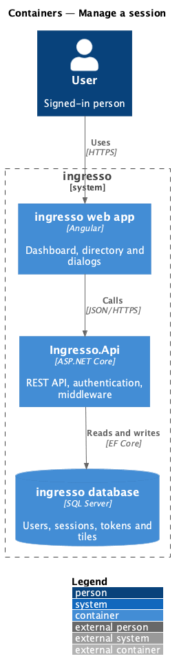
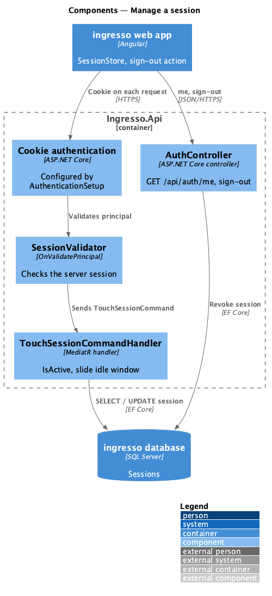
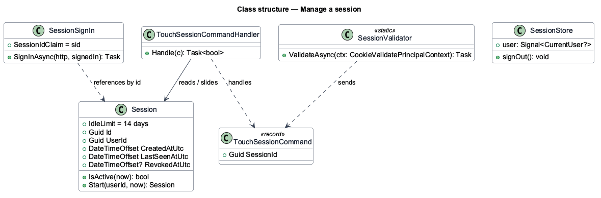
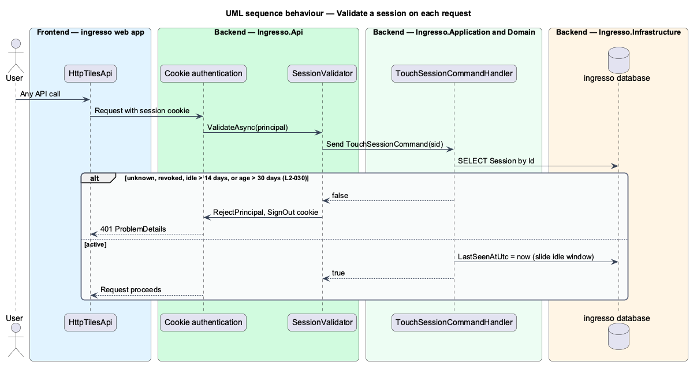
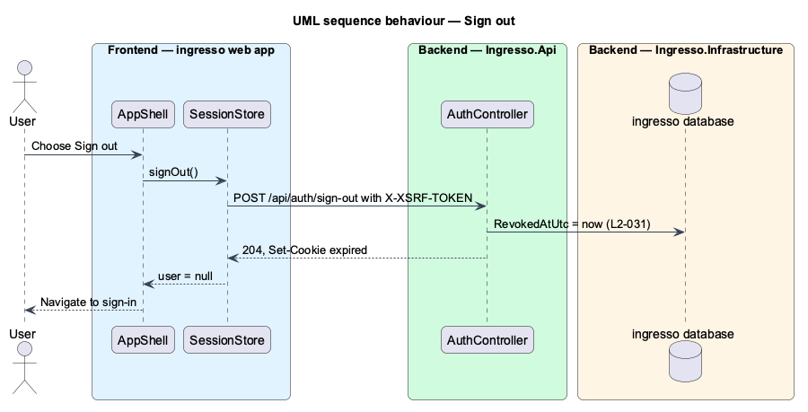

# Manage a session

## Overview

After sign-in, a session keeps the user signed in on one device until it expires or the user signs out.

**session** — server-side record of one signed-in device

**session cookie** — `HttpOnly`, `Secure`, `SameSite=Lax` cookie that carries only the session identifier

Each request validates the cookie against its session row (ADR 0009). An active session slides its idle window forward. A revoked, idle or unknown session makes the request anonymous and clears the cookie. Sign-out revokes the row, so a replayed cookie no longer authenticates.

## Description

The slice runs from the ingresso web app to the ingresso database.

- **`AuthenticationSetup`** — configures the cookie scheme with `HttpOnly`, `SecurePolicy.Always` and `SameSite=Lax`, and wires `SessionValidator` to `OnValidatePrincipal`.
- **`SessionSignIn`** — writes the cookie with the `sid` claim and other identity claims from `SignedIn`.
- **`SessionValidator.ValidateAsync`** — reads `sid` and sends `TouchSessionCommand`. When the command returns false, it rejects the principal and signs the cookie out.
- **`TouchSessionCommandHandler`** — loads the session, checks `Session.IsActive(now)`, and updates `LastSeenAtUtc`.
- **`Session`** — entity with `IdleLimit` of 14 days and `RevokedAtUtc`.
- **`SessionStore`** — web-app state for the current user, loaded from `GET /api/auth/me`.
- **Sign-out endpoint** — `<TO SUPPLY>`: `POST /api/auth/sign-out` that revokes the session and clears the cookie.

The current source differs from the requirements in these points. Each is open work for the slice.

- `L2-030` sets a 30-day absolute limit. `Session.IsActive` checks only the 14-day idle limit.
- `L2-031` requires sign-out from any screen. Only `TestSignInController` exposes `sign-out`, and only in test environments.

## Requirements

The feature realizes the following level-2 (L2) requirements. Each L2 requirement refines a level-1 (L1) requirement, cited by identifier.

| L2 ID | Refines (L1) | Requirement |
|-------|--------------|-------------|
| `L2-030` | `L1-007` | The session cookie shall be an opaque reference to a server-side session. |
| `L2-031` | `L1-007` | The user shall be able to sign out from any screen. |

## Diagrams

### System context

The user stays signed in to ingresso and signs out. No external system takes part.

### Containers

The browser sends the cookie on each API request. `Ingresso.Api` checks the session row in the database.

### Components

The cookie authentication handler calls `SessionValidator`, which sends `TouchSessionCommand` to the application layer.

### Class structure

`SessionValidator` depends on `ISender` to run `TouchSessionCommandHandler`. The handler reads and updates `Session`.

### Behaviour — validate a session on each request

Every authenticated request touches the session row. An idle, revoked, expired or unknown session results in `401`, and the cookie is cleared.

### Behaviour — sign out

Sign-out revokes the session row before it clears the cookie, so a replayed cookie fails validation.

