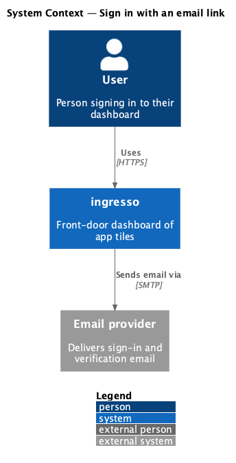
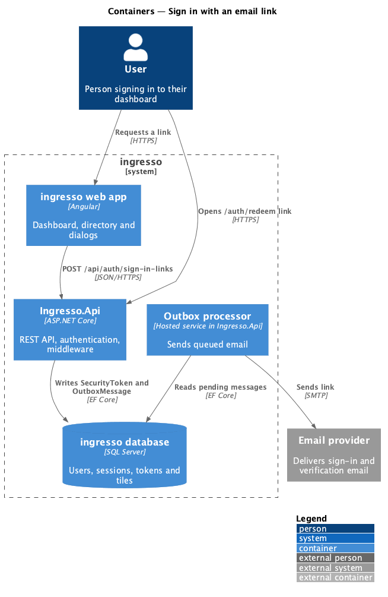
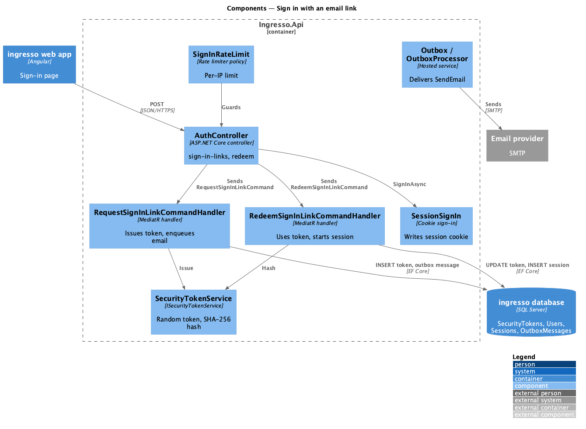
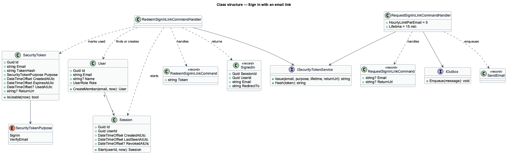
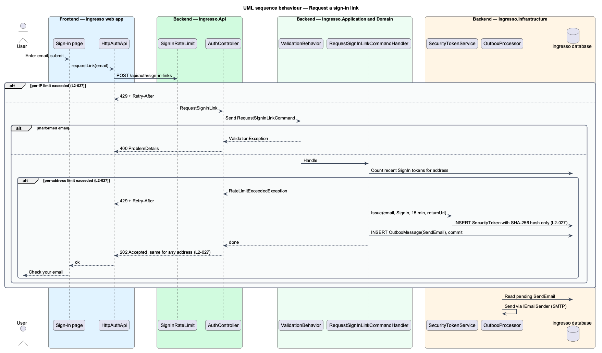
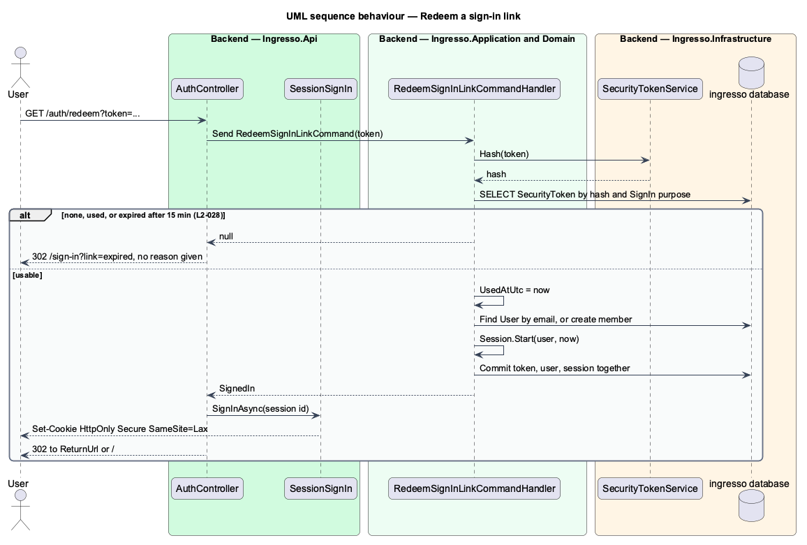

# Sign in with an email link

## Overview

ingresso has no passwords. A user signs in by entering an email address and opening a single-use link sent to that address.

**sign-in link** — single-use URL carrying a random token, valid for 15 minutes

**security token** — stored record of an issued link, holding only a SHA-256 hash of the token

**outbox** — table of pending messages that a background processor delivers after the request commits

The request step never reveals whether an account exists: every well-formed address gets the same `202` response. The redeem step marks the token used, finds or creates the user, and starts a session in one unit of work, so one token can start at most one session.

## Description

The slice runs from the web app to the database and out through the email provider.

- **Sign-in page** — `<TO SUPPLY>`: no sign-in route exists in `app.routes.ts`. The page collects the email and shows the uniform confirmation.
- **`HttpAuthApi`** — implementation of `AuthApi` behind the `AUTH_API` token. `<TO SUPPLY>`: its request-link method.
- **`AuthController.RequestSignInLink`** — `POST /api/auth/sign-in-links`, anonymous, under the `sign-in-links` rate-limit policy. It always returns `202 Accepted`.
- **`RequestSignInLinkCommandValidator`** — checks the email shape and length, and allows only a local `ReturnUrl`.
- **`RequestSignInLinkCommandHandler`** — enforces the per-address limit, issues a token through `ISecurityTokenService`, and enqueues `SendEmail` on `IOutbox`.
- **`SecurityTokenService`** — creates the random token, stores its hash in `SecurityToken`, and hashes presented tokens.
- **`OutboxProcessor` / `SendEmailHandler`** — deliver queued email through `IEmailSender` after commit.
- **`AuthController.Redeem`** — `GET /auth/redeem?token=`. It sends `RedeemSignInLinkCommand`, signs in through `SessionSignIn`, and redirects. An unusable token redirects to `/sign-in?link=used`, `link=expired` or `link=invalid` (unknown or tampered, which says nothing more).
- **`RedeemSignInLinkCommandHandler`** — marks the token used, creates the `User` on first sign-in, and starts a `Session`.

Decisions made while building the slice:

- `L2-027` now states the limits as 5 per address and 20 per IP in an hour, which is what the source enforces (`HourlyLimitPerEmail`, `SignInRateLimit`).
- `RedeemSignInLinkCommand` returns a `RedeemResult` with a `LinkFailure` (`Invalid`, `Used`, `Expired`), so the page can tell a used link from an expired one while a tampered one reveals nothing.
- The dev mailbox and the test sign-in seam exist only in Development and the test host; `DevMailbox:Expose` and `Auth:TestSignIn:Enabled` do nothing elsewhere.
- The sign-in screen (`pages/sign-in`) sits outside the shell and is built from `Card`, `Logo`, `FormField`, `Input`, `ErrorSummary`, `Button` and `Alert`.

Still open:

- `SignInRateLimit` still registers a `feed-creation` policy carried over from the source template. No ingresso endpoint uses it.

## Requirements

The feature realizes the following level-2 (L2) requirements. Each L2 requirement refines a level-1 (L1) requirement, cited by identifier.

| L2 ID | Refines (L1) | Requirement |
|-------|--------------|-------------|
| `L2-027` | `L1-007` | A user shall request a sign-in link by entering their email address. |
| `L2-028` | `L1-007` | A sign-in link shall be single use and expire. |

## Diagrams

### System context

The user signs in to ingresso, which sends the link through an external email provider.

### Containers

The web app posts the request to `Ingresso.Api`. The API writes the token and an outbox message. The outbox processor sends the email. The browser later opens the redeem URL on the API.

### Components

Two endpoints on `AuthController` drive two handlers. `SecurityTokenService` hashes tokens, and the outbox decouples email delivery from the request.

### Class structure

`SecurityToken` records an issued link by hash. Redeeming it creates a `Session` for a `User`. Both handlers depend on `IClock`, `IAppDbContext` and `ISecurityTokenService`.

### Behaviour — request a sign-in link

The response is the same for known and unknown addresses. Only the token's hash is stored, and the email leaves through the outbox after commit.

### Behaviour — redeem a sign-in link

The redeem step is one unit of work, so a token cannot start two sessions. A used or expired token gets its own message on the sign-in page; a tampered or unknown one gets only "That link didn't work".

