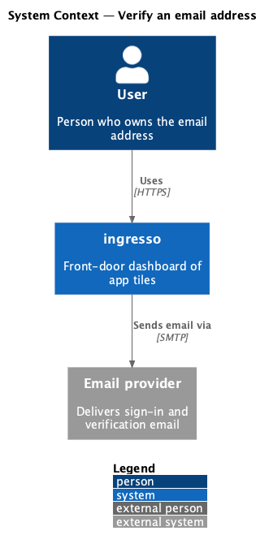
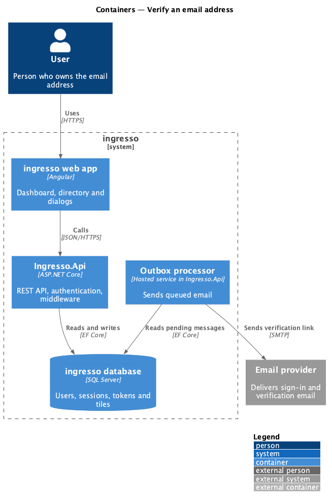
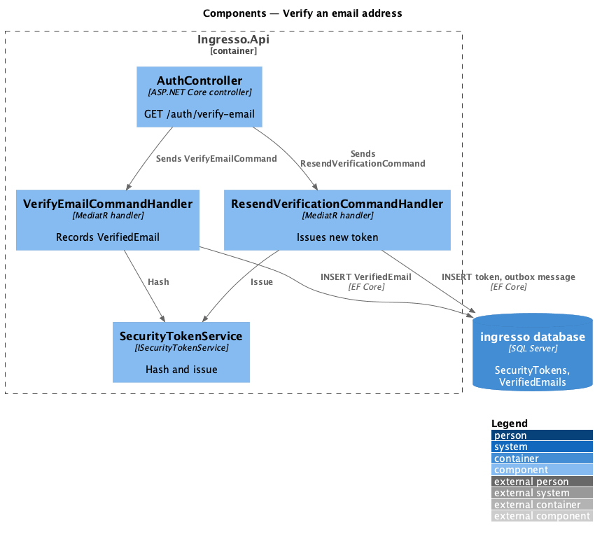
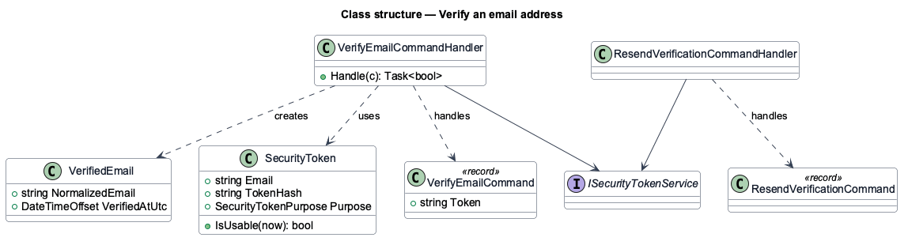
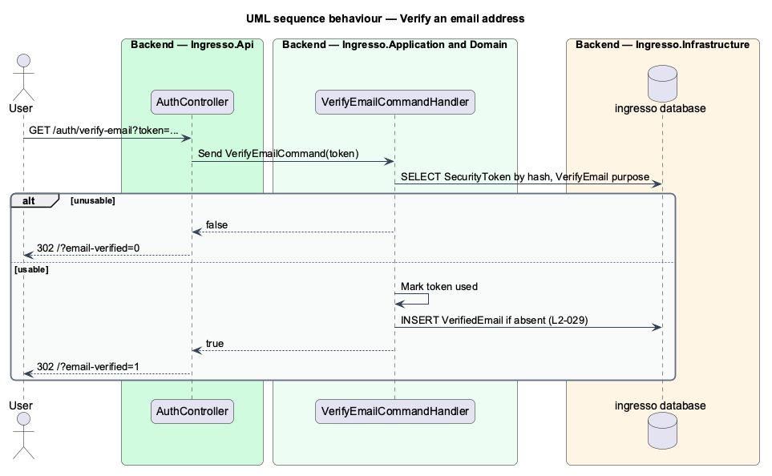

# Verify an email address

## Overview

A verified email address proves that the account holder controls the inbox. ingresso records each verified address once and gates tile access on it.

**verified email** — record that a normalized email address has proven inbox control, with the time of proof

Verification uses the same security-token mechanism as sign-in, with the `VerifyEmail` purpose. A user may request another verification email, subject to rate limits.

## Description

The slice runs from the ingresso web app to the ingresso database.

- **`AuthController.VerifyEmail`** — `GET /auth/verify-email?token=`. It sends `VerifyEmailCommand` and redirects to `/?email-verified=1` or `/?email-verified=0`.
- **`VerifyEmailCommandHandler`** — redeems a `VerifyEmail` token and adds a `VerifiedEmail` row when none exists for the address.
- **`ResendVerificationCommandHandler`** — issues a new `VerifyEmail` token and enqueues the email, unless the address is already verified.
- **`VerifiedEmail`** — entity keyed by `NormalizedEmail` with `VerifiedAtUtc`.

The current source differs from the requirements in these points. Each is open work for the slice.

- `L2-029` requires the first sign-in redemption to mark the address verified. `RedeemSignInLinkCommandHandler` does not write a `VerifiedEmail` row.
- `L2-029` requires `403` from tile endpoints for an unverified account. `<TO SUPPLY>`: no authorization policy checks verification.
- `<TO SUPPLY>`: no `AuthController` endpoint sends `ResendVerificationCommand`.

## Requirements

The feature realizes the following level-2 (L2) requirements. Each L2 requirement refines a level-1 (L1) requirement, cited by identifier.

| L2 ID | Refines (L1) | Requirement |
|-------|--------------|-------------|
| `L2-029` | `L1-007` | A new account's email shall be verified before the dashboard opens. |

## Diagrams

### System context

The user verifies their address through ingresso, which sends the email through an external provider.

### Containers

`Ingresso.Api` issues the token and queues the email. The user opens the verification link on the API.

### Components

`AuthController` dispatches verification commands. The handlers read and write `SecurityToken` and `VerifiedEmail` rows.

### Class structure

`VerifyEmailCommandHandler` consumes a `SecurityToken` and creates a `VerifiedEmail`. `ResendVerificationCommandHandler` issues a new token.

### Behaviour — verify an email address

A usable token adds the `VerifiedEmail` row once. Every outcome redirects home with a flag that the web app turns into a toast.

