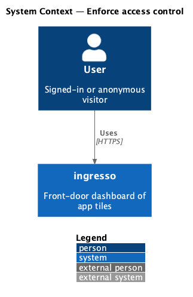
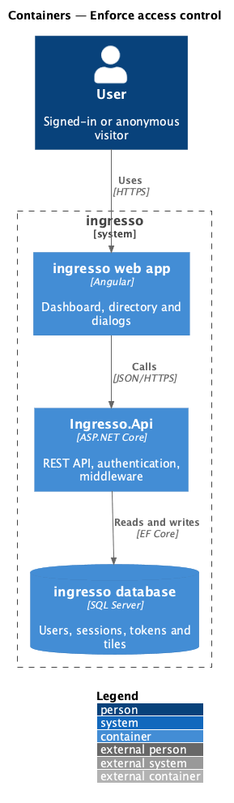
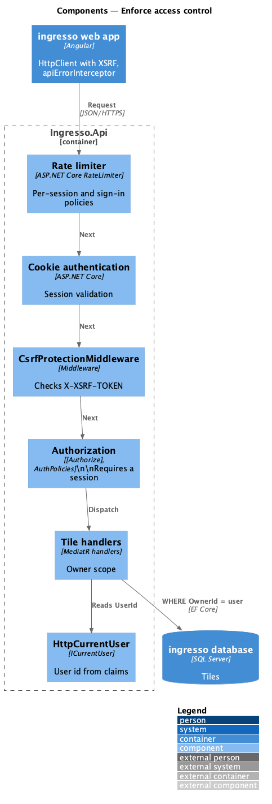
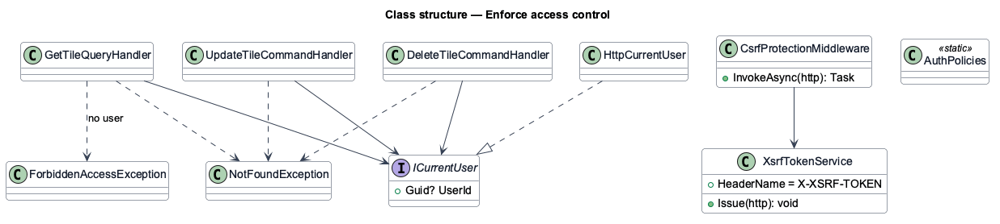
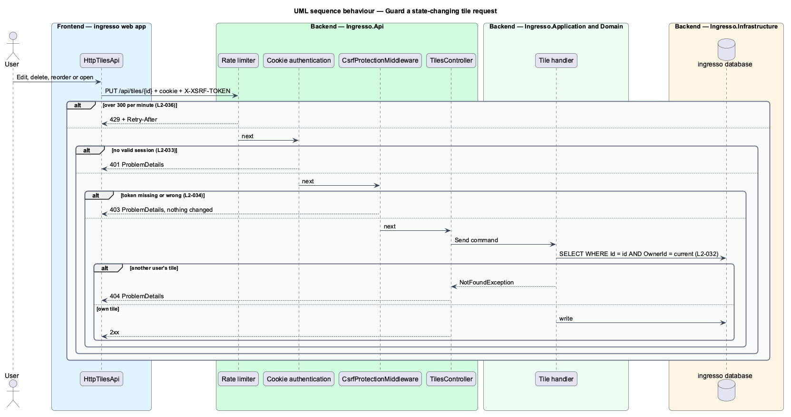

# Enforce access control

## Overview

Each ingresso dashboard is private. Access control has four layers: authentication on every endpoint, ownership filters in every tile handler, anti-forgery tokens on state-changing requests, and request rate limits.

**owner scope** — query filter that restricts a tile read or write to `OwnerId` equal to the signed-in user

**anti-forgery token** — per-session value the browser echoes in the `X-XSRF-TOKEN` header, proving the request came from the ingresso web app

A tile of another user returns `404` rather than `403`, so the response does not confirm that the tile exists.

## Description

The slice is cross-cutting. It applies to every request between the ingresso web app and `Ingresso.Api`.

- **`[Authorize]` on `TilesController`** and **`AuthPolicies`** — require an authenticated session. Only the sign-in request, redeem, verify-email and health endpoints carry `[AllowAnonymous]`.
- **`HttpCurrentUser`** — `ICurrentUser` implementation that reads the user id from the cookie claims.
- **Tile handlers** — each filters by `OwnerId == ICurrentUser.UserId`, and throws `NotFoundException` on a miss.
- **`XsrfTokenService`** — issues a readable `XSRF-TOKEN` cookie to signed-in visitors. Angular's `HttpClient` copies it into `X-XSRF-TOKEN`.
- **`CsrfProtectionMiddleware`** — rejects `POST`, `PUT`, `PATCH` and `DELETE` requests without a valid token.
- **`apiErrorInterceptor`** — maps `401` to a redirect to sign-in in the web app.
- **Rate limiting** — `SignInRateLimit` registers the sign-in policy. `L2-036` adds a per-session limit of 300 requests a minute.

The current source differs from the requirements in these points. Each is open work for the slice.

- `L2-036` requires a 300-requests-per-minute per-session limit. No global limiter exists in `Program.cs`.
- `L2-033` requires the web app to redirect anonymous users to sign-in. No sign-in route or guard exists in `app.routes.ts`.

## Requirements

The feature realizes the following level-2 (L2) requirements. Each L2 requirement refines a level-1 (L1) requirement, cited by identifier.

| L2 ID | Refines (L1) | Requirement |
|-------|--------------|-------------|
| `L2-032` | `L1-007` | Each user's tiles shall be visible only to them. |
| `L2-033` | `L1-008` | Every endpoint except sign-in request, sign-in redemption and health shall require a valid session. |
| `L2-034` | `L1-008` | State-changing requests shall be protected against cross-site forgery. |
| `L2-036` | `L1-008` | The API shall rate limit by client. |

## Diagrams

### System context

All users reach ingresso through the same access-control layers.

### Containers

The web app calls `Ingresso.Api`. The API checks session, anti-forgery token and rate limit before any handler reads data.

### Components

Middleware and filters run in a fixed order before the controller. The handler adds the owner scope.

### Class structure

Tile handlers depend on `ICurrentUser`, which `HttpCurrentUser` implements. `CsrfProtectionMiddleware` depends on `XsrfTokenService`.

### Behaviour — guard a state-changing tile request

Each check fails fast with its own status. A request that passes every layer still reaches only the owner's rows.

