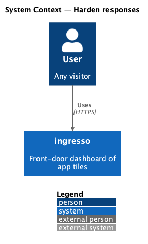
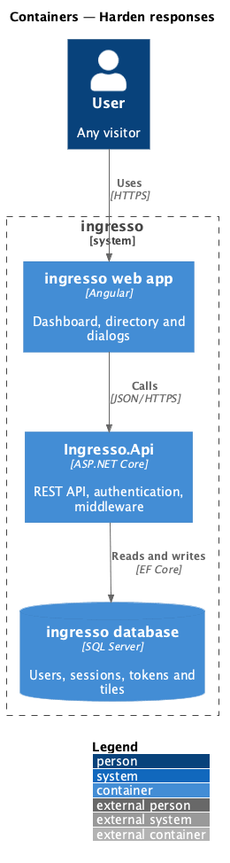
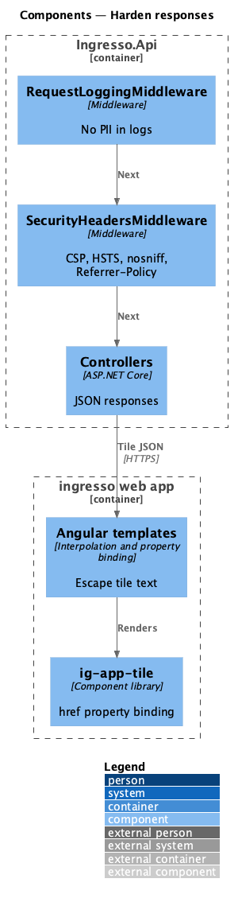
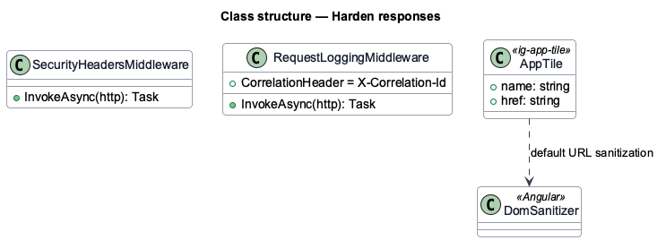
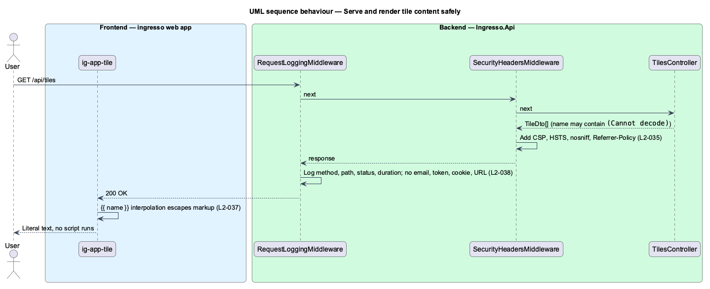

# Harden responses

## Overview

Browser-side defences limit what an attacker can do through injected content, and privacy rules limit what ingresso learns about its users.

**content security policy** — response header that lists the origins from which a page may load scripts, styles, fonts and connections

ingresso applies three measures. Every response carries hardening headers. Tile text is rendered as text, never as markup. The system loads no third-party analytics, and its logs hold no personal content.

## Description

The slice is cross-cutting. It covers every response from `Ingresso.Api` and every template in the web app.

- **`SecurityHeadersMiddleware`** — sets `X-Content-Type-Options`, `Referrer-Policy` (`strict-origin-when-cross-origin`) and the other hardening headers on each response.
- **Angular template binding** — interpolation and property binding escape tile text. No template uses `[innerHTML]` for user content, and no code calls `bypassSecurityTrust*`.
- **`ig-app-tile`** — binds the tile URL as an `href` property. The `L2-003` address rule keeps the value to `http` and `https`.
- **Self-hosted Geist** — fonts are served from the app bundle (ADR 0005), so no request reaches a font CDN.
- **`RequestLoggingMiddleware`** — logs method, path, status, duration and correlation id. It does not log bodies, cookies or query strings.

The current source differs from the requirements in these points. Each is open work for the slice.

- `L2-035` requires `Content-Security-Policy` and `Strict-Transport-Security`. `<TO SUPPLY>`: confirm that `SecurityHeadersMiddleware` sets both; only `Referrer-Policy` is visible in a search of the source.

## Requirements

The feature realizes the following level-2 (L2) requirements. Each L2 requirement refines a level-1 (L1) requirement, cited by identifier.

| L2 ID | Refines (L1) | Requirement |
|-------|--------------|-------------|
| `L2-035` | `L1-008` | Responses shall carry browser-hardening headers. |
| `L2-037` | `L1-008` | Tile text shall always render as text, never as markup. |
| `L2-038` | `L1-008` | The system shall not track users or log personal content. |

## Diagrams

### System context

The user's browser receives ingresso responses with hardening headers. ingresso calls no analytics or advertising system.

### Containers

`Ingresso.Api` adds headers to every response, including the web app's static files.

### Components

`SecurityHeadersMiddleware` runs early in the pipeline. Angular's sanitizer and binding rules protect the rendered page.

### Class structure

`SecurityHeadersMiddleware` and `RequestLoggingMiddleware` are independent middleware classes. The web app relies on Angular `DomSanitizer` defaults.

### Behaviour — serve and render tile content safely

The API adds headers to every response, and the web app binds tile values as text. A hostile tile name renders as literal characters.

