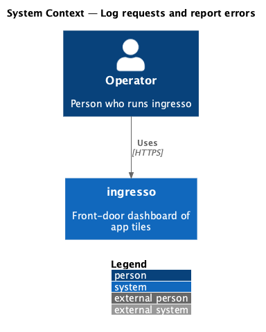
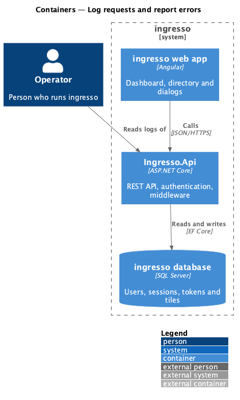
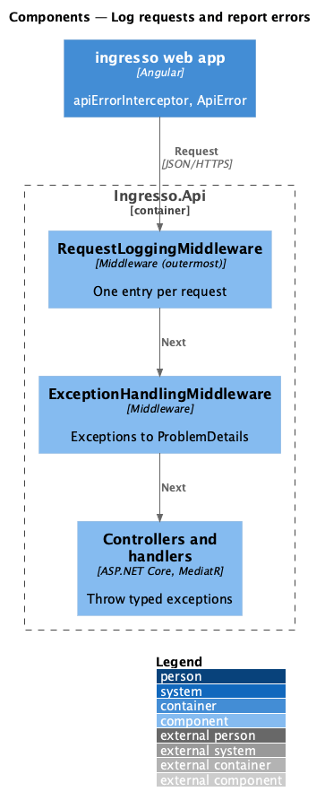
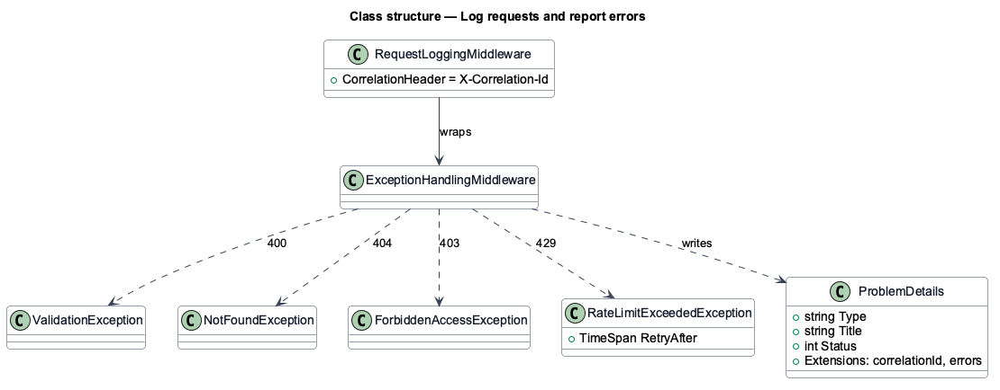
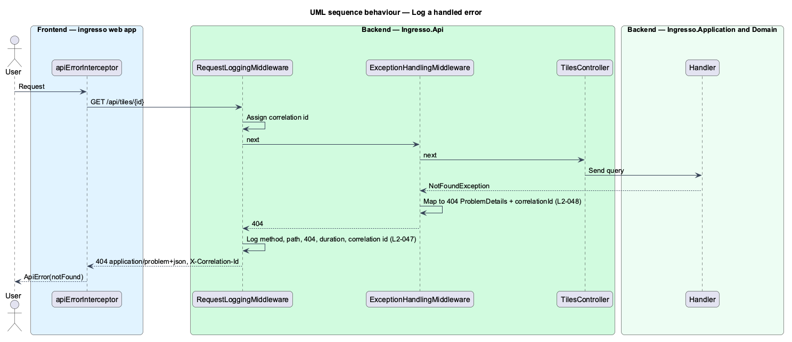

# Log requests and report errors

## Overview

Operators diagnose ingresso from its logs, and clients react to its errors. This feature defines one log entry per request and one error format for every failure.

**correlation id** — identifier assigned to a request, returned in `X-Correlation-Id`, and written to its log entry and problem details

**problem details** — RFC 7807 JSON error body with `type`, `title`, `status` and extensions

`RequestLoggingMiddleware` sits outside `ExceptionHandlingMiddleware`. A handled exception therefore logs with its mapped status, such as `404`, not with `500`.

## Description

The slice is cross-cutting. It wraps every request to `Ingresso.Api`.

- **`RequestLoggingMiddleware`** — outermost middleware. It assigns the correlation id from the current trace, returns it in `X-Correlation-Id`, and writes one entry with method, path, status and duration.
- **`ExceptionHandlingMiddleware`** — maps `ValidationException` to `400` with field errors, `NotFoundException` to `404`, `ForbiddenAccessException` to `403`, and `RateLimitExceededException` to `429`. Anything else becomes `500` without a stack trace. Each body carries `correlationId`.
- **`ReferenceCodeGenerator`** — produces the short reference code shown to users on error pages.
- **`ApiError` / `apiErrorInterceptor`** — web-app types that turn problem details into `ApiErrorKind` values for pages and dialogs.

## Requirements

The feature realizes the following level-2 (L2) requirements. Each L2 requirement refines a level-1 (L1) requirement, cited by identifier.

| L2 ID | Refines (L1) | Requirement |
|-------|--------------|-------------|
| `L2-047` | `L1-011` | Every request shall be logged with its final status. |
| `L2-048` | `L1-011` | Errors shall be returned as RFC 7807 problem details. |

## Diagrams

### System context

Operators read ingresso logs. Users see problem-details-driven messages. No external system takes part.

### Containers

`Ingresso.Api` writes structured logs and returns problem details to the web app.

### Components

The two middleware classes wrap the MVC pipeline in a fixed order.

### Class structure

`ExceptionHandlingMiddleware` maps each application exception type to a status code.

### Behaviour — log a handled error

The handler throws a typed exception. The inner middleware maps it, and the outer middleware logs the mapped status.

