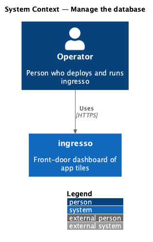
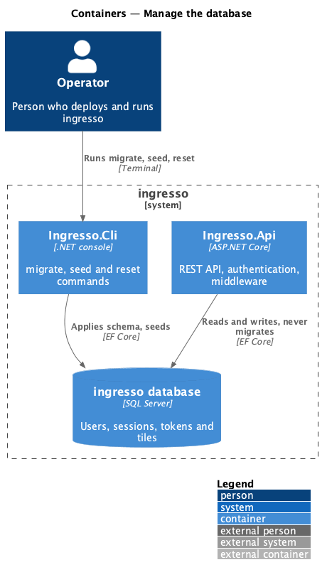
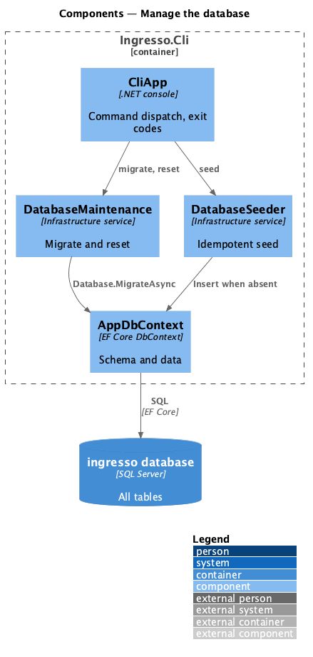
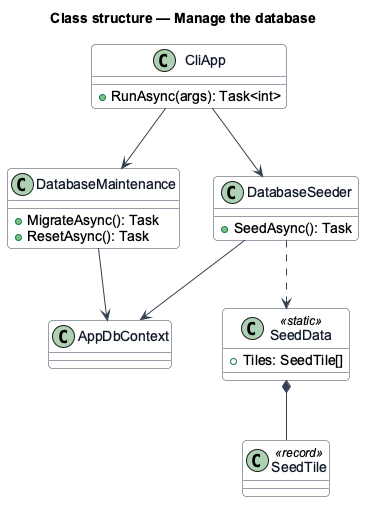
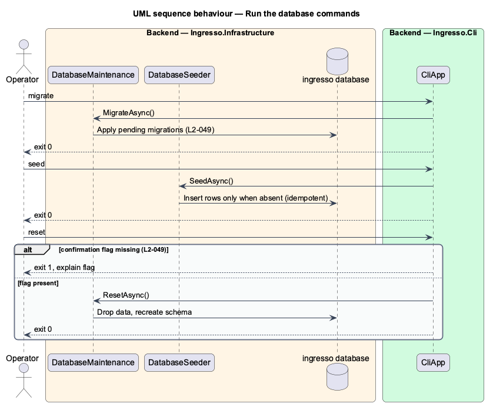

# Manage the database

## Overview

Schema changes are deliberate operations in ingresso, not side effects of starting the API. The `Ingresso.Cli` console app owns every change to the database.

**migrate** — command that applies pending EF Core migrations

**seed** — command that inserts reference and demo data when absent

**reset** — command that drops all data and recreates the schema, behind an explicit confirmation flag

Seeding is idempotent: a second run inserts nothing. The API checks for pending migrations at start-up and logs a warning, but never applies them.

## Description

The slice runs from an operator's terminal through `Ingresso.Cli` to the database.

- **`CliApp`** — parses the `migrate`, `seed` and `reset` commands and returns a non-zero exit code on failure.
- **`DatabaseMaintenance`** — runs the schema operations for each command.
- **`DatabaseSeeder` / `SeedData` / `SeedTile`** — insert seed users and tiles when absent.
- **`Program` (API)** — builds the host without a migration step.

The current source differs from the requirements in these points. Each is open work for the slice.

- `DatabaseMaintenance` calls `EnsureCreatedAsync` instead of applying migrations, and no `Migrations` folder exists in `Ingresso.Infrastructure`. `L2-049` requires `migrate` to apply migrations.
- `L2-049` requires an explicit confirmation flag for `reset`. `<TO SUPPLY>`: the flag name; `CliApp` does not parse one.
- `L2-050` requires a start-up warning for pending migrations. `<TO SUPPLY>`: no check exists in `Program.cs`.

## Requirements

The feature realizes the following level-2 (L2) requirements. Each L2 requirement refines a level-1 (L1) requirement, cited by identifier.

| L2 ID | Refines (L1) | Requirement |
|-------|--------------|-------------|
| `L2-049` | `L1-011` | The CLI shall manage the database. |
| `L2-050` | `L1-011` | The API shall never change the schema when it starts. |

## Diagrams

### System context

An operator manages the ingresso database from a terminal.

### Containers

`Ingresso.Cli` connects to the database directly. `Ingresso.Api` only reads and writes data.

### Components

`CliApp` dispatches each command to `DatabaseMaintenance` or `DatabaseSeeder`, both of which use `AppDbContext`.

### Class structure

`CliApp` depends on `DatabaseMaintenance` and `DatabaseSeeder`. Both depend on `AppDbContext`.

### Behaviour — run the database commands

Each command exits `0` on success and non-zero with a message on failure. Reset requires its confirmation flag.

