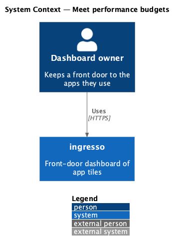
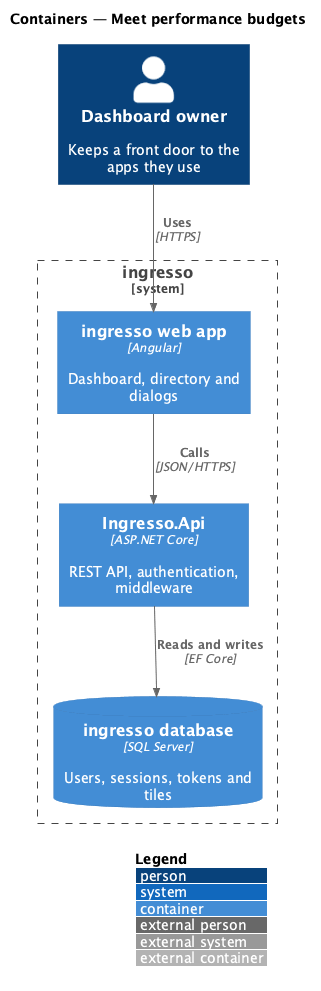
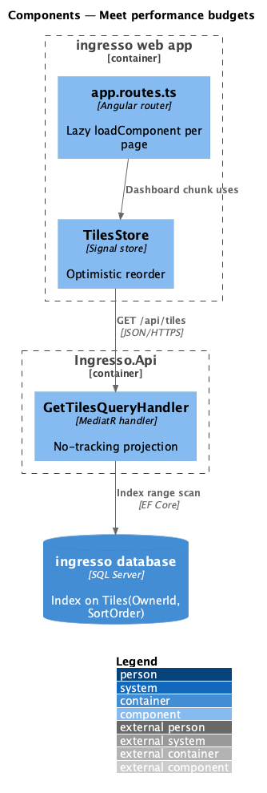
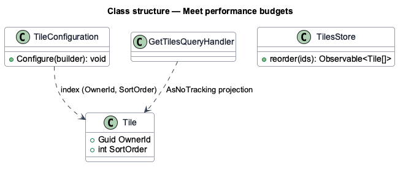
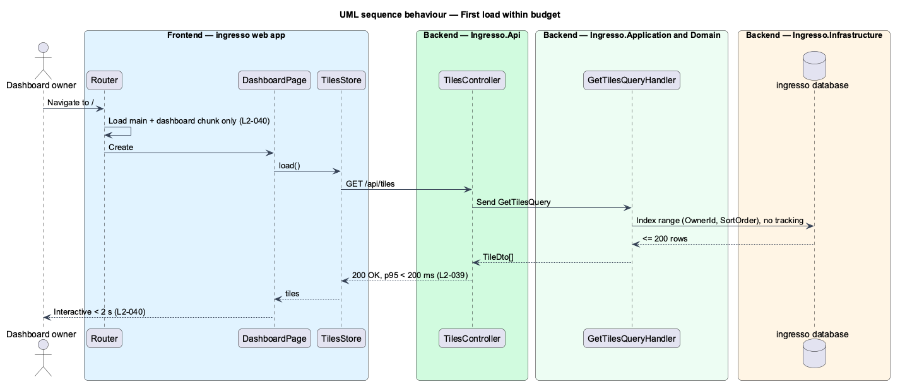

# Meet performance budgets

## Overview

ingresso is a launcher, so speed is part of its function. This feature states the performance budgets and the design choices that keep the system within them.

**p95 latency** — response time that 95 percent of requests meet or beat

**time to interactive** — time from navigation until the page responds to input

The budgets assume the 200-tile cap from `L2-004`. Tile endpoints answer in under 200 ms at p95. The dashboard becomes interactive in under 2 s on a mid-range laptop over fast 4G. A reorder shows its result within 100 ms.

## Description

The slice is cross-cutting. It spans the tile queries, the web app's bundle and the reorder interaction.

- **Owner index on `Tile`** — `TileConfiguration` indexes `OwnerId` with `SortOrder`, so the list query reads one range in order. `<TO SUPPLY>`: confirm the index definition.
- **`GetTilesQueryHandler`** — projects to `TileDto` and reads without change tracking.
- **Lazy routes** — `app.routes.ts` loads `DashboardPage` and `DirectoryPage` with `loadComponent`, so the dashboard route carries no directory code.
- **Optimistic reorder** — `TilesStore.reorder` updates the signal before the request (see `edit-layout`).
- **`frontend/projects/perf-test`** — scenarios that measure component render cost, modelled on Fluent UI `apps/perf-test`.

The current source differs from the requirements in these points. Each is open work for the slice.

- `<TO SUPPLY>`: no load test exists for the `L2-039` API budget, and no Lighthouse or Playwright trace check exists for the `L2-040` load budget.

## Requirements

The feature realizes the following level-2 (L2) requirements. Each L2 requirement refines a level-1 (L1) requirement, cited by identifier.

| L2 ID | Refines (L1) | Requirement |
|-------|--------------|-------------|
| `L2-039` | `L1-009` | Tile endpoints shall respond quickly with up to 200 tiles. |
| `L2-040` | `L1-009` | The dashboard shall become usable quickly. |
| `L2-041` | `L1-009` | Moves and resizes shall feel immediate. |

## Diagrams

### System context

The owner's experience of speed depends only on ingresso. No external system takes part.

### Containers

The web app loads lazily and calls `Ingresso.Api`. The API serves indexed reads from the database.

### Components

Lazy route chunks, the signal store and indexed handler queries each serve one budget.

### Class structure

`TilesStore` owns the optimistic update. `GetTilesQueryHandler` owns the indexed read.

### Behaviour — first load within budget

The shell and dashboard chunks load in parallel with the tile request. The list query reads one index range.

