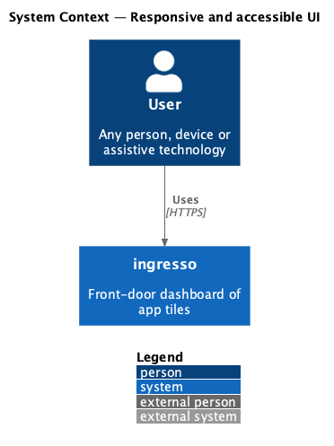
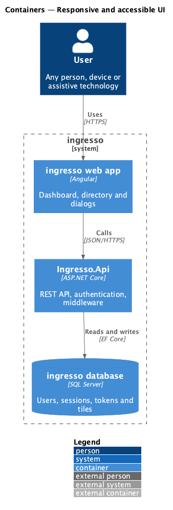
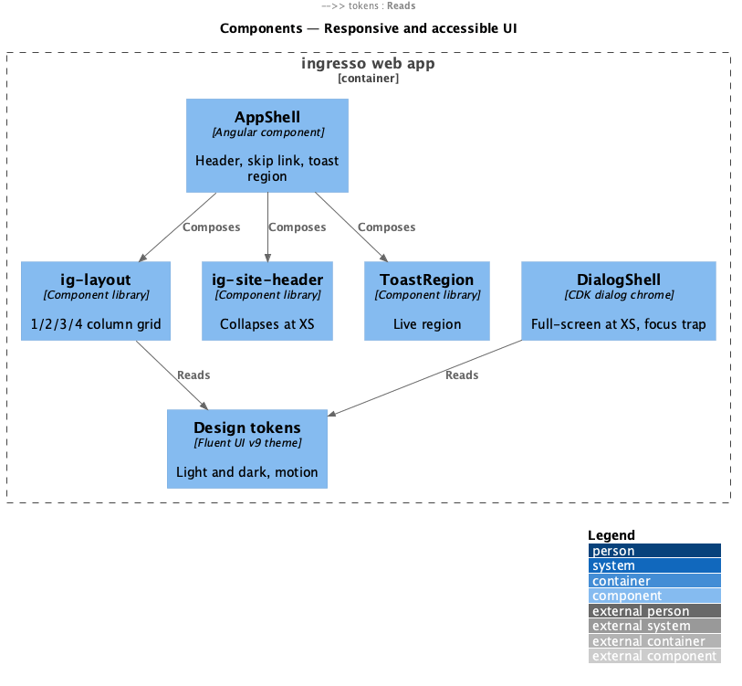
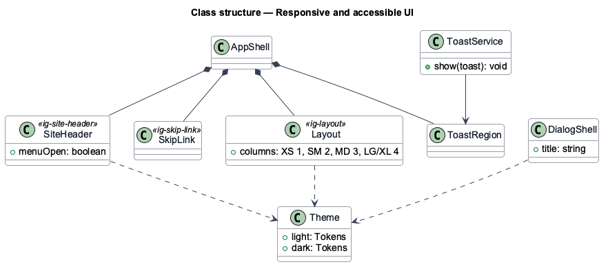
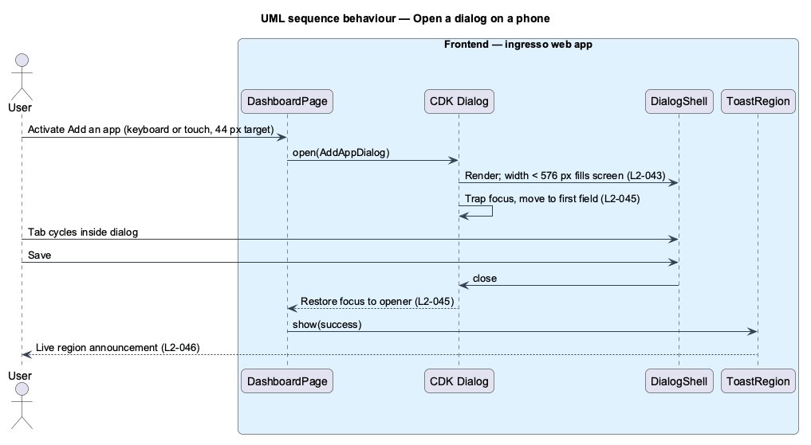

# Responsive and accessible UI

## Overview

ingresso runs on phones, tablets and desktops, in light and dark themes, for keyboard and screen-reader users. This feature defines how the web app adapts its layout and meets WCAG 2.2 AA.

**viewport class** — width band that selects a layout: XS below 576 px, SM from 576 px, MD from 768 px, LG from 992 px, XL from 1200 px

**design token** — named Fluent UI v9 value, such as `colorBrandForeground1`, that components read instead of literal colours

The `ig-*` component library carries most of this behaviour, so pages inherit it. Pages own only the grid column counts and the composition rules in `docs/screen-composition.md`.

## Description

The slice is cross-cutting. It lives in the component library and the app shell.

- **Tokens** — `frontend/projects/components/src/lib/tokens/` defines light and dark Fluent v9 themes. `npm run tokens` generates `styles/_tokens.scss`.
- **`ig-layout`** — page grid with the column count for each viewport class.
- **`ig-site-header`** — collapses navigation into a menu button at XS (ADR 0004).
- **`DialogShell`** — CDK dialog chrome. At XS it fills the screen and keeps actions in view.
- **`ig-skip-link`** — first focusable element on each page.
- **`ToastService` / `ToastRegion`** — announce toasts through a live region (ADR 0007).
- **Theme selection** — follows `prefers-color-scheme`, and stores an explicit choice in `localStorage`. `<TO SUPPLY>`: the theme switch control.
- **Reduced motion** — tokens set motion durations to zero under `prefers-reduced-motion`.

## Requirements

The feature realizes the following level-2 (L2) requirements. Each L2 requirement refines a level-1 (L1) requirement, cited by identifier.

| L2 ID | Refines (L1) | Requirement |
|-------|--------------|-------------|
| `L2-042` | `L1-010` | The dashboard shall show the 12-column grid at widths of 1024px and above, and collapse to a flow list in reading order (top row first, then left to right) below that width. A width change never changes the saved layout. |
| `L2-043` | `L1-010` | Dialogs and navigation shall fit small screens. |
| `L2-044` | `L1-010` | The app shall support light and dark themes. |
| `L2-045` | `L1-010` | Every function shall work with a keyboard, with a visible focus indicator. |
| `L2-046` | `L1-010` | State changes shall be announced to assistive technology. |

## Diagrams

### System context

Users on any device and with any input method reach the same ingresso.

### Containers

The web app renders all responsive and accessible behaviour. The API takes no part beyond serving data.

### Components

Pages compose library components, which read tokens and media queries.

### Class structure

`AppShell` composes `SiteHeader`, `SkipLink` and `ToastRegion`. `DialogShell` wraps every dialog.

### Behaviour — open a dialog on a phone

At XS the dialog fills the screen. Focus moves into the dialog, stays there while it is open, and returns to the opener on close.

