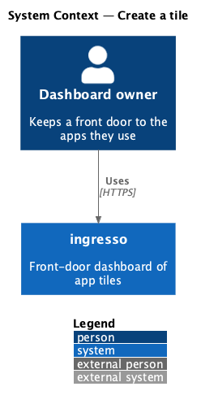
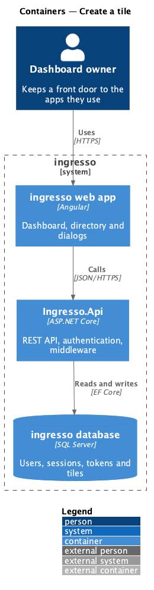
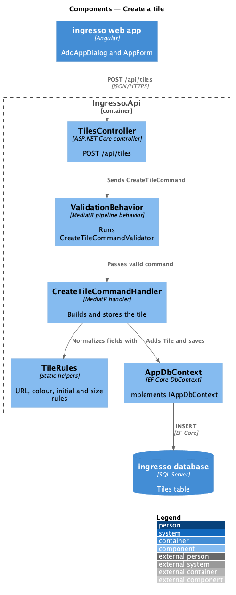
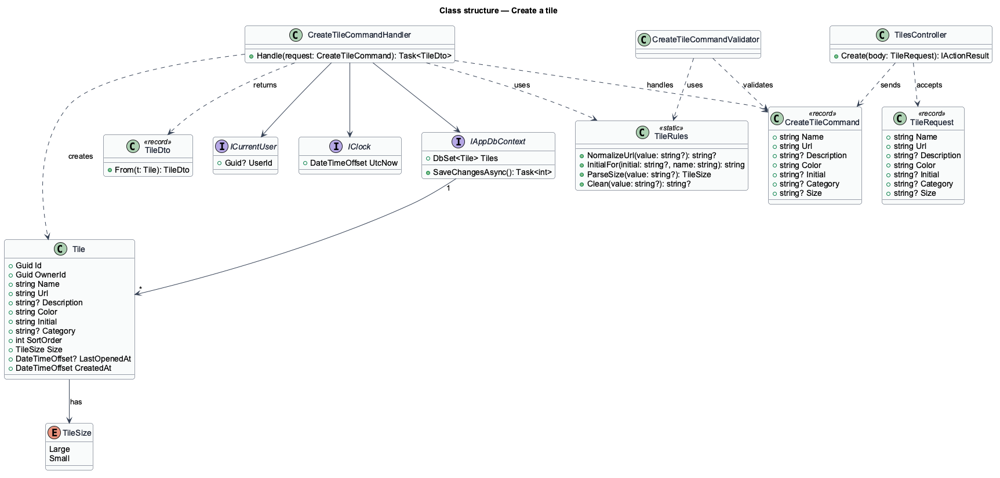
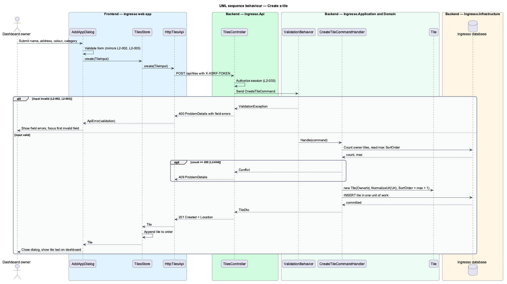

# Create a tile

## Overview

ingresso is a front-door dashboard for the apps its owner builds and uses. A *tile* is the dashboard's unit of content.

**tile** — dashboard entry that names one app, holds its web address, and opens that app in a new tab

This feature covers the creation of a tile. A signed-in user enters a name, a web address, an optional description, a colour and an optional category. The system validates the input, stores the tile against its owner, and places it after every existing tile in that owner's order.

Creation is also the entry point for the address rules that protect every later feature. A tile address is the only user-supplied value the browser navigates to, so the system accepts only absolute `http` and `https` addresses. The feature also caps the number of tiles a user holds, which bounds the dashboard's load cost (`L2-039`).

## Description

The slice runs from the ingresso web app to the ingresso database.

- **`AddAppDialog`** — CDK dialog in `frontend/projects/ingresso/src/app/dialogs/add-app/`. It hosts `AppForm` and reports the created tile to its opener.
- **`AppForm`** — reactive form shared by the add and edit dialogs. It mirrors the server rules and links each field error through `aria-describedby`.
- **`TilesStore`** — signal store for the dashboard. Its create path calls the API and appends the returned tile.
- **`HttpTilesApi`** — implementation of the `TilesApi` contract behind the `TILES_API` token. It posts a `TileInput` to `/api/tiles`.
- **`TilesController.Create`** — `POST /api/tiles`. It maps a `TileRequest` to a `CreateTileCommand` and returns `201 Created` with the `TileDto`.
- **`CreateTileCommandValidator`** — FluentValidation rules for name, address, colour, description, category, initial and size. `ValidationBehavior` runs it before the handler.
- **`TileRules`** — static helpers. `NormalizeUrl` returns an absolute `http`/`https` URL or `null`. `MustBeHexColor`, `InitialFor` and `ParseSize` cover the other fields.
- **`CreateTileCommandHandler`** — resolves the owner from `ICurrentUser`, computes the next `SortOrder`, builds the `Tile`, and saves it in one unit of work.
- **`Tile`** — domain entity for one tile, scoped to its owner by `OwnerId`.

Built to the requirements:

- `TileRules` holds the limits (name 60, description 280, address 2048, 200 tiles) and the eight-colour `Palette`. `NormalizeUrl` accepts only an absolute `http` or `https` address and returns it unchanged.
- `CreateTileCommandHandler` throws `ConflictException` at 200 tiles; `ExceptionHandlingMiddleware` answers `409` problem details.
- The Add app dialog warns when the address already belongs to a tile (`L2-026`): an alert offers Add anyway or Cancel. The check is client-side against the loaded tiles, ignoring case and trailing slashes.
- The form turns a bare host such as `app.asana.com` into `https://app.asana.com` before it posts, so the server's strict rule never surprises the person typing.
- Tile text is bound as text everywhere, so markup in a name or description shows literally (`L2-037`).

## Requirements

The feature realizes the following level-2 (L2) requirements. Each L2 requirement refines a level-1 (L1) requirement, cited by identifier.

| L2 ID | Refines (L1) | Requirement |
|-------|--------------|-------------|
| `L2-001` | `L1-001` | A signed-in user shall be able to create a tile with a name, web address, description, colour and category. The new tile appears last in the user's order. |
| `L2-002` | `L1-001` | Tile input shall be validated on the server and mirrored in the form. |
| `L2-003` | `L1-001` | A tile address shall be an absolute `http` or `https` URL. |
| `L2-004` | `L1-001` | A user shall hold at most 200 tiles. |

## Diagrams

### System context

The dashboard owner creates tiles in ingresso. No external system takes part in this slice.

### Containers

The request travels from the Angular web app to `Ingresso.Api`, which stores the tile in the ingresso database.

### Components

Inside `Ingresso.Api`, the controller sends a `CreateTileCommand` through MediatR. `ValidationBehavior` validates it, and the handler stores a `Tile` through `IAppDbContext`.

### Class structure

`CreateTileCommandHandler` handles `CreateTileCommand`, depends on `ICurrentUser`, `IClock` and `IAppDbContext`, and creates a `Tile`. `TileRules` supplies the shared field rules.

### Behaviour — create a tile

The handler resolves the owner, appends the tile to the end of the owner's order, and commits. A validation failure returns `400` problem details, and the dialog stays open with field errors.

