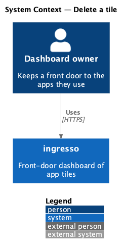
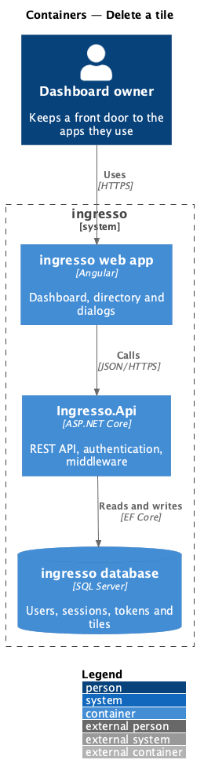
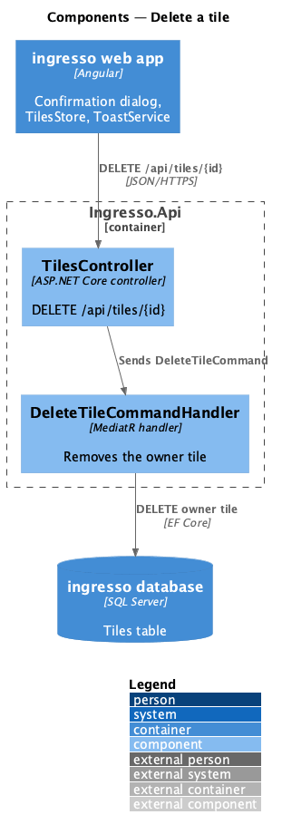
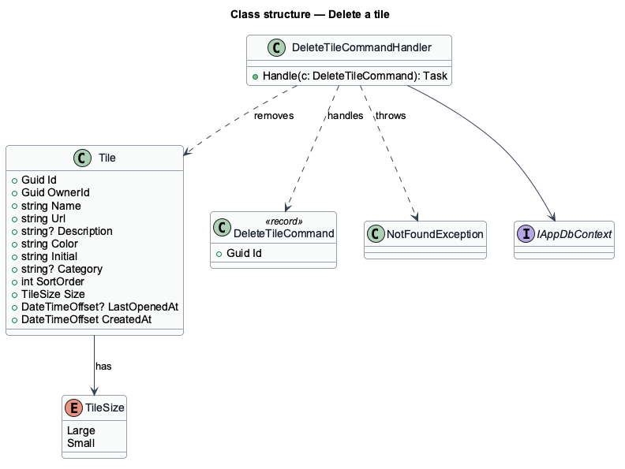
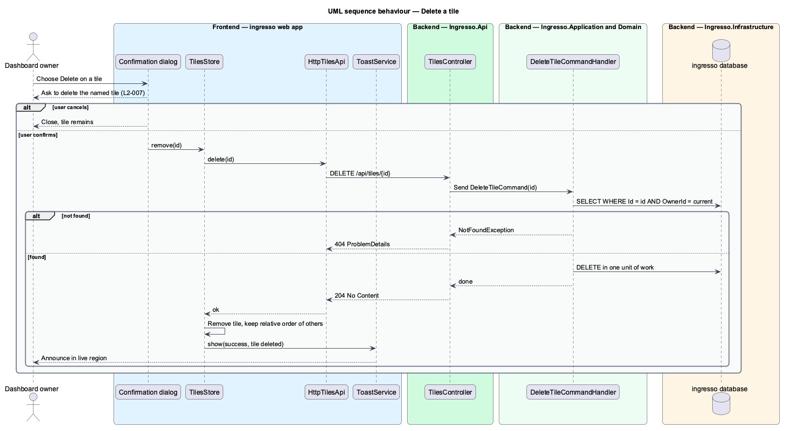

# Delete a tile

## Overview

An owner removes a tile when they stop using its app. Deletion is permanent, so the system asks for confirmation first and names the tile in the question.

Deleting a tile leaves a gap in the sort order. The remaining tiles keep their relative order, because the dashboard orders by `SortOrder` and the gap has no visible effect.

## Description

The slice runs from the ingresso web app to the ingresso database.

- **`EditAppDialog`** — offers Delete. The delete path returns a `delete` `EditAppOutcome` to the opener.
- **Confirmation dialog** — CDK dialog composed from `DialogShell`. It names the tile and offers Delete and Cancel. `<TO SUPPLY>`: the component that hosts the confirmation is not present in `dialogs/` yet.
- **`TilesStore.remove`** — calls the API and removes the tile from the signal list.
- **`ToastService`** — shows the confirmation toast in the `ToastRegion`.
- **`TilesController.Delete`** — `DELETE /api/tiles/{id}`. It returns `204 No Content`.
- **`DeleteTileCommandHandler`** — loads the tile by `Id` and `OwnerId`, removes it, and saves.

The current source differs from the requirements in these points. Each is open work for the slice.

- `L2-007` requires a confirmation dialog that names the tile. No confirmation dialog exists under `frontend/projects/ingresso/src/app/dialogs/`.

## Requirements

The feature realizes the following level-2 (L2) requirements. Each L2 requirement refines a level-1 (L1) requirement, cited by identifier.

| L2 ID | Refines (L1) | Requirement |
|-------|--------------|-------------|
| `L2-007` | `L1-001` | A user shall be able to delete a tile after confirming. |

## Diagrams

### System context

The owner deletes a tile in ingresso. No external system takes part.

### Containers

The web app sends the deletion to `Ingresso.Api`, which removes the row from the Tiles table.

### Components

The controller sends `DeleteTileCommand`. The handler removes the owner's tile.

### Class structure

`DeleteTileCommandHandler` handles `DeleteTileCommand` and removes a `Tile` through `IAppDbContext`.

### Behaviour — delete a tile

The confirmation names the tile. Only a confirmed deletion reaches the API, and success shows a toast.

