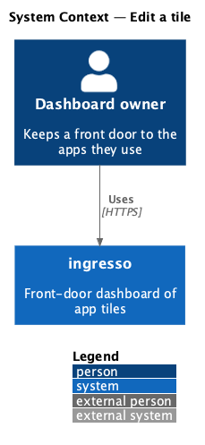
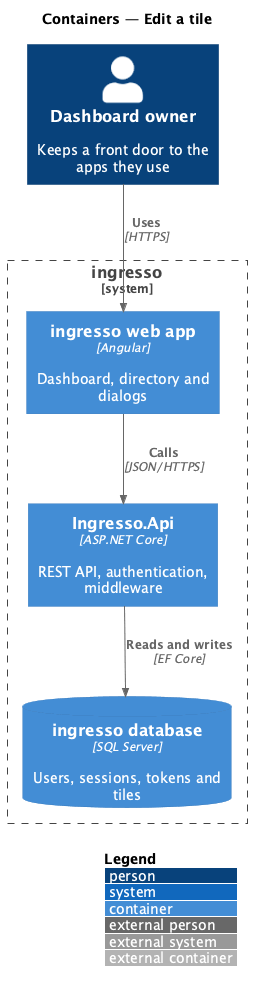
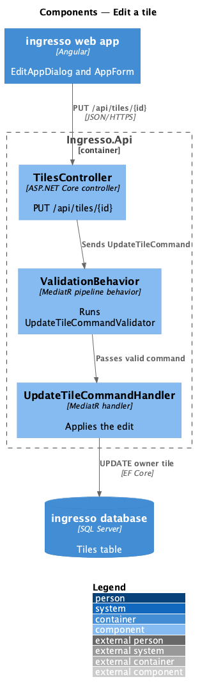
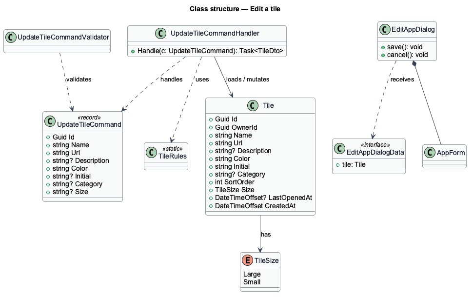
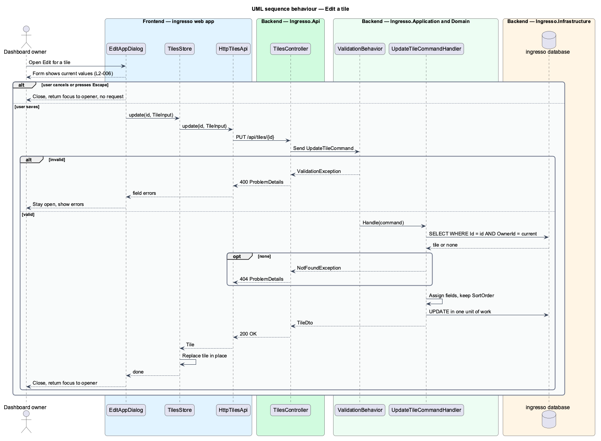

# Edit a tile

## Overview

A tile's details change over time: an app moves to a new address, gains a better name, or belongs in another category. This feature lets the owner change any field of an existing tile from an Edit dialog.

An edit replaces the tile's fields and leaves its position unchanged. The same validation rules as creation apply (`L2-002`, `L2-003`). The dialog is a CDK dialog, so it traps focus while open and returns focus to its opener when it closes.

## Description

The slice runs from the ingresso web app to the ingresso database.

- **`EditAppDialog`** — CDK dialog in `dialogs/edit-app/`. It receives `EditAppDialogData` with the tile, hosts `AppForm` pre-filled with current values, and closes with an `EditAppOutcome`.
- **`AppDialogs`** — state service that opens the add and edit dialogs with consistent configuration and focus return.
- **`TilesStore.update`** — calls the API and replaces the tile in place.
- **`TilesController.Update`** — `PUT /api/tiles/{id}`. It maps the `TileRequest` to an `UpdateTileCommand`.
- **`UpdateTileCommandValidator`** — the same field rules as `CreateTileCommandValidator`.
- **`UpdateTileCommandHandler`** — loads the tile by `Id` and `OwnerId`, assigns the cleaned fields, keeps `SortOrder`, and saves.

The current source differs from the requirements in these points. Each is open work for the slice.

- The field-length gaps listed under `create-tile` apply to `UpdateTileCommandValidator` as well.

## Requirements

The feature realizes the following level-2 (L2) requirements. Each L2 requirement refines a level-1 (L1) requirement, cited by identifier.

| L2 ID | Refines (L1) | Requirement |
|-------|--------------|-------------|
| `L2-006` | `L1-001` | A user shall be able to change any tile field from an Edit dialog. |

## Diagrams

### System context

The owner edits a tile in ingresso. No external system takes part.

### Containers

The web app sends the edit to `Ingresso.Api`, which updates the Tiles table.

### Components

The controller sends `UpdateTileCommand`. `ValidationBehavior` runs the validator before the handler changes the entity.

### Class structure

`UpdateTileCommandHandler` handles `UpdateTileCommand` and mutates `Tile`. It reuses `TileRules` for normalization.

### Behaviour — edit a tile

The dialog opens with current values. A save replaces the fields and keeps the tile's position. Cancel or Escape closes the dialog without a request.

