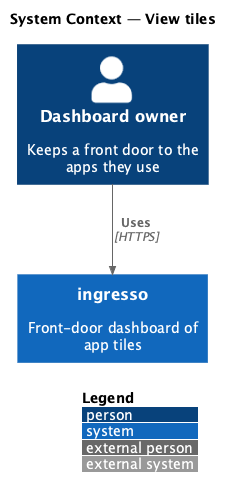
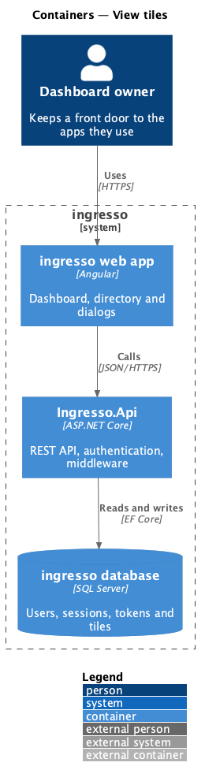
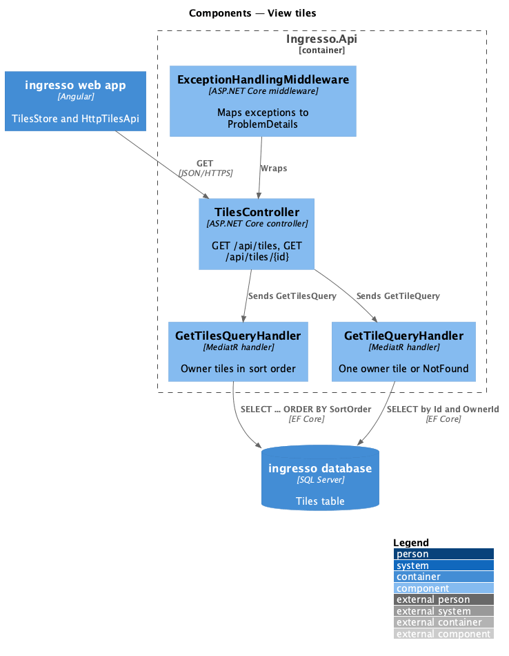
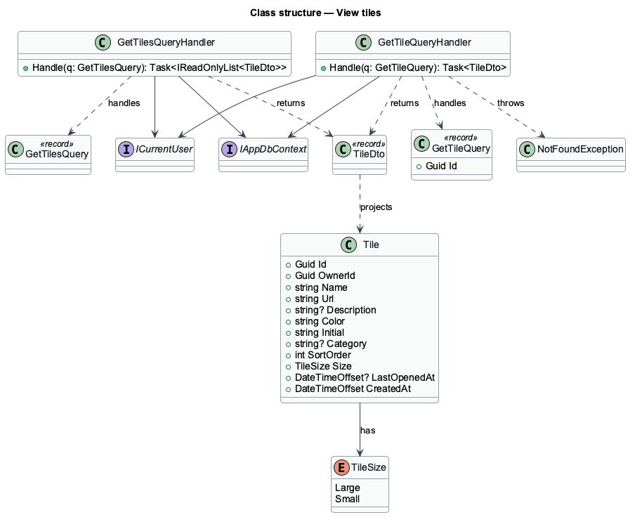
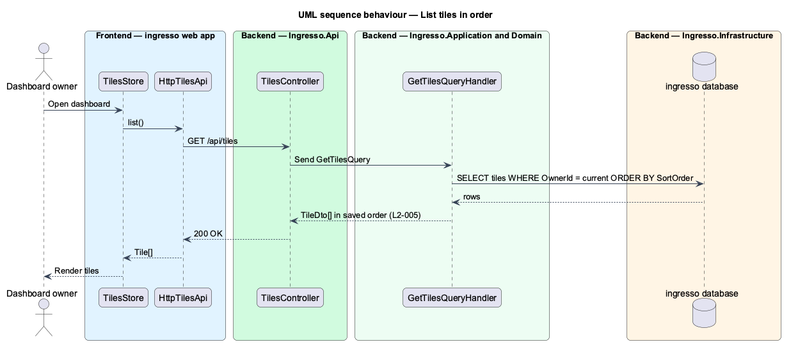
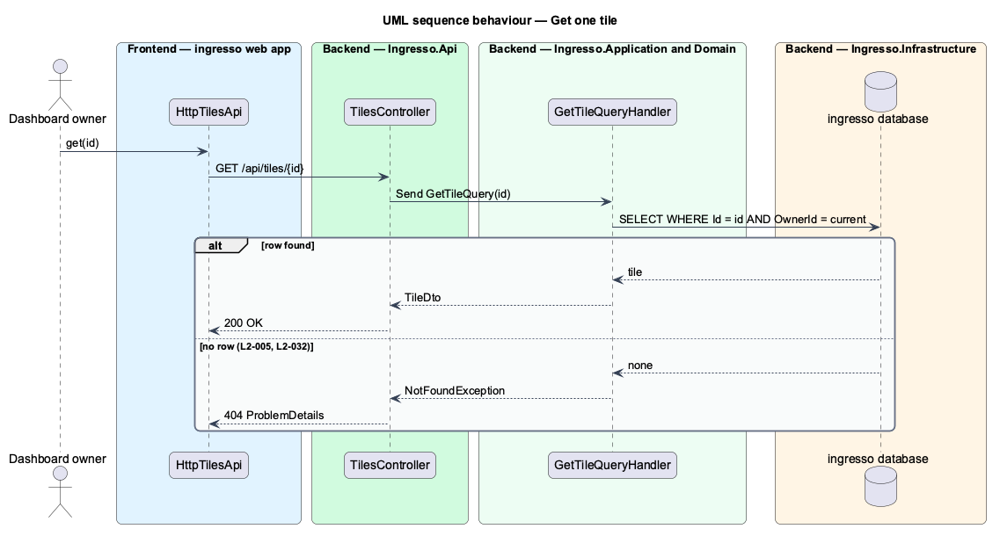

# View tiles

## Overview

Every dashboard view starts by reading the signed-in user's tiles. This feature covers the two read paths: the ordered list of all tiles, and one tile by its identifier.

**sort order** — zero-based position of a tile in its owner's dashboard

The list always comes back in sort order, so the dashboard renders it without re-sorting. Both reads are scoped to the owner. A tile that belongs to another user is indistinguishable from a tile that does not exist (`L2-032`).

## Description

The slice runs from the ingresso web app to the ingresso database.

- **`TilesStore.load`** — loads the list on first entry to the dashboard and exposes it as a signal with a `LoadStatus`.
- **`HttpTilesApi.list` / `get`** — `GET /api/tiles` and `GET /api/tiles/{id}`.
- **`TilesController.List` / `Get`** — send `GetTilesQuery` and `GetTileQuery` through MediatR.
- **`GetTilesQueryHandler`** — reads the owner's tiles ordered by `SortOrder` and projects each to `TileDto`.
- **`GetTileQueryHandler`** — reads one tile by `Id` and `OwnerId`. It throws `NotFoundException` when no row matches.
- **`ExceptionHandlingMiddleware`** — maps `NotFoundException` to `404` problem details.

## Requirements

The feature realizes the following level-2 (L2) requirements. Each L2 requirement refines a level-1 (L1) requirement, cited by identifier.

| L2 ID | Refines (L1) | Requirement |
|-------|--------------|-------------|
| `L2-005` | `L1-001` | The API shall return the user's tiles in their saved order, and a single tile by id. |

## Diagrams

### System context

The dashboard owner reads their tiles from ingresso. No external system takes part.

### Containers

The web app calls `Ingresso.Api`, which reads the Tiles table.

### Components

The controller dispatches one of two queries. Each handler filters by owner before it reads.

### Class structure

Both query handlers depend on `IAppDbContext` and `ICurrentUser` and return `TileDto` projections of `Tile`.

### Behaviour — list tiles in order

The store asks for the list once. The handler filters by owner, then orders by `SortOrder`.

### Behaviour — get one tile

A missing tile and another user's tile produce the same `404` response.

